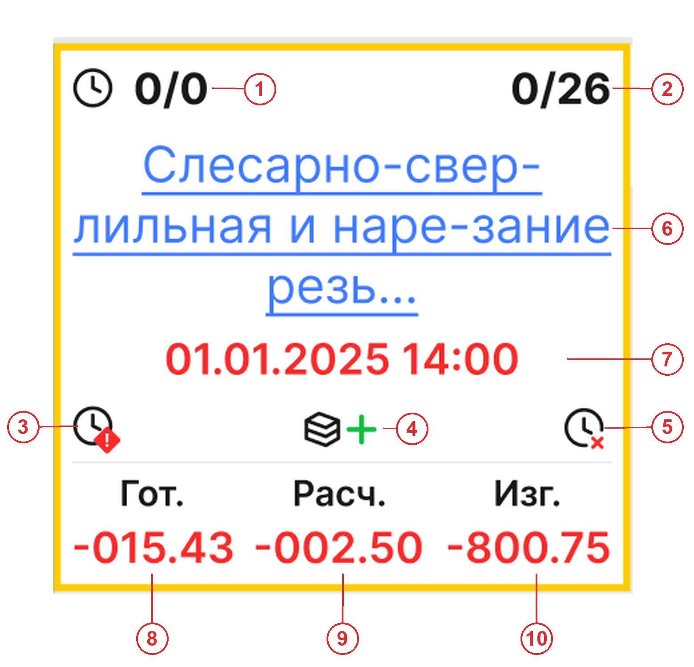

# Понятия и формулы системы управления запасами и производством

## Контекст

Данный документ определяет ключевые понятия и формулы, используемые в модулях управления запасами, производственными заданиями (ПЗ) и прочими заказами в ERP-системе. Четкое понимание этих определений и алгоритмов расчета необходимо для корректного формирования отчетов, планирования закупок и производства, а также для обеспечения прозрачности логики работы системы.

---

## Определения (Понятия)

### <a id="potrebnost-roditelya"></a>Потребность родителя (Parent Requirement)

- **Описание:** Количество сущности (детали, сборки, материала), указанное в спецификации для производства одной единицы родительской сущности (сборки или изделия). Для конечного изделия данный показатель не существует, так как у него нет родителя в производственной цепочке.
- **Применение:** Базовый коэффициент для расчета потребностей в компонентах.

### <a id="gotovnost-k-komplektatsii"></a>Готовность к комплектации (Kitting Readiness)

- **Описание:** Статус, который проверяет, достаточно ли на складе всех необходимых дочерних компонентов для комплектации родительской единицы (сборки или изделия). Статус присваивается, если количество каждого дочернего компонента на складе соответствует или превышает значение, рассчитанное как `"Потребность родителя" * "Требуемое количество родителя"`.
- **Применение:** Определяет возможность запуска процесса сборки/комплектации.

#### Наименование {#entity-name}

- **Для изделий:** Наименование изделия
- **Для сборок:** Наименование сборочной единицы
- **Для деталей:** Наименование детали
- **Общее:** Наименование сущности

#### Артикул (только для изделий) {#entity-article}
- **Для изделий:** Уникальное обозначение изделия, предназначенное для использования внешним покупателем

#### Обозначение {#entity-designation}

- **Для изделий:** Обозначение изделия
- **Для сборок:** Обозначение сборочной единицы
- **Для деталей:** Обозначение детали
- **Общее:** Обозначение сущности

#### Изображение {#entity-image}

- **Для изделий:** превью изделия
- **Для сборок:** превью сборочной единицы
- **Для деталей:** превью детали
- **Общее:** превью сущности

#### Поиск по обозначению и наименованию {#entity-search}
- **Для изделий:** Поиск по обозначению и наименованию изделия
- **Для сборок:** Поиск по обозначению и наименованию сборочной единицы
- **Для деталей:** Поиск по обозначению и наименованию детали
- **Для материалов:** Поиск по обозначению и наименованию материала
- **Общее:** Поиск по обозначению и наименованию сущности

#### Номер (№) {#table-row-number}
- **Общее:** Порядковый номер в списке

#### Дата плановой отгрузки {#date-shipment}

- **Общее:** Ближайшая плановая дата отгрузки по задачам на отгрузку.

#### Дата плановой готовности склада {#warehouse-readines-date}
- **Общее:** Необходимая дата производства сущности для отгрузки на склад.

#### Дата планируемой готовности на операцию {#warehouse-readines-date-by-operation}
- **Общее:** Рассчетная дата выполнения на операцию, рассчитывается по формуле:
Начало работ по операции + (подготовительное время + (основное время + вспомогательное) * Кол-во заказанное по ПЗ).

#### Заказано {#ordered}
- **Для Изделий:** Заказанное кол-во на склад у производства.
- **Для сборок:** Заказанное кол-во на склад у производства.
- **Для деталей:** Заказанное кол-во на склад у производства.
- **Для материалов:** Заказанное кол-во на склад у поставщика.

#### Заказано на производство {#ordered-to-production}
- **Общее:** "Кол-во сущностей на заказ" - "Оприходованное по заказу кол-во"

#### Единица измерения {#mesuarement}
- **Для (тип сущности):** Единица измерения (тип сущности) 

- **Общее:** Единица измерения сущности.

#### Начало работ {#start-time}
- **Для Изделий:** Начало работ это самая ранняя начало работ на самое раннее производственное задание, на второй операции этой сущности.
- **Для сборок:** Начало работ это самая ранняя начало работ на самое раннее производственное задание, на второй операции этой сущности.
- **Общее:** Начало работ это самая ранняя начало работ на самое раннее производственное задание, на самой первой операции этой сущности.

#### Начало работ по операции {#start-time-by-operation}

**Начало работ по операции** — дата и время начала текущей операции по производственному заданию. У разделённой операции начало каждой части задаётся отдельно для её оборудования или исполнителя.

Поле используется на страницах ПЗ по оборудованию, исполнителю, операциям сборки и операциям металлообработки.

##### Как рассчитывается начало работ

Дата зависит от типа расчёта, заданного для операции:

- **Автоматически:** операции выполняются последовательно в очереди оборудования или исполнителя. Первая начинается от даты «Установка начала работ», следующие — после расчётного окончания предыдущей автоматической работы в этой очереди. Расчёт учитывает рабочий календарь оборудования или исполнителя.
- **По дате готовности предыдущей операции:** начало определяется по расчётному окончанию предыдущей операции этой сущности.
- **По началу работ следующей операции:** из начала следующей операции вычитается время выполнения текущей с учётом рабочего календаря. Если следующей операции нет, используется расчётное начало текущей операции, когда оно определено.

Другие варианты расчёта, доступные в настройках операции, включают «По дате заказа на склад» и «По дефициту дочерних изделий». Название применённого варианта показывает подсказка при наведении на значок руки рядом с датой. Если дата отсутствует, в ячейке отображается «—».

##### Изменение на страницах ПЗ по оборудованию и исполнителю

Нажмите значок календаря в ячейке начала работ. Настройка доступна для операций с автоматическим расчётом: на странице оборудования — для металлообработки, на странице исполнителя — для сборочных операций. Её также можно открыть через меню по троеточию: «Изменить начало работ» или «Изменить или сбросить начало работ».

В открывшемся окне есть два режима:

- **«Автоматический»:** выберите начало очереди или место после другой автоматической работы. Операция сохраняет связь с очередью, а выбранный порядок сохраняется при пересчёте дат. Дата начала пересчитывается вместе с очередью.
- **«Остальные»:** укажите дату и время вручную. При необходимости добавьте часы или минуты. Заданное вручную начало сохраняется при автоматическом пересчёте и не сдвигает автоматическую очередь. Такая операция отображается в группе «Остальные» фильтра «Тип расчёта».

Изменение места операции через календарь или перетаскивание строки действует в очереди выбранного оборудования или исполнителя. Фильтры таблицы не ограничивают очередь только видимыми строками.

##### Изменение на страницах ПЗ по операциям

На страницах операций сборки и металлообработки значок календаря и пункт меню позволяют задать или сбросить ручное начало для операции с автоматическим расчётом.

При редактировании уже заданного вручную начала календарь подставляет расчётную дату изготовления предыдущей строки в текущем порядке таблицы. Если строки выше или её даты нет, используется текущее начало выбранной операции. До сохранения можно выбрать другую дату.

##### Обозначения в таблице

| Обозначение | Значение |
| --- | --- |
| Фиолетовая рамка ячейки | Автоматический расчёт без ручной даты или ручного изменения места в очереди. |
| Жёлтая рамка ячейки | Другой тип расчёта, вручную заданная дата или вручную выбранное место в автоматической очереди. |
| Голубой фон строки | Неавтоматический тип расчёта или вручную заданное начало работ. |
| Значок руки | Подсказка показывает тип расчёта, «Начало работ задано вручную» или «Положение в очереди задано вручную». |

При ручном изменении места в очереди автоматический расчёт сохраняется. Само перемещение не переводит операцию в группу «Остальные».

##### Сброс начала работ и порядка

На страницах ПЗ по оборудованию и исполнителю кнопка **«Сбросить порядок операций»** сбрасывает ручные даты начала работ и порядок автоматических операций выбранного оборудования или исполнителя. Дата в поле «Установка начала работ» сохраняется. Кнопка **«Сбросить»** в окне настройки начала работ на этих страницах выполняет тот же сброс очереди.

На страницах ПЗ по операциям кнопка **«Сбросить»** снимает ручное начало выбранной операции или её части и возвращает её к автоматическому расчёту.

#### Требуемая дата готовности {#calculated-create-time}

**Требуемая дата готовности** — срок, к которому сущность должна быть полностью готова по потребности заказчика или следующего этапа процесса.

Это требуемый срок завершения, а не фактическая дата готовности.

Расчёт идёт **обратно — от требуемого срока к началу производства**.

1. **Последняя операция ПЗ** получает самую раннюю дату из связанных потребностей:

   - для изделия — готовность по отгрузке;
   - для детали или сборки — начало работ родительского ПЗ;
   - по заказу склада — требуемая готовность склада.

   Учитываются потребности, которые обеспечивает конкретное ПЗ.

2. **Предыдущие операции** должны завершиться к началу следующей:

   - для сборки и изделия используется расчётное начало следующей операции;
   - для металлообработки — назначенное начало следующей операции. Если оно рассчитывается «по готовности предыдущей», используется расчётное начало.

3. **Расчётное начало операции** определяется так:

   ```text
   Требуемая готовность − Время выполнения операции
   ```

   ```text
   Время выполнения = Подготовительное + (Основное + Вспомогательное) × Количество по ПЗ
   ```

   Время вычитается с учётом рабочего календаря исполнителя или оборудования.

4. **Для сущности в целом** «Требуемая дата готовности» берётся из последней операции последнего ПЗ.

5. **Если исходного срока нет**, требуемая дата и рассчитанное от неё начало остаются пустыми.

#### Требуемая дата изготовления {#required-manufacturing-date}

Дата и время, к которым деталь или сборка должны быть изготовлены для обеспечения потребности, закреплённой за ПЗ.

Определяется по самому раннему из связанных сроков: началу работ родительского ПЗ (для детали — назначенному, для сборки — расчётному) или указанной в заказе склада дате требуемой готовности склада.

- **Для детали:** используется назначенное начало работ первой операции родительского ПЗ или дата требуемой готовности склада — в зависимости от того, какой срок наступает раньше.
- **Для сборки:** используется расчётное начало работ первой операции родительского ПЗ или дата требуемой готовности склада — в зависимости от того, какой срок наступает раньше.

#### Дата требуемой готовности на операцию {#calculated-create-time-by-operation}

**Дата требуемой готовности на операцию** — дата и время, к которым текущая операция должна быть завершена для обеспечения связанной потребности.

Это требуемый срок завершения операции, а не расчётная или фактическая дата её окончания.

##### Последняя операция ПЗ

Срок соответствует требуемой готовности по этому ПЗ в сводной таблице модального окна «Список заказов». Выбирается самая ранняя из дат потребностей и заказов склада, которые обеспечивает конкретное ПЗ:

- **Для изделия:** требуемая готовность изделия на складе по связанному заказу покупателя.
- **Для детали:** назначенное начало работ **первой операции** родительского ПЗ.
- **Для сборочной единицы:** расчётное начало работ **первой операции** родительского ПЗ.
- **По заказу склада:** дата требуемой готовности склада, указанная в этом заказе для выбранной сущности.

Если одно ПЗ обеспечивает несколько потребностей, используется самый ранний из связанных с ним сроков.

##### Предыдущие операции ПЗ

Текущая операция должна завершиться к началу следующей операции этого же технологического процесса:

- **Для сборки и изделия:** используется расчётное начало следующей операции.
- **Для металлообработки:** используется назначенное начало следующей операции. Если у следующей операции выбран тип расчёта «По дате готовности предыдущей операции», используется её расчётное начало.

При попадании срока в перерыв он корректируется по рабочему календарю оборудования или исполнителя. Если нужная исходная дата отсутствует, поле остаётся пустым и в таблице отображается «—».

Из этого срока рассчитывается начало операции: [требуемая готовность минус время выполнения операции](#calculated-create-time).

#### Требуемое время готовности {#entity-required-ready-time}

**Требуемое время готовности** — дата и время, к которым сущность должна быть полностью изготовлена по ПЗ текущей строки.

На страницах ПЗ по оборудованию, исполнителю, операциям сборки и операциям металлообработки поле показывает **дату требуемой готовности последней операции этой сущности в указанном ПЗ**. Это срок завершения всего её технологического процесса по данному ПЗ.

Для всех операций одной сущности в одном ПЗ показывается общий срок. У другого ПЗ на ту же сущность срок может отличаться. Дата определяется связанными с конкретным ПЗ потребностями и заказами склада — по [правилам последней операции](#calculated-create-time-by-operation).

Если дата требуемой готовности последней операции отсутствует, поле остаётся пустым и в таблице отображается «—».

Это требуемый срок изготовления сущности, а не начало работ по текущей операции и не её расчётное окончание.

#### Расчётная дата изготовления  {#calculate-needs-time}
- **Общее:** Начало последней операции + время её выполнения.

#### Дельта по времени
- **Определение:** Разница между Дата планируемой готовности на операцию и Дата требуемой готовности на операцию. Показывает загруженность на операцию.

#### Время изг. дефицитных Д/СБ
- **Определение:** Время изготовления дефицитных Деталей и Сборок по спецификации в часах и минутах. Стандартная формула времени для всех операций ТП сущности (подготовительное время + (основное время + вспомогательное) * Кол-во отметок ).

#### Задолженность
В [загрузке производства](#production-workload) «Есть» означает, что у операции ПЗ или проекта задач есть действующая работа с началом раньше первого дня выбранного периода. Ячейка выделяется красным. Если период начинается сегодня, это работа с началом до сегодняшнего дня.

#### Операции
- **Предыдущая операция:** Информация о предыдущей операции технологического процесса.
- **Текущая операция:** Информация о текущей операции технологического процесса.
- **Следующая операция:** Информация о следующей операции технологического процесса.

#### Готовность к комплектации
- **Определиние:** планируемое время изготовления последней дефицитной детали/сборки/материала.


#### Легенда ячейки операций



| № | Элемент | Описание |
| :--- | :--- | :--- |
| **1** | Время операции | Оставшееся время выполнения операции в часах и минутах. |
| **2** | Сделано / Всего | Количество выполненного по операции и общее количество, которое нужно выполнить. |
| **3** | Предупреждение о сроках | Расчётная дата изготовления позже требуемого срока или начала следующей операции либо начало текущей операции раньше расчётной готовности предыдущей. Наведите на значок, чтобы увидеть причину. |
| **4** | Наличие материала | Показывается на первой операции металлообработки. «+» означает, что материал есть на складе; «×» — что материала недостаточно для производства. |
| **5** | Не задано время | В операции отсутствует основное время или оно равно 0. |
| **6** | Название операции | Название операции технологического процесса. |
| **7** | Расчётная дата изготовления на операцию | Дата и время расчётного окончания операции: начало работ по операции + время её выполнения с учётом рабочего календаря. |
| **8** | Гот. | [Просрочка готовности начала работ, ч](#delay-work-start-readiness). Разница между началом текущей операции и готовностью комплектующих, материалов или предыдущей операции. |
| **9** | Расч. | [Просрочка расчётного начала работ, ч](#delay-calculated-start-time). Формула: Расчётное начало работ − Начало работ. |
| **10** | Изг. | [Просрочка изготовления, ч](#delay-production). Формула: Дата требуемой готовности на операцию − Расчётная дата изготовления на операцию. |

Показатели **8–10** выражены в рабочих часах с десятичной дробью: 2.50 — 2 часа 30 минут. Отрицательное значение выделяется красным и означает опоздание; неотрицательное — зелёным и означает отсутствие опоздания. Если данных для расчёта нет, показан прочерк.

#### Цвет фона ячейки
- **Зеленый:** Все отметки о выполнении операции проставлены.
- **Голубой:** Работа начата, но не все отметки о выполнении операции проставлены.
- **Желтый:** Работа по операции не начата. По ней нет отметок о выполнении.
- **Серый:** На онлайн-табло МО по ПЗ сборки деталь не заказана в ПЗ МО: «Заказано по ПЗ МО» равно 0. Пустые ячейки без операции также отображаются серым.
---

## Формулы расчета

### 1. Общее время {#f1-obshee-vremya}

#### Общее время на сборку {#obshee-vremya-na-sborku}

Сумма всех времен производства дочерних сборок, полученных рекурсивно, с учетом их потребности на родителя.

#### Общее время на МО {#obshee-vremya-na-mo}

Сумма всех времен производства дочерних деталей, полученных рекурсивно, с учетом их потребности на родителя.

### 2. Расчет потребностей {#f2-raschet-potrebnostey}

#### Потребность по Заказам Склада (ЗС) {#potrebnost-po-zakazam-sklada}

`Сумма[("Потребность родителя" * "Потребность по ЗС родителя")]`
_Актуально для деталей, сборок, материалов._

#### Потребность по Заказам Поставщика (для материалов) {#potrebnost-po-zakazam-postavshika}

`Сумма[("Потребность по заказам поставщика")]`

### 3. Расчет остатков {#f3-raschet-ostatkov}

#### Минимальный остаток (для сб/д) {#minimalnyi-ostatok}

`Сумма[("Потребность родителя" * "Минимальный остаток родителя")]`

#### Рекомендуемый остаток {#rekomenduemyi-ostatok}

`"Минимальный остаток" * 3`

#### Остаток с учетом прихода {#ostatok-s-uchetom-prihoda}

- _Для сборок и деталей:_ `Сумма["Кол-во родителя на складе"] - "Минимальный остаток родителя"`
- _Для изделий:_ `Сумма["Минимальный остаток родителя"] - "Кол-во"`

#### Реальный остаток с учетом планируемых отгрузок и производства {#realnyi-ostatok}

- _Для деталей и сборок:_ `"Заказано на складе" + "Кол-во" - "Потребность по ЗС"`
- _Для изделий:_ `"Заказано на складе" + "Кол-во" - "Потребность по ЗО"`
- _Для материалов:_ `"Заказано на складе" + "Кол-во" - "Потребность по заказам поставщика"`

### СВОЕ {#deficit-CBOE}
- **Общее:** По умолчанию `"Рекомендуемое количество"`

### 4. Расчет дефицита {#f4-raschet-defitsita}

#### Дефицит (не может быть < 0) {#defitsit}

`"Кол-во" - "Минимальный остаток" + "Потребность по ЗО"`

#### Дефицит с учетом минимального остатка {#defitsit-s-uchetom-minimalnogo-ostatka}

`"Кол-во" - ("Минимальный остаток" + "Дефицит по ЗС")`

#### Дефицит по ЗО (Задачам на Отгрузки) {#defitsit-po-zo}

- _Для сб/д/материала:_ `Сумма[("Потребность родителя" * "Потребность по ЗО родителя")]`
- _Для изделий:_ `Сумма["Заказанное кол-во по ЗО"]`

#### Дефицит по ПЗ (Производственному Заданию) {#defitsit-po-pz}

`"Кол-во" - "Кол-во в наборах" - ("Осталось сделать по ПЗ" * "Потребность родителя")`

#### Общий дефицит по ПЗ {#obshchiy-defitsit-po-pz}

Потребность детали по каждой позиции ПЗ на сборку:

`max(количество по позиции ПЗ − уже собрано, 0) × количество детали в спецификации`

Общий дефицит по ПЗ — отрицательная часть разницы между свободным количеством детали и суммой потребностей по всем таким позициям:

`min(свободное количество детали − сумма потребностей по всем найденным ПЗ на сборку, 0)`, где `свободное количество детали = max(количество детали − количество в наборах, 0)`.

#### Просрочка начала работ {#delay-start-time}

**Для сущности — детали, сборочной единицы или изделия.** Разница между началом работ по сущности и расчётной готовностью необходимых для неё компонентов к комплектации, выраженная в рабочих часах.

`Начало работ - готовность к комплектации`

#### Просрочка готовности начала работ, ч {#delay-work-start-readiness}

Разница между началом текущей операции и готовностью комплектующих, материалов или предыдущей операции, выраженная в рабочих часах. Показывает, успевает ли предыдущий этап к началу текущей операции.

Общая формула:

`Начало текущей операции − Дата готовности необходимого предыдущего этапа`

Дата готовности выбирается в зависимости от операции.

**Первая операция сборки**

`Начало первой операции − Самая поздняя расчётная готовность дефицитных комплектующих первого уровня`

Учитываются комплектующие, которых не хватает именно для комплектации выбранной сущности по этой позиции ПЗ. Потребность определяется с учётом уже собранных наборов. Из дат расчётного изготовления таких комплектующих выбирается самая поздняя.

**Первая операция металлообработки**

`Начало первой операции − Самая поздняя планируемая дата незакрытой поставки материала`

Учитываются материал заготовки и материалы из спецификации детали. Среди незакрытых поставок этих материалов выбирается самая поздняя планируемая дата поставки.

**Вторая и последующие операции**

`Начало работ текущей операции − Расчётное окончание предыдущей операции`

Используется расчётная дата изготовления на предыдущую операцию этой сущности.

**Как читать значение**

- **Положительное** — предыдущий этап должен быть готов раньше начала текущей операции; есть запас времени.
- **Отрицательное** — комплектующие, материалы или предыдущая операция опаздывают к началу текущей операции.
- **Ноль** — расчётная готовность совпадает с началом операции по рабочему календарю.

Например, `+2` означает запас в 2 рабочих часа, а `−2` — опоздание на 2 рабочих часа.

Если нет даты начала текущей операции или даты готовности предыдущего этапа, показатель не рассчитывается и отображается прочерк. Отсутствие даты не считается нулевой просрочкой.

#### Просрочка начала работ, ч {#delay-calculated-start-time}

**Для отдельной операции.** Разница между расчётным началом работ и началом работ той же операции, выраженная в рабочих часах. Показывает смещение расчётного начала относительно заданного начала этой операции.

`Расчётное начало работ − Начало работ`

Прежнее название: «Просрочка расчётного начала работ, ч».

#### Просрочка изготовления {#delay-production}

`Требуемая дата готовности – Расчётная дата изготовления`

#### Просрочка комплектации {#delay-complectation}

`Требуемая дата готовности – Расчётная дата изготовления комплектации (1 операция)`

### 5. Расчет производственных показателей {#f5-raschet-proizvodstvennyh-pokazateley}

#### В наборах {#v-naborah}

`Сумма["Потребность родителя" * "Скомплектованное кол-во родителя"]`

#### С учетом прихода (Сб и Изд) {#s-uchetom-prihoda}

`"Остаток с учетом прихода" - "Минимальный остаток"`

#### Заказано на складе (не может быть < 0) {#zakazano-na-proizvodstve}

`Сумма["Кол-во сущностей на заказ" - "Оприходованное по заказу кол-во"]`

#### Осталось сделать по ПЗ (не может быть < 0) {#ostalos-sdelat-po-pz}

`"Заказано по конкретному ПЗ" - "Собранное в наборы кол-во сборки"`

#### Заказано по ПЗ {#zakazano-po-pz}

`Сумма всех "Потребность по ПЗ" на конкретную сущность`

#### Время по операциям ТП {#vremya-po-operatsiyam-tp}

`"Подготовительное время" + ("Вспомогательное время" + "Основное время") * Кол-во`

#### Дефицит с учетом производства  {#defitsit-s-uchetom-proizvodstva}
`'"Количество на складе" + "Количество деталей, заказанных на производство" - "Дефицит"'`

### 6. Расчет показателей операции {#f6-raschet-pokazatelei-operation}

#### Рассчет изготовление сущности на операцию {#calculate-prepare-entity-by-operation}
`("Подготовительное время" + ("Основное время" + "Вспомогательное") * "Кол-во сущности" )`

#### Рассчет изготовление сущности по ТП {#calculate-prepare-entity-by-tech-process}
`"Подготовительное время" + ("Основное время" + "Вспомогательное") по каждой операции * "Кол-во сущности")`
---

## Принципы и соглашения

- Формулы, помеченные как **«не может быть меньше нуля»**, должны возвращать 0, если результат вычисления отрицательный.
- Под **«Сумма[]»** подразумевается агрегация по всем родительским сущностям, где текущая сущность является компонентом.
- Расчеты, основанные на **«Потребности родителя»**, выполняются рекурсивно вверх по иерархии спецификаций.

---

## Справочник по интерфейсам

### План по операциям МО

**`http://localhost:8080/metalloworking/operation-metall/1/...`**

| Поле                    | Расчет / Источник данных                                                                                               |
| :---------------------- | :--------------------------------------------------------------------------------------------------------------------- |
| <a id="plan-mo-kol-vo-sht"></a>**кол-во шт**           | "Заказано на складе"                                                                                             |
| <a id="plan-mo-operatsii"></a>**операции**            | кол-во операций в ТП                                                                                                   |
| <a id="plan-mo-sdelano-sht"></a>**сделано, ШТ**         | кол-во выполненных отметок по текущей операции                                                                         |
| <a id="plan-mo-ostalos-sht"></a>**Осталось, ШТ**        | недоделанное кол-во отметок по текущей операции                                                                        |
| <a id="plan-mo-norma-vremeni"></a>**Норма времени ч/мин** | Стандартная формула времени для текущей операции ТП сущности. `Кол-во = "Заказано на складе"`.                   |
| <a id="plan-mo-otrabotano"></a>**Отработано ч/мин**    | Стандартная формула времени для текущей операции ТП сущности. `Кол-во = кол-во сделанных по текущей операции отметок`. |
| <a id="plan-mo-sleduyuschaya-operatsiya"></a>**следующая операция**  | Информация о следующей операции в ТП: название и кол-во сделанных по ней отметок.                                      |

### План по операциям Сборка

**`http://localhost:8080/assembly/operation-assemble/46/...`**

| Поле                    | Расчет / Источник данных                                                                             |
| :---------------------- | :--------------------------------------------------------------------------------------------------- |
| <a id="plan-sb-kol-vo-sht"></a>**кол-во шт**           | "Заказано на складе"                                                                           |
| <a id="plan-sb-operatsii"></a>**операции**            | кол-во операций в ТП                                                                                 |
| <a id="plan-sb-sdelano-sht"></a>**сделано, ШТ**         | кол-во выполненных отметок по текущей операции                                                       |
| <a id="plan-sb-ostalos-sht"></a>**Осталось, ШТ**        | недоделанное кол-во отметок по текущей операции                                                      |
| <a id="plan-sb-norma-vremeni"></a>**Норма времени ч/мин** | Стандартная формула времени для текущей операции ТП сущности. `Кол-во = "Заказано на складе"`. |
| <a id="plan-sb-norma-podg"></a>**Норма времени Подг.** | `"подгтовительное время по текущей операции" * "Заказано на складе"`                           |
| <a id="plan-sb-norma-vsp"></a>**Норма времени Всп.**  | `"впомогательное время по текущей операции" * "Заказано на складе"`                            |
| <a id="plan-sb-norma-osn"></a>**Норма времени Осн.**  | `"основное время по текущей операции" * "Заказано на складе"`                                  |
| <a id="plan-sb-sleduyuschaya-operatsiya"></a>**следующая операция**  | Информация о следующей операции в ТП: название и кол-во сделанных по ней отметок.                    |

### Модальное окно "Создания отметки"

| Поле                                   | Расчет / Источник данных                                                                                                                                                         |
| :------------------------------------- | :------------------------------------------------------------------------------------------------------------------------------------------------------------------------------- |
| <a id="sozdanie-otmetki-kol-vo-otgruzhennyh"></a>**кол-во отгруженных деталей**         | Количество отгруженных при приходе отметок по текущей операции.                                                                                                                  |
| <a id="sozdanie-otmetki-raschetnoe-vremya"></a>**расчетное время (мин)**              | Отображает время по текущей операции на 1 отметку и на все по текущей операции.                                                                                                  |
| <a id="sozdanie-otmetki-fakticheskoe-vremya-vypolneniya"></a>**Фактическое время выполнения (мин)** | Фактическое основное время выполнения по текущей отметке.                                                                                                                        |
| <a id="sozdanie-otmetki-fakticheskoe-vremya"></a>**фактическое время (мин)**            | Время по текущей операции. Рассчитывается для 1 отметки и для кол-ва, указанного в "Кол-во выполненных деталей" (основное время берется из поля "Фактическое время выполнения"). |

### Страница «Производство» {#production-page}

Здесь можно оценить загрузку оборудования и сотрудников, посмотреть результаты работ и перейти к производственным заданиям. В подсказках используются сокращения: ПЗ — производственное задание, ЗС — заказ склада, МО — металлообработка, СБ — сборочная единица.

Перед запуском тура раскройте нужные блоки, чтобы были доступны подсказки по их столбцам. Во время тура можно прокручивать содержимое. Нажатие на рамку элемента открывает его подсказку; блок можно выбрать по всей его видимой площади, а вложенные элементы — по их собственным рамкам.

#### Переходы к разделам

| Поле / Элемент | Описание |
| :--- | :--- |
| **Металлообработка** | Перейдите к работам по металлообработке деталей, чтобы посмотреть их состояние. |
| **Сборка** | Перейдите к работам по сборке сборочных единиц и изделий, чтобы посмотреть их состояние. |
| **Производственные задания** | Откройте список производственных заданий, чтобы найти нужное задание, посмотреть его состав, добавить позиции или создать новое. |
| **Онлайн табло** | Откройте общую сводку производства, чтобы следить за состоянием работ и выполнением операций. |
| **Онлайн табло по ПЗ** | Посмотрите состояние работ в разрезе производственных заданий. Используйте онлайн табло по ПЗ, когда нужно проследить выполнение конкретного ПЗ. |
| **Онлайн табло для МО по ПЗ сборки** | Посмотрите задания металлообработки, связанные с ПЗ сборки. Это помогает проверить, как продвигается изготовление деталей для сборочных работ. |

#### Загрузка оборудования и исполнителей {#production-workload}

Без выбранного периода блок показывает загрузку за 14 дней, начиная с сегодняшнего. Выберите период в календаре, чтобы задать начало и конец загрузки. Прокрутите таблицу вправо, чтобы загрузить следующие дни в пределах периода. Во время подгрузки новые значения показаны скелетонами, а ранее загруженные дни остаются видимыми. Сравните оборудование или исполнителей, чтобы увидеть распределение работ и задолженность по операциям.

| Поле / Элемент | Описание |
| :--- | :--- |
| **Загрузка по оборудованию/исполнителю** | Выберите «По оборудованию», чтобы посмотреть загрузку оборудования, или «По исполнителю», чтобы посмотреть загрузку сотрудников. Загрузка исполнителя включает полную норму каждой активной назначенной ему задачи досок: по дате готовности и по дате начала работ. В колонке «Операция / Проект» сохранены операции ПЗ; проекты задач показаны без ссылок. При смене режима фильтры подразделения и типа операции сбрасываются. |
| **Подразделение** | Фильтрует по подразделению. В режиме «По исполнителю» остаются сотрудники выбранного подразделения. В режиме «По оборудованию» остаётся оборудование, у которого прикреплённый тип операции содержит выбранное подразделение. |
| **Тип операции** | Фильтрует по типу операции: остаются оборудование или исполнители, связанные с выбранным типом. |
| **Период загрузки** | Выберите начало и конец периода: таблица загружает данные порциями до 14 дней и останавливается на выбранной конечной дате. <br/> Даты раньше сегодняшнего дня недоступны. Если начало не выбрано, загрузка начинается с сегодняшнего дня; без конечной даты подгрузка не ограничена. |
| **Следующие дни загрузки** | При прокрутке к правому краю таблица автоматически добавляет до 14 дней в пределах выбранного периода. После его последнего дня подгрузка прекращается. Если следующая партия не загрузилась, нажмите «Повторить» у правого края. Уже загруженные значения и выбранные фильтры сохраняются. |
| **Поиск оборудования или исполнителя** | Поиск по названию оборудования или имени исполнителя в зависимости от выбранного режима. Введите часть названия или имени и нажмите Enter. Поле остаётся у левого края таблицы при горизонтальной прокрутке. Можно выбрать запрос из истории. |
| **Оборудование** | Здесь указано оборудование, для которого показана загрузка. Нажмите на название, чтобы открыть страницу его производственных заданий в новой вкладке. |
| **Исполнитель** | Здесь указан исполнитель, для которого показана загрузка. Нажмите на фамилию, чтобы открыть страницу его производственных заданий в новой вкладке. |
| **Создание задачи** | Открывает окно создания задачи. Автоматически подставляет сотрудника, для которого создают задачу. |
| **Номер операции в группе** | Порядковый номер операции внутри группы выбранного оборудования. |
| **Номер операции в группе** | Порядковый номер операции внутри группы выбранного исполнителя. |
| **Операция** | Тип технологической операции, связанной с оборудованием. Нажмите на название, чтобы открыть задания по этому типу операции в новой вкладке. |
| **Операция / Проект** | Операции ПЗ и проекты активных задач сотрудника. Название операции открывает задания по её типу в новой вкладке. |
| **Задолженность по операции / проекту** | «Есть» означает, что у операции ПЗ или проекта задач есть действующая работа с началом раньше первого дня выбранного периода. Такая ячейка выделяется красным. |

##### Загрузка на сегодня {#production-workload-today}

Верхняя строка «время / дельта» показывает расчётное время работ со сроком готовности сегодня и отклонение от требуемого срока в часах. Например, «6.50 / -1.00» означает 6 часов 30 минут работ и отставание на 1 час; положительная дельта означает запас времени.

Фон ячейки зелёный при положительной дельте, а при нулевой — если расчётное время больше нуля. Отрицательная дельта окрашивает фон в красный. Если оба значения равны нулю, подсветки нет.

Нижнее значение показывает загрузку по началу работ / продолжительность рабочего дня. Например, «6 ч/8 ч» — 6 часов работ с началом сегодня при 8-часовом рабочем дне. Загрузка учитывается целиком, даже если превышает рабочий день. Значение красное, если начало хотя бы одной работы назначено раньше готовности предыдущей операции или комплектующих; иначе зелёное.

| Режим | Верхнее значение «время / дельта» | Нижнее значение загрузки |
| :--- | :--- | :--- |
| **По оборудованию** | Открывает в новой вкладке страницу «Производственные задания по оборудованию» для оборудования из строки. Фильтр «Дата требуемой готовности на операцию» установлен на сегодня. | Открывает ту же страницу с фильтром «Начало работ по операции» на сегодня. |
| **По исполнителю** | Открывает в новой вкладке страницу «Производственные задания по исполнителю» для сотрудника из строки. Фильтр «Дата требуемой готовности на операцию» установлен на сегодня. | Открывает ту же страницу с фильтром «Начало работ по операции» на сегодня. |

**Рабочие часы.** Значок часов с плюсом рядом открывает «Установка рабочих часов». Настройка действует только на этот день для выбранного оборудования или исполнителя; после сохранения очередь работ пересчитывается.

#### Исполнители по производственным заданиям {#production-users}

Сводка назначенных работ сотрудников выбранного подразделения по активным ПЗ с незакрытой потребностью склада.

«Занятость исполнителя» показывает весь оставшийся объём назначенных работ. «Занятость на данный момент» показывает объём, который уже можно выполнять, с разбивкой по типам операций. Для последующих операций учитывается количество, выполненное на предыдущем этапе и ещё не выполненное на текущем.

В показателях «ЗС/ПЗ» слева указаны данные по заказам склада, справа — по производственным заданиям.

Нажмите на строку сотрудника или его операции, чтобы ниже увидеть список его активных ПЗ.

| Поле / Элемент | Описание |
| :--- | :--- |
| **Подразделение исполнителей** | Фильтрует по подразделению сотрудника: «Сборка», «Склад» или «Металлообработка». По умолчанию выбрана «Сборка». При смене подразделения список сотрудников обновляется, а показанный ниже список ПЗ предыдущего сотрудника скрывается. |
| **Меню действий** | В меню по троеточию доступны: «Онлайн табло по ПЗ», «ПЗ по исполнителю». |
| **Табельный номер** | Номер сотрудника в системе. |
| **Исполнитель** | ФИО сотрудника. |
| **Общая занятость: позиции ЗС/ПЗ** | Количество уникальных позиций, по которым сотруднику назначена работа: слева — по ЗС, справа — по ПЗ. Позиция — это деталь, сборка или изделие в конкретном ПЗ. Несколько назначенных сотруднику операций одной позиции не увеличивают этот счётчик. |
| **Общая занятость: количество ЗС/ПЗ** | Сумма оставшегося количества по всем назначенным сотруднику операциям: слева — для закрытия заказов склада, справа — для выполнения ПЗ. Выполненное количество исключается. Если одна деталь проходит несколько операций этого сотрудника, остаток учитывается по каждой операции. |
| **Общая занятость: время по ЗС** | Нормативное время оставшихся назначенных работ для закрытия заказов склада. Учитываются ещё не выполненное количество и нормы каждой операции, включая работу, которая пока ждёт предыдущего этапа. |
| **Общая занятость: время по ПЗ** | Нормативное время всех оставшихся назначенных сотруднику работ по ПЗ, включая работу, которая пока ждёт предыдущего этапа. При разделении операции учитывается назначенная сотруднику часть. |
| **Текущая занятость: позиции ЗС/ПЗ** | Количество позиций с доступной работой по типу операции, указанному справа: слева — по ЗС, справа — по ПЗ. Для первой операции учитывается оставшаяся работа, для последующих — наличие количества, уже выполненного на предыдущей операции и ещё не выполненного на текущей. |
| **Текущая занятость: количество ЗС/ПЗ** | Количество единиц продукции, доступных сотруднику по типу операции в этой строке: слева — для заказов склада, справа — для ПЗ. Для первой операции это оставшееся количество. Для последующих — количество, выполненное на предыдущей операции, за вычетом уже выполненного на текущей. Доступна и часть партии. |
| **Текущая занятость: время по ЗС** | Нормативное время доступной сейчас работы для закрытия заказов склада по типу операции в этой строке. Рассчитывается по количеству, которое можно передать на текущую операцию, за вычетом уже выполненного. |
| **Текущая занятость: время по ПЗ** | Нормативное время доступного сейчас объёма работ по ПЗ для типа операции в этой строке. Объём, ожидающий выполнения предыдущего этапа, сюда не входит. Сравните с временем в блоке «Занятость исполнителя», чтобы оценить, сколько назначенной работы уже можно выполнять. |
| **Разбивка по операциям** | Тип операции, к которому относятся показатели блока «Занятость на данный момент». У сотрудника может быть несколько строк с разными типами операций. |
| **Печать сводки исполнителей** | Откройте «Выбор столбцов», отметьте нужные столбцы и нажмите «Печать». |
| **Сводка исполнителей в Excel** | Экспортирует данные таблицы в Excel. Откройте «Выбор столбцов», отметьте нужные столбцы и нажмите «Экспортировать». Файл появится в загрузках. |

##### Список ПЗ выбранного исполнителя {#production-user-tasks}

Появляется под сводкой после нажатия на строку сотрудника или его операции.

| Поле / Элемент | Описание |
| :--- | :--- |
| **Номер строки в списке ПЗ исполнителя** | Порядковый номер задания в списке ПЗ выбранного исполнителя. |
| **Номер производственного задания** | Номер связанного ПЗ. Нажмите на него, чтобы открыть сведения о задании. |
| **Дата создания ПЗ** | Дата, когда производственное задание было создано в системе. |
| **ПЗ на сборку или металлообработку** | Вид работ в задании: сборка или металлообработка (МО). |
| **Расчётное время выполнения ПЗ** | Общее расчётное время всего производственного задания в часах и минутах. |
| **Общий процент выполнения** | В этой сводке процент пока отображается как 0 % и не отражает фактический прогресс. Для проверки выполнения откройте ПЗ по его номеру и посмотрите отметки по операциям. |
| **Срок выполнения ПЗ** | Плановая дата выполнения производственного задания. |
| **Описание ПЗ** | Описание, указанное в производственном задании. |

#### Оборудование по производственным заданиям металлообработки {#production-equipment}

Сводка назначенных оборудованию работ по ПЗ. «Занятость на ПЗ» показывает весь оставшийся объём работ, включая операции, которые ожидают предыдущего этапа. «Занятость на данный момент» показывает показатели текущего этапа с разбивкой по типам операций.

Каждая назначенная операция или её часть с невыполненным объёмом учитывается как отдельная позиция. Количество продукции суммируется по этим операциям, время рассчитывается по их нормативам.

 Нажмите на основную строку оборудования, чтобы ниже увидеть его активные производственные задания.

| Поле / Элемент | Описание |
| :--- | :--- |
| **Отбор по типу операции** | Фильтрует по типу операции, назначенной оборудованию. В сводке остаётся оборудование с работами выбранного типа; количество позиций, количество продукции и время рассчитываются по этим работам. В списке можно искать тип операции по названию. |
| **Меню действий** | В меню по троеточию доступны: «ПЗ по оборудованию». |
| **Наименование оборудования** | Наименование оборудования. |
| **Общая занятость: позиции ПЗ** | Количество назначенных оборудованию операций или их частей с невыполненным объёмом. Каждая учитывается отдельно, даже если несколько операций относятся к одной детали в одном ПЗ. Одна позиция может включать несколько единиц продукции. |
| **Общая занятость: количество продукции** | Сумма количества, которое осталось выполнить по всем назначенным оборудованию операциям. При разделении операции учитывается часть, назначенная этому оборудованию. Если одна деталь проходит на нём несколько операций, остаток учитывается по каждой операции. |
| **Общая занятость: время** | Нормативное время всего оставшегося объёма назначенных оборудованию работ. Учитываются подготовительное, основное и вспомогательное время операций и количество, которое ещё нужно выполнить. Включает работы, ожидающие предыдущего этапа. |
| **Текущая занятость: позиции ПЗ** | Количество позиций, включённых в строку занятости на данный момент по типу операции справа. Позиция соответствует назначенной оборудованию операции или её части. Объём работ по этим позициям смотрите в столбцах «Кол-во сущностей» и «Время, ч/мин» этой же строки. |
| **Текущая занятость: количество продукции** | Количество единиц продукции, учтённое для текущего этапа по типу операции в этой строке. Для последующих операций учитывается объём, выполненный на предыдущей операции и ещё не выполненный на текущей. При разделении операции учитывается часть, назначенная этому оборудованию. |
| **Текущая занятость: время** | Нормативное время объёма работ, учтённого на текущем этапе по типу операции в этой строке. Рассчитывается по нормам операции и количеству продукции в соседнем столбце. |
| **Операции оборудования** | Тип операции. Для одного оборудования могут быть показаны разные типы операций. |
| **Печать сводки оборудования** | Откройте «Выбор столбцов», отметьте нужные столбцы и нажмите «Печать». |
| **Сводка оборудования в Excel** | Экспортирует данные таблицы в Excel. Откройте «Выбор столбцов», отметьте нужные столбцы и нажмите «Экспортировать». Файл появится в загрузках. |

##### Список ПЗ выбранного оборудования {#production-equipment-tasks}

Появляется под сводкой после нажатия на основную строку оборудования.

| Поле / Элемент | Описание |
| :--- | :--- |
| **Номер строки в списке ПЗ оборудования** | Порядковый номер задания в списке ПЗ выбранного оборудования. |
| **Номер производственного задания** | Номер связанного ПЗ. Нажмите на него, чтобы открыть сведения о задании. |
| **Дата создания ПЗ** | Дата, когда производственное задание было создано в системе. |
| **ПЗ на сборку или металлообработку** | Вид работ в задании: сборка или металлообработка (МО). |
| **Расчётное время выполнения ПЗ** | Общее расчётное время всего производственного задания в часах и минутах. |
| **Общий процент выполнения** | В этой сводке процент пока отображается как 0 % и не отражает фактический прогресс. Для проверки выполнения откройте ПЗ по его номеру и посмотрите отметки по операциям. |
| **Срок выполнения ПЗ** | Плановая дата выполнения производственного задания. |
| **Описание ПЗ** | Описание, указанное в производственном задании. |

#### Результаты работ за период {#production-work-results}

Сводка выполненных работ по исполнителям за выбранный период. Учитываются неархивные отметки выполнения операций без брака.

«Кол-во позиций» суммирует количество из отметок, «Кол-во сущностей» показывает счётчик учтённых производственных объектов, «Затраченное время» рассчитывается по нормативам операций. Сотрудники без учтённых отметок за период показаны с нулевыми показателями.

Выберите период и подразделение над таблицей. Дважды нажмите на строку исполнителя, чтобы в новой вкладке открыть страницу «Результаты работы» с этим исполнителем и тем же периодом.

| Поле / Элемент | Описание |
| :--- | :--- |
| **Период результатов работ** | Фильтрует по дате выполнения операции, указанной в отметке, за выбранный период. |
| **Подразделение в результатах работ** | Фильтрует по подразделению исполнителя: «Сборка», «Склад» или «Металлообработка». В режиме «Все» показаны сотрудники всех трёх подразделений. |
| **Номер строки отчёта** | Порядковый номер исполнителя в текущем списке результатов работ. |
| **Табельный номер** | Табельный номер исполнителя. |
| **ФИО исполнителя** | ФИО сотрудника. |
| **Количество позиций** | Сумма количества из учтённых отметок выполнения операций за выбранный период. Выполненный объём учитывается по каждой операции: одна деталь может участвовать в показателе несколько раз, если сотрудник отметил выполнение разных операций по ней. |
| **Количество сущностей** | Счётчик производственных сущностей, по которым учтены отметки исполнителя за выбранный период: позиций металлообработки деталей, сборок и изделий. |
| **Затраченное время, ч/мин** | Нормативное время работ, выполненных исполнителем за выбранный период. Для каждой учтённой отметки рассчитывается время операции по подготовительному, основному и вспомогательному времени и количеству в отметке. |
| **Печать результатов работ** | Откройте «Выбор столбцов», отметьте нужные столбцы и нажмите «Печать». |
| **Результаты работ в Excel** | Экспортирует данные таблицы в Excel. Откройте «Выбор столбцов», отметьте нужные столбцы и нажмите «Экспортировать». Файл появится в загрузках. |

### Страница «Создание производственного задания» {#create-production-task}

Мастер создания ПЗ для металлообработки и сборки состоит из трёх этапов. Сначала выберите позиции, затем проверьте их количество и назначьте исполнителей операций.

#### Этап 1. Фильтры и поиск {#create-production-task-filters}

| Поле / Элемент | Описание |
| :--- | :--- |
| <a id="create-production-task-filters-ready-date"></a>**Календарь** | Фильтрует по требуемому времени готовности в режиме МО и по дате плановой отгрузки связанного заказа в режиме сборки. Выберите нужный период в календаре. |
| <a id="create-production-task-filters-operation-type"></a>**Фильтр по типу операции** | Фильтрует по выбранному типу технологической операции. |
| <a id="create-production-task-filters-assembly-readiness"></a>**Готовность к сборке** | В режиме сборки фильтрует по степени готовности к сборке. |
| <a id="create-production-task-filters-kitting-readiness"></a>**Готовность к комплектации** | В режиме сборки фильтрует по готовности к комплектации. В скобках указано количество готовых сборок. |
| <a id="create-production-task-filters-order"></a>**Фильтр по заказу** | Фильтрует по [заказам склада и покупателей](/guide/decisions/010-production-task-filters#фильтр-3-фильтрация-по-заказам-склада-isfilteringbystockorder) из задач на отгрузку. |
| <a id="create-production-task-filters-parents"></a>**Фильтр по родителям** | Фильтрует по [родительским изделиям, сборкам или деталям](/guide/decisions/010-production-task-filters#фильтр-2-фильтрация-по-родительским-элементам-dto-byparents) и показывает дочерние ПЗ на их комплектующие. |
| <a id="create-production-task-filters-task"></a>**Фильтр по производственным заданиям** | Фильтрует по выбранным производственным заданиям. |
| <a id="create-production-task-filters-deficit"></a>**Фильтр по дефициту** | Фильтрует по дефициту и обновляет список доступных позиций. |
| <a id="create-production-task-filters-search"></a>**Поиск** | Поиск по обозначению и наименованию. |

#### Таблица выбора позиций {#create-production-task-table}

| Поле / Элемент | Описание |
| :--- | :--- |
| <a id="create-production-task-table-selection"></a>**Выбор позиций** | Отметьте позиции для добавления в ПЗ. На втором этапе здесь можно удалить выбранные позиции. |
| <a id="create-production-task-table-row-menu"></a>**Меню действий** | В меню по троеточию доступны «Список заказов», «Документы» и «Примечание». |
| <a id="create-production-task-table-number"></a>**№** | Порядковый номер в списке. |
| <a id="create-production-task-table-parent-task"></a>**Номер ПЗ сборки** | Номер связанного производственного задания сборки. |
| <a id="create-production-task-table-image"></a>**Изображение** | Превью детали, сборочной единицы или изделия. |
| <a id="create-production-task-table-type"></a>**Тип** | Тип позиции — сборочная единица или изделие. |
| <a id="create-production-task-table-designation"></a>**Обозначение** | Обозначение позиции. |
| <a id="create-production-task-table-name"></a>**Наименование** | Наименование позиции. |
| <a id="create-production-task-table-customer-order"></a>**№ Заказа покупателя** | Номер заказа покупателя в формате «№ ГГ-НННН /Р от ДД.ММ.ГГГГ», где ГГ — год, НННН — порядковый номер, Р — ревизия. Например, «№ 26-4397 /0 от 22.01.2026». |
| <a id="create-production-task-table-required-time"></a>**Требуемое время готовности** | В режиме МО показывает [срок](#calculated-create-time), к которому деталь должна быть полностью готова для заказа склада или следующего этапа производства.<br><br>Это требуемый срок завершения металлообработки.<br><br>Нажмите на дату, чтобы открыть «Список заказов». |
| <a id="create-production-task-table-ordered"></a>**Заказано на складе** | Заказанное [количество](#zakazano-na-proizvodstve) на склад у производства. |
| <a id="create-production-task-table-planned"></a>**Запланировано по ПЗ** | [Количество](#zakazano-po-pz), заказанное по производственным заданиям. |
| <a id="create-production-task-table-available"></a>**Доступно к планированию по ПЗ** | Максимальное количество позиции, которое можно запланировать в ПЗ. |
| <a id="create-production-task-table-deficit"></a>**Дефицит** | Общий дефицит по позиции. |
| <a id="create-production-task-table-customer-deficit"></a>**Дефицит по ЗО** | [Дефицит](#defitsit-po-zo) по заказам покупателей. |
| <a id="create-production-task-table-task-deficit"></a>**Дефицит по ПЗ** | [Дефицит](#defitsit-po-pz) по производственному заданию сборки. |
| <a id="create-production-task-table-total-task-deficit"></a>**Общий дефицит по ПЗ** | [Отрицательная часть](#obshchiy-defitsit-po-pz) разницы между свободным количеством детали и суммой потребностей по всем таким позициям. |
| <a id="create-production-task-table-unit-time"></a>**Время изготовления 1 шт ч/мин** | Суммарное время изготовления одной единицы по всем операциям технологического процесса. |
| <a id="create-production-task-table-demand"></a>**Потребность по ЗО** | Общая потребность в позиции по заказам на складе. |
| <a id="create-production-task-table-free-quantity"></a>**Свободное кол-во** | Количество на складе за вычетом количества в наборах. Нижняя граница — 0. |
| <a id="create-production-task-table-selected-quantity"></a>**СВОЕ кол-во** | Введите количество для нового ПЗ. Значение ограничено доступным к планированию количеством. |
| <a id="create-production-task-table-total-time"></a>**Время изготовления СВОЕ ч/мин** | Расчётное время изготовления введённого количества по операциям технологического процесса. |
| <a id="create-production-task-table-add"></a>**Добавить позиции** | Переносит отмеченные строки в выбранные позиции и открывает этап проверки количества. |

#### Этап 2. Выбранные позиции и количество {#create-production-task-positions}

| Поле / Элемент | Описание |
| :--- | :--- |
| <a id="create-production-task-positions-selected"></a>**Выбранные позиции и количество** | Проверьте состав ПЗ, задайте своё количество для каждой позиции и при необходимости удалите лишние строки. |
| <a id="create-production-task-positions-reorder"></a>**Порядок позиций** | Перетащите строку, чтобы изменить порядок выбранных позиций. |
| <a id="create-production-task-positions-operations"></a>**Сформировать операции** | Формирует операции для выбранных позиций с количеством больше нуля и открывает этап назначений. |

#### Этап 3. Назначение операций и сохранение {#create-production-task-assignment}

| Поле / Элемент | Описание |
| :--- | :--- |
| <a id="create-production-task-assignment-operation-card"></a>**Операции** | Открывает окно [«Операция производственного задания»](#production-task-operation). Для сборки назначьте исполнителя, для металлообработки — исполнителя и оборудование. |
| <a id="create-production-task-assignment-due-date"></a>**Дата выполнения ПЗ** | Укажите плановую дату выполнения производственного задания. |
| <a id="create-production-task-assignment-description"></a>**Описание и примечание** | Описание производственного задания или служебное примечание к нему. |
| <a id="create-production-task-assignment-save"></a>**Сохранить ПЗ** | Сохраняет задание после назначения исполнителей всем операциям. |
| <a id="create-production-task-assignment-cancel"></a>**Отменить** | Возвращает к выбранным позициям в модальном режиме. |
| <a id="create-production-task-assignment-finish"></a>**Завершить** | В модальном режиме сохраняет добавленные позиции или передаёт результат разделения ПЗ. |

#### Переходы между этапами {#create-production-task-navigation}

| Поле / Элемент | Описание |
| :--- | :--- |
| <a id="create-production-task-navigation-previous"></a>**Предыдущий этап** | Возвращает к предыдущему этапу мастера, если переход доступен. |
| <a id="create-production-task-navigation-next"></a>**Следующий этап** | Переходит к следующему этапу после выбора необходимых данных. |

### Модальное окно «Операция производственного задания» {#production-task-operation}

Окно открывается на этапе назначения операций при [создании ПЗ](#create-production-task-assignment). В заголовке указано название выбранной операции.

#### Позиции и назначения {#production-task-operation-table}

| Поле / Элемент | Описание |
| :--- | :--- |
| <a id="production-task-operation-table-number"></a>**№** | Порядковый номер в списке. |
| <a id="production-task-operation-table-image"></a>**Изображение** | Изображение позиции производственного задания. |
| <a id="production-task-operation-table-designation"></a>**Обозначение** | Обозначение позиции производственного задания. |
| <a id="production-task-operation-table-name"></a>**Наименование** | Наименование позиции производственного задания. |
| <a id="production-task-operation-table-quantity"></a>**Выбранное количество** | Количество для выбранной позиции производственного задания. |
| <a id="production-task-operation-table-assignees"></a>**Исполнители** | Исполнители для выбранной позиции производственного задания. |
| <a id="production-task-operation-table-choose-assignee"></a>**Выбор исполнителя** | Выберите одного исполнителя для операции. В списке доступен поиск. Зелёный кружок отмечает сотрудников, прикреплённых к типу операции. Дополнительных исполнителей можно назначить после создания ПЗ в окне «Разделение операции». |
| <a id="production-task-operation-table-equipment"></a>**Оборудование** | Оборудование для операции металлообработки по выбранной позиции. |
| <a id="production-task-operation-table-choose-equipment"></a>**Выбор оборудования** | Выберите одну единицу оборудования для операции. Зелёный кружок отмечает оборудование, прикреплённое к типу операции. Оборудование, уже выбранное для другой операции этой детали, недоступно. Распределить операцию между несколькими единицами можно после создания ПЗ в окне «Разделение операции». |

#### Действия {#production-task-operation-actions}

| Поле / Элемент | Описание |
| :--- | :--- |
| <a id="production-task-operation-actions-cancel"></a>**Отменить** | Закрытие модального окна без сохранения изменений. |
| <a id="production-task-operation-actions-add"></a>**Добавить** | Применяет назначения в мастере создания ПЗ и закрывает окно. |

### Страница «Производственные задания по оборудованию» {#production-tasks-by-equipment}

Основная таблица объединяет все типы расчёта заданий выбранного оборудования. По умолчанию строки идут по началу работ, от ранних к поздним. Детали, сборочные единицы и изделия показаны в одной таблице.

#### Сведения на странице {#production-tasks-by-equipment-information}

| Поле / Элемент | Описание |
| :--- | :--- |
| <a id="production-tasks-by-equipment-label"></a>**Оборудование** | Оборудование, для которого открыт список операций. |
| <a id="production-tasks-by-equipment-operation"></a>**Операция** | Названия технологических операций, по которым отображаются производственные задания выбранного оборудования. Нажмите на название, чтобы открыть ПЗ по операции. |

#### Загрузка {#production-tasks-by-equipment-workload}

Загрузка оборудования по дням за ближайшие 14 дней, начиная с сегодняшнего. Сравните оборудование, чтобы увидеть распределение работ и задолженность.<br><br>[Подробнее о загрузке](#production-workload).

| Поле / Элемент | Описание |
| :--- | :--- |
| <a id="production-tasks-by-equipment-workload-th-number"></a>**№** | Порядковый номер в списке. |
| <a id="production-tasks-by-equipment-workload-th-executer"></a>**Оборудование** | Здесь указано оборудование, для которого показана загрузка. Нажмите на название, чтобы открыть страницу его производственных заданий в новой вкладке. |
| <a id="production-tasks-by-equipment-workload-th-debt"></a>**Задолженность** | «Есть» означает, что у оборудования есть действующая работа с началом раньше сегодняшнего дня. Такая ячейка выделяется красным. |
| <a id="production-tasks-by-equipment-workload-th-date-0"></a>**Сегодня** | Верхнее значение «время / дельта» показывает расчётное время работ со сроком готовности сегодня и отклонение от требуемого срока в часах. Например, «6.50 / -1.00» означает 6 часов 30 минут работ и отставание на 1 час; положительная дельта означает запас времени.<br><br>Фон ячейки зелёный, если дельта неотрицательная и расчётное время больше нуля. Отрицательная дельта окрашивает фон в красный. Если оба значения равны нулю, подсветки нет.<br><br>Нажмите на верхнее значение, чтобы открыть в новой вкладке страницу ПЗ оборудования с фильтром «Дата требуемой готовности на операцию» на сегодня.<br><br>Нижнее значение показывает загрузку по началу работ / продолжительность рабочего дня. Например, «6 ч/8 ч» — 6 часов работ с началом сегодня при 8-часовом рабочем дне. Загрузка учитывается целиком, даже если превышает рабочий день. Значение красное, если начало хотя бы одной работы назначено раньше готовности предыдущей операции или комплектующих; иначе зелёное. Нажатие на нижнее значение открывает ту же страницу с фильтром «Начало работ по операции» на сегодня.<br><br>Значок часов с плюсом рядом открывает «Установка рабочих часов». Настройка действует только на этот день для выбранного оборудования; после сохранения очередь работ пересчитывается.<br><br>[Подробнее о показателях](#production-workload-today). |
| <a id="production-tasks-by-equipment-workload-th-date-1"></a>**Следующие дни** | Показатели и обозначения аналогичны столбцу «Сегодня». Таблица показывает загрузку за 14 дней, начиная с сегодняшнего. Прокрутите таблицу вправо, чтобы посмотреть следующие дни. |

#### Фильтры и настройки таблицы {#production-tasks-by-equipment-filters}

| Поле / Элемент | Описание |
| :--- | :--- |
| <a id="production-tasks-by-equipment-filter-automatic-date"></a>**Установка начала работ** | Задаёт дату и время начала автоматической очереди выбранного оборудования. Сроки операций пересчитываются с учётом рабочего календаря. |
| <a id="production-tasks-by-equipment-filter-automatic-range"></a>**Начало работ по операции** | Фильтрует по дате начала работ по операции за выбранный период. |
| <a id="production-tasks-by-equipment-filter-automatic-ready-range"></a>**Дата требуемой готовности на операцию** | Фильтрует по дате требуемой готовности на операцию за выбранный период. |
| <a id="production-tasks-by-equipment-filter-calc-type"></a>**Тип расчёта** | Фильтрует по типу расчёта начала работ: «Автоматические» — автоматическая очередь без ручных дат; «Остальные» — другие способы расчёта и ручное начало; «Все» — все задания. |
| <a id="production-tasks-by-equipment-reset-queue"></a>**Сбросить порядок операций** | Сбрасывает ручные даты начала работ и порядок автоматических операций выбранного оборудования. Дата начала работ сохраняется. |
| <a id="production-tasks-by-equipment-filter-settings"></a>**Конфигурация таблицы** | Открывает настройку видимости и позиций колонок таблицы. |
| <a id="production-tasks-by-equipment-table-search"></a>**Поиск** | Поиск по обозначению и наименованию сущности. |

#### Таблица производственных заданий {#production-tasks-by-equipment-table}

| Поле / Элемент | Описание |
| :--- | :--- |
| <a id="production-tasks-by-equipment-table-th-drag"></a>**Смена приоритета** | Изменение порядка операций в очереди оборудования. |
| <a id="production-tasks-by-equipment-table-th-popup"></a>**Меню действий** | В меню по троеточию доступны: «Список заказов», «ПЗ по родителям», «Разделить ПЗ» и «Изменить начало работ». Изменение начала работ доступно для операций металлообработки с автоматическим расчётом начала работ. Если начало уже задано вручную, пункт называется «Изменить или сбросить начало работ». |
| <a id="production-tasks-by-equipment-table-th-number"></a>**№** | Порядковый номер в списке. |
| <a id="production-tasks-by-equipment-table-th-number-pt"></a>**№ ПЗ** | Номер производственного задания. |
| <a id="production-tasks-by-equipment-table-th-equipment"></a>**Оборудование** | Название оборудования. При клике открывает страницу его производственных заданий.<br><br>Есть возможность выбора оборудования из списка.<br><br>Нажатие на «+» в правом верхнем углу ячейки открывает разделение операции. |
| <a id="production-tasks-by-equipment-table-th-responsible-user"></a>**Исполнитель** | Сотрудник, выполняющий текущую операцию или её часть. При клике открывает страницу его производственных заданий.<br><br>Есть возможность выбора сотрудника из списка. Связанные с типом операции сотрудники отмечены зелёным кружком.<br><br>Нажатие на «+» в правом верхнем углу ячейки открывает разделение операции. |
| <a id="production-tasks-by-equipment-table-th-date-execute"></a>**Дата выполнения** | Плановая дата выполнения ПЗ |
| <a id="production-tasks-by-equipment-table-th-description"></a>**Описание** | Описание или комментарий к производственному заданию. |
| <a id="production-tasks-by-equipment-table-th-mark"></a>**Создать отметку** | Создание отметки о выполнении по операции. |
| <a id="production-tasks-by-equipment-table-th-type"></a>**Тип** | Тип производственной сущности.<br>Д - деталь, СБ - сборочная единица, ИЗД - изделие, З - задача. |
| <a id="production-tasks-by-equipment-table-th-image"></a>**Изображение** | Превью сущности. |
| <a id="production-tasks-by-equipment-table-th-designation"></a>**Обозначение** | Обозначение сущности. |
| <a id="production-tasks-by-equipment-table-th-name"></a>**Наименование** | Наименование сущности. |
| <a id="production-tasks-by-equipment-table-th-material"></a>**Заготовка** | Материал заготовки для детали. |
| <a id="production-tasks-by-equipment-table-th-workpiece-parameters"></a>**Параметры заготовки** | Размерные параметры заготовки, используемой для детали. |
| <a id="production-tasks-by-equipment-table-th-entity-calculated-create-time"></a>**Требуемое время готовности** | [Дата и время](#entity-required-ready-time), к которым сущность должна быть полностью изготовлена по ПЗ текущей строки. Это требуемый срок завершения последней операции этого ПЗ. |
| <a id="production-tasks-by-equipment-table-th-start-time"></a>**Начало работ** | [Дата и время](#start-time-by-operation) начала текущей операции. Нажмите значок календаря, чтобы изменить начало работ. |
| <a id="production-tasks-by-equipment-table-th-required-time"></a>**Дата требуемой готовности на операцию** | [Дата и время](#calculated-create-time-by-operation), к которым текущая операция должна быть завершена. Срок определяется потребностью следующей операции, родительского ПЗ или связанного заказа. |
| <a id="production-tasks-by-equipment-table-th-calculated-date"></a>**Расчётная дата изготовления на операцию** | Дата и время окончания текущей операции.<br><br>Формула: Начало работ по операции + Время выполнения операции.<br><br>Расчёт учитывает рабочий календарь оборудования или исполнителя. Для разделённой операции берётся количество её части. |
| <a id="production-tasks-by-equipment-table-th-work-start-readiness-delay"></a>**Просрочка готовности начала работ, ч** | [Разница](#delay-work-start-readiness) между началом текущей операции и готовностью комплектующих, материалов или предыдущей операции, в рабочих часах. Плюс — запас времени, минус — опоздание. |
| <a id="production-tasks-by-equipment-table-th-calculated-start-time-delay"></a>**Просрочка расчетного начала работ, ч** | [Количество часов](#delay-calculated-start-time) просрочки относительно расчётного начала работ.<br><br>Формула: Расчётное начало работ − Начало работ. |
| <a id="production-tasks-by-equipment-table-th-delta-time"></a>**Дельта по времени** | Разница между расчётной датой изготовления на операцию и датой требуемой готовности на операцию. |
| <a id="production-tasks-by-equipment-table-th-calculate-assemble-time"></a>**Расчётное время** | Время выполнения текущей операции в часах и минутах.<br><br>Формула: Подготовительное время + (Основное время + Вспомогательное время) × Количество по ПЗ.<br><br>Для разделённой операции берётся количество её части. При нулевом количестве время равно 0. |
| <a id="production-tasks-by-equipment-table-th-production-delay"></a>**Просрочка изготовления, ч** | [Разница](#delay-production) между требуемой датой готовности и расчётной датой изготовления текущей операции, в рабочих часах. Плюс — запас времени, минус — опоздание.<br><br>Формула: Дата требуемой готовности на операцию − Расчётная дата изготовления на операцию. |
| <a id="production-tasks-by-equipment-table-th-count-by-production-task"></a>**Кол-во по ПЗ** | Заказанное по текущему ПЗ количество. |
| <a id="production-tasks-by-equipment-table-th-remaining"></a>**Осталось сделать** | Оставшееся количество отметок по текущей операции. |
| <a id="production-tasks-by-equipment-table-th-time-to-prepare"></a>**Время на изготовление** | Время выполнения текущей операции для количества по ПЗ, в часах и минутах.<br><br>Формула: Подготовительное время + (Основное время + Вспомогательное время) × Количество по ПЗ.<br><br>Для разделённой операции берётся количество её части. При нулевом количестве время равно 0. |
| <a id="production-tasks-by-equipment-table-th-prev-operation"></a>**Предыдущая операция** | [Информация](#легенда-ячеики-операции) о предыдущей операции технологического процесса. |
| <a id="production-tasks-by-equipment-table-th-current-operation"></a>**Текущая операция** | [Информация](#легенда-ячеики-операции) о текущей операции технологического процесса. |
| <a id="production-tasks-by-equipment-table-th-next-operation"></a>**Следующая операция** | [Информация](#легенда-ячеики-операции) о следующей операции технологического процесса. |

#### Печать и экспорт {#production-tasks-by-equipment-actions}

| Поле / Элемент | Описание |
| :--- | :--- |
| <a id="production-tasks-by-equipment-automatic-print"></a>**Печать** | Откройте «Выбор столбцов», отметьте нужные поля и нажмите «Печатать». На печать попадут только выбранные столбцы этой таблицы; экранные данные и экспорт Excel не изменяются. |
| <a id="production-tasks-by-equipment-automatic-excel-export"></a>**Экспорт в Excel** | Откройте панель справа, выберите столбцы и экспортируйте все ПЗ по текущим фильтрам. |

### Страница «Производственные задания по исполнителю» {#production-tasks-by-user}

На странице отображается список производственных заданий и активных задач выбранного исполнителя. По умолчанию строки идут по началу работ, от ранних к поздним.

#### Сведения на странице {#production-tasks-by-user-information}

| Поле / Элемент | Описание |
| :--- | :--- |
| <a id="production-tasks-by-user-label"></a>**Исполнитель** | ФИО выбранного исполнителя, для которого отображаются задания. |
| <a id="production-tasks-by-user-operation"></a>**Операция** | Названия технологических операций, по которым отображаются производственные задания выбранного исполнителя. Нажмите на название, чтобы открыть ПЗ по операции. |

#### Загрузка {#production-tasks-by-user-workload}

Загрузка выбранного исполнителя по дням за ближайшие 14 дней, начиная с сегодняшнего. Включает ПЗ и активные задачи досок, назначенные сотруднику.<br><br>[Подробнее о загрузке](#production-workload).

| Поле / Элемент | Описание |
| :--- | :--- |
| <a id="production-tasks-by-user-workload-th-number"></a>**№** | Порядковый номер в списке. |
| <a id="production-tasks-by-user-workload-th-executer"></a>**Исполнитель** | Здесь указан исполнитель, для которого показана загрузка. Нажмите на фамилию, чтобы открыть страницу его производственных заданий в новой вкладке. |
| <a id="production-tasks-by-user-workload-th-debt"></a>**Задолженность** | «Есть» означает, что у исполнителя есть действующая работа с началом раньше сегодняшнего дня. Такая ячейка выделяется красным. |
| <a id="production-tasks-by-user-workload-th-date-0"></a>**Сегодня** | Верхнее значение «время / дельта» показывает расчётное время работ со сроком готовности сегодня и отклонение от требуемого срока в часах. Например, «6.50 / -1.00» означает 6 часов 30 минут работ и отставание на 1 час; положительная дельта означает запас времени.<br><br>Фон ячейки зелёный, если дельта неотрицательная и расчётное время больше нуля. Отрицательная дельта окрашивает фон в красный. Если оба значения равны нулю, подсветки нет.<br><br>Нажмите на верхнее значение, чтобы открыть в новой вкладке страницу ПЗ исполнителя с фильтром «Дата требуемой готовности на операцию» на сегодня.<br><br>Нижнее значение показывает загрузку по началу работ / продолжительность рабочего дня. Например, «6 ч/8 ч» — 6 часов работ с началом сегодня при 8-часовом рабочем дне. Загрузка учитывается целиком, даже если превышает рабочий день. Значение красное, если начало хотя бы одной работы назначено раньше готовности предыдущей операции или комплектующих; иначе зелёное. Нажатие на нижнее значение открывает ту же страницу с фильтром «Начало работ по операции» на сегодня.<br><br>Значок часов с плюсом рядом открывает «Установка рабочих часов». Настройка действует только на этот день для выбранного исполнителя; после сохранения очередь работ пересчитывается.<br><br>[Подробнее о показателях](#production-workload-today). |
| <a id="production-tasks-by-user-workload-th-date-1"></a>**Следующие дни** | Показатели и обозначения аналогичны столбцу «Сегодня». Таблица показывает загрузку за 14 дней, начиная с сегодняшнего. Прокрутите таблицу вправо, чтобы посмотреть следующие дни. |

#### Фильтры и настройки таблицы {#production-tasks-by-user-filters}

| Поле / Элемент | Описание |
| :--- | :--- |
| <a id="production-tasks-by-user-filter-date"></a>**Установка начала работ** | Задаёт дату и время начала автоматической очереди выбранного исполнителя. Сроки операций пересчитываются с учётом рабочего календаря. |
| <a id="production-tasks-by-user-filter-range"></a>**Начало работ по операции** | Фильтрует по дате начала работ по операции за выбранный период. |
| <a id="production-tasks-by-user-filter-automatic-ready-range"></a>**Дата требуемой готовности на операцию** | Фильтрует по дате требуемой готовности на операцию за выбранный период. |
| <a id="production-tasks-by-user-filter-calc-type"></a>**Тип расчёта** | Фильтрует по типу расчёта начала работ: «Автоматические» — автоматическая очередь без ручных дат; «Остальные» — другие способы расчёта и ручное начало; «Задачи» — только задачи с досок; «Все» — ПЗ и задачи. |
| <a id="production-tasks-by-user-reset-queue"></a>**Сбросить порядок операций** | Сбрасывает ручные даты начала работ и порядок автоматических операций выбранного исполнителя. Дата начала работ сохраняется. |
| <a id="production-tasks-by-user-filter-settings"></a>**Конфигурация таблицы** | Открывает настройку видимости и позиций колонок таблицы. |
| <a id="production-tasks-by-user-table-search"></a>**Поиск** | Поиск по обозначению и наименованию сущности. |

#### Таблица производственных заданий {#production-tasks-by-user-table}

| Поле / Элемент | Описание |
| :--- | :--- |
| <a id="production-tasks-by-user-table-th-drag"></a>**Смена приоритета** | Изменение порядка операций в очереди исполнителя. |
| <a id="production-tasks-by-user-table-th-popup"></a>**Меню действий** | В меню по троеточию доступны: «Список заказов», «ПЗ по родителям», «Разделить ПЗ» и «Изменить начало работ». Изменение начала работ доступно для сборочных операций с автоматическим расчётом начала работ. Если начало уже задано вручную, пункт называется «Изменить или сбросить начало работ». |
| <a id="production-tasks-by-user-table-th-number"></a>**№** | Порядковый номер в списке. |
| <a id="production-tasks-by-user-table-th-number-pt"></a>**№ ПЗ** | Номер производственного задания. |
| <a id="production-tasks-by-user-table-th-equipment"></a>**Оборудование** | Название оборудования. При клике открывает страницу его производственных заданий.<br><br>Есть возможность выбора оборудования из списка.<br><br>Нажатие на «+» в правом верхнем углу ячейки открывает разделение операции. |
| <a id="production-tasks-by-user-table-th-responsible-user"></a>**Исполнитель** | Сотрудник, выполняющий текущую операцию или её часть. При клике открывает страницу его производственных заданий.<br><br>Есть возможность выбора сотрудника из списка. Связанные с типом операции сотрудники отмечены зелёным кружком.<br><br>Нажатие на «+» в правом верхнем углу ячейки открывает разделение операции. |
| <a id="production-tasks-by-user-table-th-date-execute"></a>**Дата выполнения** | Плановая дата выполнения ПЗ |
| <a id="production-tasks-by-user-table-th-description"></a>**Описание** | Описание или комментарий к производственному заданию. |
| <a id="production-tasks-by-user-table-th-mark"></a>**Создать отметку** | Создание отметки о выполнении по операции. |
| <a id="production-tasks-by-user-table-th-type"></a>**Тип** | Тип производственной сущности.<br>Д - деталь, СБ - сборочная единица, ИЗД - изделие, З - задача. |
| <a id="production-tasks-by-user-table-th-image"></a>**Изображение** | Превью сущности. |
| <a id="production-tasks-by-user-table-th-designation"></a>**Обозначение** | Обозначение сущности. |
| <a id="production-tasks-by-user-table-th-name"></a>**Наименование** | Наименование сущности. |
| <a id="production-tasks-by-user-table-th-time"></a>**Время изг. дефицитных Д/СБ** | Для сборки и изделия — суммарное время изготовления деталей и сборочных единиц, которых не хватает на складе для оставшегося количества по ПЗ. |
| <a id="production-tasks-by-user-table-th-entity-calculated-create-time"></a>**Требуемое время готовности** | [Дата и время](#entity-required-ready-time), к которым сущность должна быть полностью изготовлена по ПЗ текущей строки. Это требуемый срок завершения последней операции этого ПЗ. |
| <a id="production-tasks-by-user-table-th-start-time"></a>**Начало работ** | [Дата и время](#start-time-by-operation) начала текущей операции. Нажмите значок календаря, чтобы изменить начало работ. |
| <a id="production-tasks-by-user-task-start-time"></a>**Начало работ по задаче** | Календарь рядом с началом работ задачи меняет её поле «Дата начала работ». Выберите дату и время и сохраните: строка, порядок по началу работ и загрузка исполнителя обновятся. Изменение доступно по тем же правам, что в карточке задачи; начало не может быть позже срока готовности. |
| <a id="production-tasks-by-user-table-th-required-time"></a>**Дата требуемой готовности на операцию** | [Дата и время](#calculated-create-time-by-operation), к которым текущая операция должна быть завершена. Срок определяется потребностью следующей операции, родительского ПЗ или связанного заказа. |
| <a id="production-tasks-by-user-table-th-calculated-date"></a>**Расчётная дата изготовления на операцию** | Дата и время окончания текущей операции.<br><br>Формула: Начало работ по операции + Время выполнения операции.<br><br>Расчёт учитывает рабочий календарь оборудования или исполнителя. Для разделённой операции берётся количество её части. |
| <a id="production-tasks-by-user-table-th-work-start-readiness-delay"></a>**Просрочка готовности начала работ, ч** | [Разница](#delay-work-start-readiness) между началом текущей операции и готовностью комплектующих, материалов или предыдущей операции, в рабочих часах. Плюс — запас времени, минус — опоздание. |
| <a id="production-tasks-by-user-table-th-calculated-start-time-delay"></a>**Просрочка расчетного начала работ, ч** | [Количество часов](#delay-calculated-start-time) просрочки относительно расчётного начала работ.<br><br>Формула: Расчётное начало работ − Начало работ. |
| <a id="production-tasks-by-user-table-th-delta-time"></a>**Дельта по времени** | Разница между расчётной датой изготовления на операцию и датой требуемой готовности на операцию. |
| <a id="production-tasks-by-user-table-th-production-delay"></a>**Просрочка изготовления, ч** | [Разница](#delay-production) между требуемой датой готовности и расчётной датой изготовления текущей операции, в рабочих часах. Плюс — запас времени, минус — опоздание.<br><br>Формула: Дата требуемой готовности на операцию − Расчётная дата изготовления на операцию. |
| <a id="production-tasks-by-user-table-th-count-by-production-task"></a>**Кол-во заказанное по ПЗ** | Заказаное количество по текущему ПЗ |
| <a id="production-tasks-by-user-table-th-remaining"></a>**Осталось сделать** | Оставшееся по текущей операции кол-во отметок |
| <a id="production-tasks-by-user-table-th-time-to-prepare"></a>**Время на изготовление** | Время выполнения текущей операции для количества по ПЗ, в часах и минутах.<br><br>Формула: Подготовительное время + (Основное время + Вспомогательное время) × Количество по ПЗ.<br><br>Для разделённой операции берётся количество её части. При нулевом количестве время равно 0. |
| <a id="production-tasks-by-user-table-th-prev-operation"></a>**Предыдущая операция** | [Информация](#легенда-ячеики-операции) о предыдущей операции технологического процесса. |
| <a id="production-tasks-by-user-table-th-current-operation"></a>**Текущая операция** | [Информация](#легенда-ячеики-операции) о текущей операции технологического процесса. |
| <a id="production-tasks-by-user-table-th-next-operation"></a>**Следующая операция** | [Информация](#легенда-ячеики-операции) о следующей операции технологического процесса. |

#### Печать и экспорт {#production-tasks-by-user-actions}

| Поле / Элемент | Описание |
| :--- | :--- |
| <a id="production-tasks-by-user-print-button"></a>**Печать** | Откройте «Выбор столбцов», отметьте нужные поля и нажмите «Печатать». На печать попадут только выбранные столбцы этой таблицы; экранные данные и экспорт Excel не изменяются. |
| <a id="production-tasks-by-user-automatic-excel-export"></a>**Экспорт в Excel** | Откройте панель справа, выберите столбцы и экспортируйте все ПЗ по текущим фильтрам. |

### Страница «Производственные задания по операции сборки» {#production-tasks-by-operation}

Страница отображает все производственные задания по выбранной операции: детали, сборки и изделия.

#### Сведения на странице {#production-tasks-by-operation-information}

| Поле / Элемент | Описание |
| :--- | :--- |
| <a id="production-tasks-by-operation-operation"></a>**Операция** | Название технологической операции, по которой отображаются производственные задания. |

#### Загрузка {#production-tasks-by-operation-workload}

Загрузка ресурсов выбранной операции по дням за ближайшие 14 дней, начиная с сегодняшнего. Выберите «По оборудованию», чтобы посмотреть загрузку оборудования, или «По исполнителю», чтобы посмотреть загрузку сотрудников.<br><br>[Подробнее о загрузке](#production-workload).

| Поле / Элемент | Описание |
| :--- | :--- |
| <a id="production-tasks-by-operation-workload-th-number"></a>**№** | Порядковый номер в списке. |
| <a id="production-tasks-by-operation-workload-th-executer"></a>**Оборудование / Исполнитель** | Здесь указано оборудование, для которого показана загрузка. Нажмите на название, чтобы открыть страницу его производственных заданий в новой вкладке.<br><br>Здесь указан исполнитель, для которого показана загрузка. Нажмите на фамилию, чтобы открыть страницу его производственных заданий в новой вкладке. |
| <a id="production-tasks-by-operation-workload-th-debt"></a>**Задолженность** | «Есть» означает, что у оборудования или исполнителя есть действующая работа с началом раньше сегодняшнего дня. Такая ячейка выделяется красным. |
| <a id="production-tasks-by-operation-workload-th-date-0"></a>**Сегодня** | Верхнее значение «время / дельта» показывает расчётное время работ со сроком готовности сегодня и отклонение от требуемого срока в часах. Например, «6.50 / -1.00» означает 6 часов 30 минут работ и отставание на 1 час; положительная дельта означает запас времени.<br><br>Фон ячейки зелёный, если дельта неотрицательная и расчётное время больше нуля. Отрицательная дельта окрашивает фон в красный. Если оба значения равны нулю, подсветки нет.<br><br>Нажмите на верхнее значение, чтобы открыть в новой вкладке страницу ПЗ оборудования или исполнителя с фильтром «Дата требуемой готовности на операцию» на сегодня.<br><br>Значок часов с плюсом рядом открывает «Установка рабочих часов». Настройка действует только на этот день для выбранного оборудования или исполнителя; после сохранения очередь работ пересчитывается.<br><br>[Подробнее о показателях](#production-workload-today). |
| <a id="production-tasks-by-operation-workload-th-date-1"></a>**Следующие дни** | Показатели и обозначения аналогичны столбцу «Сегодня». Таблица показывает загрузку за 14 дней, начиная с сегодняшнего. Прокрутите таблицу вправо, чтобы посмотреть следующие дни. |

#### Фильтры и настройки таблицы {#production-tasks-by-operation-filters}

| Поле / Элемент | Описание |
| :--- | :--- |
| <a id="production-tasks-by-operation-date-range"></a>**Начало работ по операции** | Фильтрует по дате начала работ по операции за выбранный период. |
| <a id="production-tasks-by-operation-ready-date-range"></a>**Дата требуемой готовности на операцию** | Фильтрует по дате требуемой готовности на операцию за выбранный период. |
| <a id="production-tasks-by-operation-equipment-filter"></a>**Фильтр по оборудованию** | Фильтр по оборудованию для отображения задач только для выбранного оборудования. |
| <a id="production-tasks-by-operation-settings"></a>**Конфигурация таблицы** | Открывает настройку видимости и позиций колонок таблицы. |
| <a id="production-tasks-by-operation-table-search"></a>**Поиск** | Поиск по обозначению и наименованию сущности. |

#### Таблица производственных заданий {#production-tasks-by-operation-table}

| Поле / Элемент | Описание |
| :--- | :--- |
| <a id="production-tasks-by-operation-table-th-popup"></a>**Меню действий** | В меню по троеточию доступны: «Список заказов», «ПЗ по родителям», «Разделить ПЗ» и «Изменить начало работ». Изменение начала работ доступно для операций с автоматическим расчётом начала работ. Если начало уже задано вручную, пункт называется «Изменить или сбросить начало работ». |
| <a id="production-tasks-by-operation-table-th-number"></a>**№** | Порядковый номер в списке. |
| <a id="production-tasks-by-operation-table-th-number-pt"></a>**№ ПЗ** | Номер производственного задания. |
| <a id="production-tasks-by-operation-table-th-equipment"></a>**Оборудование** | Название оборудования. При клике открывает страницу его производственных заданий.<br><br>Есть возможность выбора оборудования из списка.<br><br>Нажатие на «+» в правом верхнем углу ячейки открывает разделение операции. |
| <a id="production-tasks-by-operation-table-th-responsible-user"></a>**Исполнитель** | Сотрудник, выполняющий текущую операцию или её часть. При клике открывает страницу его производственных заданий.<br><br>Есть возможность выбора сотрудника из списка. Связанные с типом операции сотрудники отмечены зелёным кружком.<br><br>Нажатие на «+» в правом верхнем углу ячейки открывает разделение операции. |
| <a id="production-tasks-by-operation-table-th-date-execute"></a>**Дата выполнения** | Плановая дата выполнения ПЗ |
| <a id="production-tasks-by-operation-table-th-description"></a>**Описание** | Описание или комментарий к производственному заданию. |
| <a id="production-tasks-by-operation-table-th-mark"></a>**Создать отметку** | Создание отметки о выполнении по операции. |
| <a id="production-tasks-by-operation-table-th-type"></a>**Тип** | Тип производственной сущности.<br>Д - деталь, СБ - сборочная единица, ИЗД - изделие, З - задача. |
| <a id="production-tasks-by-operation-table-th-image"></a>**Изображение** | Превью сущности. |
| <a id="production-tasks-by-operation-table-th-designation"></a>**Обозначение** | Обозначение сущности. |
| <a id="production-tasks-by-operation-table-th-name"></a>**Наименование** | Наименование сущности. |
| <a id="production-tasks-by-operation-table-th-entity-calculated-create-time"></a>**Требуемое время готовности** | [Дата и время](#entity-required-ready-time), к которым сущность должна быть полностью изготовлена по ПЗ текущей строки. Это требуемый срок завершения последней операции этого ПЗ. |
| <a id="production-tasks-by-operation-table-th-start-time"></a>**Начало работ** | [Дата и время](#start-time-by-operation) начала текущей операции. Нажмите значок календаря, чтобы изменить начало работ. |
| <a id="production-tasks-by-operation-table-th-required-time"></a>**Дата требуемой готовности на операцию** | [Дата и время](#calculated-create-time-by-operation), к которым текущая операция должна быть завершена. Срок определяется потребностью следующей операции, родительского ПЗ или связанного заказа. |
| <a id="production-tasks-by-operation-table-th-calculated-date"></a>**Расчётная дата изготовления на операцию** | Дата и время окончания текущей операции.<br><br>Формула: Начало работ по операции + Время выполнения операции.<br><br>Расчёт учитывает рабочий календарь оборудования или исполнителя. Для разделённой операции берётся количество её части. |
| <a id="production-tasks-by-operation-table-th-work-start-readiness-delay"></a>**Просрочка готовности начала работ, ч** | [Разница](#delay-work-start-readiness) между началом текущей операции и готовностью комплектующих, материалов или предыдущей операции, в рабочих часах. Плюс — запас времени, минус — опоздание. |
| <a id="production-tasks-by-operation-table-th-calculated-start-time-delay"></a>**Просрочка расчетного начала работ, ч** | [Количество часов](#delay-calculated-start-time) просрочки относительно расчётного начала работ.<br><br>Формула: Расчётное начало работ − Начало работ. |
| <a id="production-tasks-by-operation-table-th-delta-time"></a>**Дельта по времени** | Разница между расчётной датой изготовления на операцию и датой требуемой готовности на операцию. |
| <a id="production-tasks-by-operation-table-th-calculate-assemble-time"></a>**Расчётное время** | Суммарное время изготовления недостающих деталей и сборочных единиц по спецификации, в часах и минутах.<br><br>Формула: Время металлообработки недостающих деталей + Время сборки недостающих сборочных единиц.<br><br>Для каждой недостающей сущности: Подготовительное время + (Основное время + Вспомогательное время) × Дефицит. Дефицит = max(0, Осталось сделать по ПЗ × Количество в спецификации − Количество на складе). Времена берутся из технологического процесса соответствующей сущности. |
| <a id="production-tasks-by-operation-table-th-production-delay"></a>**Просрочка изготовления, ч** | [Разница](#delay-production) между требуемой датой готовности и расчётной датой изготовления текущей операции, в рабочих часах. Плюс — запас времени, минус — опоздание.<br><br>Формула: Дата требуемой готовности на операцию − Расчётная дата изготовления на операцию. |
| <a id="production-tasks-by-operation-table-th-count-by-production-task"></a>**Кол-во заказанное по ПЗ** | Заказанное количество по текущему ПЗ. |
| <a id="production-tasks-by-operation-table-th-remaining"></a>**Осталось сделать** | Оставшееся по текущей операции количество отметок. |
| <a id="production-tasks-by-operation-table-th-time-to-prepare"></a>**Время на изготовление** | Время выполнения текущей операции для количества по ПЗ, в часах и минутах.<br><br>Формула: Подготовительное время + (Основное время + Вспомогательное время) × Количество по ПЗ.<br><br>Для разделённой операции берётся количество её части. При нулевом количестве время равно 0. |
| <a id="production-tasks-by-operation-table-th-operation"></a>**Операции** | Количество операций в технологическом процессе. |
| <a id="production-tasks-by-operation-table-th-prev-operation"></a>**Предыдущая операция** | [Информация](#легенда-ячеики-операции) о предыдущей операции технологического процесса. |
| <a id="production-tasks-by-operation-table-th-current-operation"></a>**Текущая операция** | [Информация](#легенда-ячеики-операции) о текущей операции технологического процесса. |
| <a id="production-tasks-by-operation-table-th-next-operation"></a>**Следующая операция** | [Информация](#легенда-ячеики-операции) о следующей операции технологического процесса. |

#### Печать и экспорт {#production-tasks-by-operation-actions}

| Поле / Элемент | Описание |
| :--- | :--- |
| <a id="production-tasks-by-operation-print"></a>**Печать** | Откройте «Выбор столбцов», отметьте нужные поля и нажмите «Печатать». На печать попадут только выбранные столбцы этой таблицы; экранные данные и экспорт Excel не изменяются. |
| <a id="production-tasks-by-operation-excel-export"></a>**Экспорт в Excel** | Откройте панель справа, выберите столбцы и экспортируйте все ПЗ по текущим фильтрам. |

### Страница «Производственные задания по операции металлообработки» {#production-tasks-by-operation-metalloworking}

На странице отображается список производственных заданий по выбранной операции металлообработки.

#### Сведения на странице {#production-tasks-by-operation-metalloworking-information}

| Поле / Элемент | Описание |
| :--- | :--- |
| <a id="production-tasks-by-operation-metalloworking-operation"></a>**Операция** | Название технологической операции, по которой отображаются производственные задания. |

#### Загрузка {#production-tasks-by-operation-metalloworking-workload}

Загрузка оборудования выбранной операции по дням за ближайшие 14 дней, начиная с сегодняшнего. Сравните оборудование, чтобы увидеть распределение работ и задолженность.<br><br>[Подробнее о загрузке](#production-workload).

| Поле / Элемент | Описание |
| :--- | :--- |
| <a id="production-tasks-by-operation-metalloworking-workload-th-number"></a>**№** | Порядковый номер в списке. |
| <a id="production-tasks-by-operation-metalloworking-workload-th-executer"></a>**Оборудование** | Здесь указано оборудование, для которого показана загрузка. Нажмите на название, чтобы открыть страницу его производственных заданий в новой вкладке. |
| <a id="production-tasks-by-operation-metalloworking-workload-th-debt"></a>**Задолженность** | «Есть» означает, что у оборудования есть действующая работа с началом раньше сегодняшнего дня. Такая ячейка выделяется красным. |
| <a id="production-tasks-by-operation-metalloworking-workload-th-date-0"></a>**Сегодня** | Верхнее значение «время / дельта» показывает расчётное время работ со сроком готовности сегодня и отклонение от требуемого срока в часах. Например, «6.50 / -1.00» означает 6 часов 30 минут работ и отставание на 1 час; положительная дельта означает запас времени.<br><br>Фон ячейки зелёный, если дельта неотрицательная и расчётное время больше нуля. Отрицательная дельта окрашивает фон в красный. Если оба значения равны нулю, подсветки нет.<br><br>Нажмите на верхнее значение, чтобы открыть в новой вкладке страницу ПЗ оборудования с фильтром «Дата требуемой готовности на операцию» на сегодня.<br><br>Значок часов с плюсом рядом открывает «Установка рабочих часов». Настройка действует только на этот день для выбранного оборудования; после сохранения очередь работ пересчитывается.<br><br>[Подробнее о показателях](#production-workload-today). |
| <a id="production-tasks-by-operation-metalloworking-workload-th-date-1"></a>**Следующие дни** | Показатели и обозначения аналогичны столбцу «Сегодня». Таблица показывает загрузку за 14 дней, начиная с сегодняшнего. Прокрутите таблицу вправо, чтобы посмотреть следующие дни. |

#### Фильтры и настройки таблицы {#production-tasks-by-operation-metalloworking-filters}

| Поле / Элемент | Описание |
| :--- | :--- |
| <a id="production-tasks-by-operation-metalloworking-date-range"></a>**Начало работ по операции** | Фильтрует по дате начала работ по операции за выбранный период. |
| <a id="production-tasks-by-operation-metalloworking-ready-date-range"></a>**Дата требуемой готовности на операцию** | Фильтрует по дате требуемой готовности на операцию за выбранный период. |
| <a id="production-tasks-by-operation-metalloworking-equipment-filter"></a>**Фильтр по оборудованию** | Фильтр по оборудованию для отображения задач только для выбранного оборудования. |
| <a id="production-tasks-by-operation-metalloworking-settings"></a>**Конфигурация таблицы** | Открывает настройку видимости и позиций колонок таблицы. |
| <a id="production-tasks-by-operation-metalloworking-table-search"></a>**Поиск** | Поиск по обозначению и наименованию сущности. |

#### Таблица производственных заданий {#production-tasks-by-operation-metalloworking-table}

| Поле / Элемент | Описание |
| :--- | :--- |
| <a id="production-tasks-by-operation-metalloworking-table-th-popup"></a>**Меню действий** | В меню по троеточию доступны: «Список заказов», «ПЗ по родителям», «Разделить ПЗ» и «Изменить начало работ». Изменение начала работ доступно для операций с автоматическим расчётом начала работ. Если начало уже задано вручную, пункт называется «Изменить или сбросить начало работ». |
| <a id="production-tasks-by-operation-metalloworking-table-th-number"></a>**№** | Порядковый номер в списке. |
| <a id="production-tasks-by-operation-metalloworking-table-th-number-pt"></a>**№ ПЗ** | Номер производственного задания. |
| <a id="production-tasks-by-operation-metalloworking-table-th-equipment"></a>**Оборудование** | Название оборудования. При клике открывает страницу его производственных заданий.<br><br>Есть возможность выбора оборудования из списка.<br><br>Нажатие на «+» в правом верхнем углу ячейки открывает разделение операции. |
| <a id="production-tasks-by-operation-metalloworking-table-th-responsible-user"></a>**Исполнитель** | Сотрудник, выполняющий текущую операцию или её часть. При клике открывает страницу его производственных заданий.<br><br>Есть возможность выбора сотрудника из списка. Связанные с типом операции сотрудники отмечены зелёным кружком.<br><br>Нажатие на «+» в правом верхнем углу ячейки открывает разделение операции. |
| <a id="production-tasks-by-operation-metalloworking-table-th-date-execute"></a>**Дата выполнения** | Плановая дата выполнения ПЗ |
| <a id="production-tasks-by-operation-metalloworking-table-th-description"></a>**Описание** | Описание или комментарий к производственному заданию. |
| <a id="production-tasks-by-operation-metalloworking-table-th-mark"></a>**Создать отметку** | Создание отметки о выполнении по операции. |
| <a id="production-tasks-by-operation-metalloworking-table-th-type"></a>**Тип** | Тип производственной сущности.<br>Д - деталь, СБ - сборочная единица, ИЗД - изделие, З - задача. |
| <a id="production-tasks-by-operation-metalloworking-table-th-image"></a>**Изображение** | Превью сущности. |
| <a id="production-tasks-by-operation-metalloworking-table-th-designation"></a>**Обозначение** | Обозначение сущности. |
| <a id="production-tasks-by-operation-metalloworking-table-th-name"></a>**Наименование** | Наименование сущности. |
| <a id="production-tasks-by-operation-metalloworking-table-th-material"></a>**Заготовка** | Материал заготовки для детали. |
| <a id="production-tasks-by-operation-metalloworking-table-th-workpiece-parameters"></a>**Параметры заготовки** | Размерные параметры заготовки, используемой для детали. |
| <a id="production-tasks-by-operation-metalloworking-table-th-entity-calculated-create-time"></a>**Требуемое время готовности** | [Дата и время](#entity-required-ready-time), к которым сущность должна быть полностью изготовлена по ПЗ текущей строки. Это требуемый срок завершения последней операции этого ПЗ. |
| <a id="production-tasks-by-operation-metalloworking-table-th-start-time"></a>**Начало работ** | [Дата и время](#start-time-by-operation) начала текущей операции. Нажмите значок календаря, чтобы изменить начало работ. |
| <a id="production-tasks-by-operation-metalloworking-table-th-required-time"></a>**Дата требуемой готовности на операцию** | [Дата и время](#calculated-create-time-by-operation), к которым текущая операция должна быть завершена. Срок определяется потребностью следующей операции, родительского ПЗ или связанного заказа. |
| <a id="production-tasks-by-operation-metalloworking-table-th-calculated-date"></a>**Расчётная дата изготовления на операцию** | Дата и время окончания текущей операции.<br><br>Формула: Начало работ по операции + Время выполнения операции.<br><br>Расчёт учитывает рабочий календарь оборудования или исполнителя. Для разделённой операции берётся количество её части. |
| <a id="production-tasks-by-operation-metalloworking-table-th-work-start-readiness-delay"></a>**Просрочка готовности начала работ, ч** | [Разница](#delay-work-start-readiness) между началом текущей операции и готовностью комплектующих, материалов или предыдущей операции, в рабочих часах. Плюс — запас времени, минус — опоздание. |
| <a id="production-tasks-by-operation-metalloworking-table-th-calculated-start-time-delay"></a>**Просрочка расчетного начала работ, ч** | [Количество часов](#delay-calculated-start-time) просрочки относительно расчётного начала работ.<br><br>Формула: Расчётное начало работ − Начало работ. |
| <a id="production-tasks-by-operation-metalloworking-table-th-delta-time"></a>**Дельта по времени** | Разница между расчётной датой изготовления на операцию и датой требуемой готовности на операцию. |
| <a id="production-tasks-by-operation-metalloworking-table-th-calculate-assemble-time"></a>**Расчётное время** | Суммарное время изготовления недостающих деталей и сборочных единиц по спецификации, в часах и минутах.<br><br>Формула: Время металлообработки недостающих деталей + Время сборки недостающих сборочных единиц.<br><br>Для каждой недостающей сущности: Подготовительное время + (Основное время + Вспомогательное время) × Дефицит. Дефицит = max(0, Осталось сделать по ПЗ × Количество в спецификации − Количество на складе). Времена берутся из технологического процесса соответствующей сущности. |
| <a id="production-tasks-by-operation-metalloworking-table-th-production-delay"></a>**Просрочка изготовления, ч** | [Разница](#delay-production) между требуемой датой готовности и расчётной датой изготовления текущей операции, в рабочих часах. Плюс — запас времени, минус — опоздание.<br><br>Формула: Дата требуемой готовности на операцию − Расчётная дата изготовления на операцию. |
| <a id="production-tasks-by-operation-metalloworking-table-th-count-by-production-task"></a>**Кол-во заказанное по ПЗ** | Заказаное количество по текущему ПЗ |
| <a id="production-tasks-by-operation-metalloworking-table-th-remaining"></a>**Осталось сделать** | Оставшееся по текущей операции кол-во отметок |
| <a id="production-tasks-by-operation-metalloworking-table-th-time-to-prepare"></a>**Время на изготовление** | Время выполнения текущей операции для количества по ПЗ, в часах и минутах.<br><br>Формула: Подготовительное время + (Основное время + Вспомогательное время) × Количество по ПЗ.<br><br>Для разделённой операции берётся количество её части. При нулевом количестве время равно 0. |
| <a id="production-tasks-by-operation-metalloworking-table-th-prev-operation"></a>**Предыдущая операция** | [Информация](#легенда-ячеики-операции) о предыдущей операции технологического процесса. |
| <a id="production-tasks-by-operation-metalloworking-table-th-current-operation"></a>**Текущая операция** | [Информация](#легенда-ячеики-операции) о текущей операции технологического процесса. |
| <a id="production-tasks-by-operation-metalloworking-table-th-next-operation"></a>**Следующая операция** | [Информация](#легенда-ячеики-операции) о следующей операции технологического процесса. |

#### Печать и экспорт {#production-tasks-by-operation-metalloworking-actions}

| Поле / Элемент | Описание |
| :--- | :--- |
| <a id="production-tasks-by-operation-metalloworking-print"></a>**Печать** | Откройте «Выбор столбцов», отметьте нужные поля и нажмите «Печатать». На печать попадут только выбранные столбцы этой таблицы; экранные данные и экспорт Excel не изменяются. |
| <a id="production-tasks-by-operation-metalloworking-excel-export"></a>**Экспорт в Excel** | Откройте панель справа, выберите столбцы и экспортируйте все ПЗ по текущим фильтрам. |

### Модальное окно "Производственный путь"

<a id="production-path"></a>

Окно показывает сведения о детали, сборочной единице или изделии, операции, отметки и комплектацию. Для детали используется производственный путь металлообработки, для сборки или изделия — производственный путь сборки.

Перед запуском тура раскройте нужные разделы. Во время тура можно прокручивать высокие блоки и выбирать их подсказку по всей видимой площади; рамки столбцов открывают подсказки соответствующих столбцов.

#### Сведения о производственной позиции {#production-path-information}

| Поле / Элемент | Описание |
| :--- | :--- |
| **Операция** | Операция, из которой открыт производственный путь; при открытии без указания операции показана первая операция технологического процесса. Если операция отсутствует, показан прочерк. |
| **Исполнитель — для сборки или изделия** | Исполнитель отображаемой операции. Когда изменение доступно, можно выбрать другого исполнителя из списка. |
| **Выбор исполнителя — для сборки или изделия** | Выберите исполнителя для отображаемой операции. Кнопка рядом с именем открывает список замены; если исполнитель не назначен, нажмите «Выбрать». |
| **Оборудование — для детали** | Название оборудования, которое назначено на выполнение операции. Когда изменение доступно, можно выбрать другое оборудование из списка. |
| **Выбор оборудования — для детали** | Выберите оборудование для отображаемой операции. Кнопка рядом с названием открывает список замены; если оборудование не назначено, нажмите «Выбрать». |
| **Заказано** | Остаток заказа склада: заказанное количество минус изготовленное. Выбор ПЗ не меняет это значение. |
| **Заказано по ПЗ** | Количество по выбранному производственному заданию. Без выбранного ПЗ показано общее количество по связанным ПЗ. Если данные отсутствуют, показано «—». |
| **Обозначение** | Обозначение детали, сборочной единицы или изделия. |
| **Наименование** | Наименование детали, сборочной единицы или изделия. Нажмите на название, чтобы открыть карточку. |
| **Необходимое кол-во** | Количество выбранного ПЗ. Если ПЗ не выбрано — общее количество заказов склада. От этого количества рассчитываются сроки и потребность по спецификации. |
| **Уровень готовности к комплектации по ПЗ** | Для каждой детали, сборки и материала считаем, на сколько процентов свободный остаток закрывает потребность по ПЗ, максимум 100%. Складываем проценты и делим на количество детей. Доля каждого ребёнка одинакова. |
| **Медиа** | Изображения, документы и другие вложения детали, сборочной единицы или изделия. |

#### ПЗ, заказы склада и покупателей {#production-path-orders}

ПЗ, заказы склада и заказы покупателей текущей производственной позиции. Выбор ПЗ определяет количество и отметки в производственном пути; флажок в заголовке «Заказы склада» возвращает общий производственный путь.

| Поле / Элемент | Описание |
| :--- | :--- |
| **Выбор заказа** | Флажок выбирает одно ПЗ. Флажок в заголовке «Заказы склада» возвращает общий производственный путь. У отдельных заказов склада и покупателей флажки недоступны. |
| **Перетаскивание** | Перетащите ПЗ за значок в этой колонке, чтобы изменить порядок в общей производственной очереди. После изменения порядка даты пересчитываются. Заказы склада, заказы покупателей и архивные ПЗ перемещать нельзя. |
| **Меню действий** | В меню по троеточию доступны: «Разделить ПЗ». |
| **№ заказа** | Номер производственного задания или заказа. Нажмите на номер, чтобы открыть карточку ПЗ, заказа склада или заказа покупателя. |
| **Дата создания** | Дата создания производственного задания или заказа. |
| **Требуемое время готовности** | Дата и время, к которым производственная позиция должна быть готова по производственному заданию или заказу. |
| **Кол-во на заказ** | Необходимое количество по производственному заданию или заказу. |
| **Статус** | Статус готовности: «Готово» или «Не готово». Для ПЗ учитывается выполнение всех операций текущей производственной позиции, для заказа склада — заказанного количества, для заказа покупателя — отсутствие дефицита. |
| **Производственные задания** | Выберите ПЗ, чтобы увидеть его количество, готовность и отметки. При открытии из ПЗ задание выбирается автоматически. |
| **Заказы склада** | Флажок в заголовке выбирает общий производственный путь по заказам склада; в скобках показана сумма заказанного количества видимых заказов склада. |
| **Заказы покупателей** | Заказы покупателей, в которых используется текущая производственная позиция. Нажмите на номер, чтобы открыть карточку заказа. Выбор, перемещение и разделение этих строк недоступны. |
| **Повторить загрузку ПЗ** | Повторяет загрузку производственных заданий после ошибки. |
| **Повторить загрузку заказов** | Повторяет загрузку заказов склада и покупателей после ошибки. |

#### Операции активного технологического процесса {#production-path-operations}

Таблица операций активного технологического процесса и отметок; выбранное ПЗ определяет количество и состав отметок.

| Поле / Элемент | Описание |
| :--- | :--- |
| **№** | Порядковый номер в списке. |
| **Операции** | Операции технологического процесса детали, сборочной единицы или изделия. |
| **Исполнитель** | Исполнитель операции или её части. Можно выбрать любого сотрудника; привязанные к типу операции отмечены зелёным кружком. |
| **Разделить операцию** | Кнопка «+» открывает разделение выбранной операции между исполнителями и оборудованием. После сохранения данные производственного пути обновляются. |
| **Выбор исполнителя** | Выберите сотрудника для этой операции или части. Повторный сотрудник в частях одной сборочной операции недоступен. |
| **Оборудование** | Оборудование операции или её части. Столбец расположен рядом с исполнителем у МО и сборок. Можно выбрать любое оборудование; привязанное к типу операции отмечено зелёным кружком. |
| **Выбор оборудования** | Выберите оборудование для этой операции или части. Занятое в другой операции МО оборудование недоступно. |
| **Начало работ по операции** | Дата начала работ по операции: определяется <a href="#start-time-by-operation">очередностью</a> выполнения или задаётся вручную. При отсутствии даты показан прочерк. |
| **Изменить начало работ** | Календарь открывает выбор даты и времени для автоматического типа расчёта; кнопка «Сбросить» возвращает автоматический расчёт. |
| **Просрочка готовности начала работ, ч** | Просрочка готовности начала работ, ч показывает, как готовность предыдущего этапа соотносится с началом текущей операции.<br /><br />Для первой операции: начало первой операции − самая поздняя расчётная готовность дефицитных комплектующих первого уровня. Положительное значение означает запас, отрицательное — опоздание комплектующих.<br /><br />Для второй и последующих операций: начало работ текущей - расчётное окончание предыдущей операции.<br />Отрицательное значение — предыдущая операция опаздывает; положительное — есть запас времени. |
| **Просрочка расчётного начала работ, ч** | Для отдельной операции. Разница между расчётным началом работ и началом работ той же операции, выраженная в рабочих часах. Показывает смещение расчётного начала относительно заданного начала этой операции.<br /><br /><a href="#delay-calculated-start-time">Расчётное начало работ − Начало работ</a> |
| **Расчётная дата начала работ** | Дата начала операции, рассчитанная обратным планированием от даты готовности с учётом нормы времени и рабочих часов. |
| **Дата требуемой готовности на операцию** | <a href="#calculated-create-time-by-operation">Дата</a>, к которой должно быть изготовлено необходимое количество по операции. |
| **Расчётная дата изготовления на операцию** | Расчётная дата выполнения операции: начало работ + подготовительное время + (основное время + вспомогательное) × количество выбранного ПЗ или заказа склада. |
| <a id="proizv-put-norma-1sht"></a>**Норма вр., на 1 шт, ч/мин** | Норма времени операции для одной штуки. |
| <a id="proizv-put-norma-itogo"></a>**Норма вр., Итого ч/мин** | Норма времени для количества выбранного ПЗ или остатка заказа склада. |
| **Осталось в нормо ч/мин** | Норма времени на оставшееся по операции количество. |
| <a id="proizv-put-gotovnost"></a>**Готовность в %** | Доля сделанного количества от выбранного ПЗ или складского заказа. |
| <a id="proizv-put-sdelano"></a>**Сделано, шт** | Количество выполненных отметок по текущей операции. |
| <a id="proizv-put-ostalos"></a>**Осталось сделать, шт.** | Остаток по операции для выбранного ПЗ или складского заказа. |

#### Отметки выполнения {#production-path-marks}

Здесь показаны дата, количество и исполнитель отметок.

| Поле / Элемент | Описание |
| :--- | :--- |
| **Действия с отметкой** | В строке отметки доступны действия по её состоянию и правам пользователя. |
| **Дата исполнения** | Фактическая дата отметки. |
| **Кол-во сделано, шт.** | Количество, указанное в отметке. |
| **Исполнитель** | ФИО исполнителя. |

<a id="proizv-put-otrabotano"></a><a id="proizv-put-vypolneno"></a>Нормативное время выполненной работы рассчитывается по нормам операции и количеству из отметок: `Подготовительное время + (Основное время + Вспомогательное время) × Выполненное количество`.

#### Остальной технологический процесс {#production-path-additional-process}

Таблица операций по производственным заданиям текущей производственной позиции.

| Поле / Элемент | Описание |
| :--- | :--- |
| **Нет производственных заданий** | Если у производственной позиции нет связанных ПЗ, здесь показано сообщение об их отсутствии. |
| **№ ПЗ** | Номер производственного задания. |
| **Заказано по ПЗ** | Количество позиции в производственном задании. |
| **Наименование операции** | Наименование операции производственного задания. |
| **Исполнитель** | Исполнитель операции или её части. Можно выбрать любого сотрудника; привязанные к типу операции отмечены зелёным кружком. |
| **Оборудование** | Оборудование операции или её части. Столбец расположен рядом с исполнителем у МО и сборок. Можно выбрать любое оборудование; привязанное к типу операции отмечено зелёным кружком. |
| **Время выполнения 1 шт ч/мин** | Норма времени на изготовление одной штуки. |
| **Сделано по ПЗ** | Изготовленное количество по этому производственному заданию. |
| **Расчётное начало работ** | Дата начала операции в ПЗ, рассчитанная обратным планированием от даты готовности с учётом нормы времени и рабочих часов. |
| **Начало работ по операции** | Дата начала операции в ПЗ: определяется <a href="#start-time-by-operation">очередностью</a> выполнения или задаётся вручную. При отсутствии даты показан прочерк. |
| **Изменить начало работ** | Календарь открывает выбор даты и времени для автоматического типа расчёта; кнопка «Сбросить» возвращает автоматический расчёт. |
| **Просрочка готовности начала работ, ч** | Просрочка готовности начала работ, ч показывает, как готовность предыдущего этапа соотносится с началом текущей операции.<br /><br />Для первой операции: начало первой операции − самая поздняя расчётная готовность дефицитных комплектующих первого уровня. Положительное значение означает запас, отрицательное — опоздание комплектующих.<br /><br />Для второй и последующих операций: начало работ текущей - расчётное окончание предыдущей операции.<br />Отрицательное значение — предыдущая операция опаздывает; положительное — есть запас времени. |
| **Просрочка расчётного начала работ, ч** | Для отдельной операции. Разница между расчётным началом работ и началом работ той же операции, выраженная в рабочих часах. Показывает смещение расчётного начала относительно заданного начала этой операции.<br /><br /><a href="#delay-calculated-start-time">Расчётное начало работ − Начало работ</a> |
| **Дата требуемой готовности на операцию** | <a href="#calculated-create-time-by-operation">Дата</a>, к которой должно быть изготовлено необходимое количество по операции. |
| **Расчётная дата изготовления на операцию** | Расчётная дата выполнения операции: начало работ по операции + подготовительное время + (основное время + вспомогательное) × количество заказанного по ПЗ. |
| **Просрочка изготовления, ч** | <a href="#delay-production">Требуемая дата готовности – Расчётная дата изготовления</a> |
| **Выбор исполнителя** | Выберите сотрудника для этой операции или части. Повторный сотрудник в частях одной сборочной операции недоступен. |
| **Выбор оборудования** | Выберите оборудование для этой операции или части. Занятое в другой операции МО оборудование недоступно. |

#### Комплектация: сборки {#production-path-assemblies}

Раздел производственного пути сборки или изделия. Состав и потребность в сборочных единицах. Раскройте раздел, чтобы посмотреть таблицу.

| Поле / Элемент | Описание |
| :--- | :--- |
| **Изображение** | Превью сборки. |
| **Обозначение** | Обозначение сборки. |
| **Наименование** | Наименование сборки. |
| **Процент выполнения** | Свободный остаток ребёнка / потребность этого родителя по выбранному ПЗ или заказу склада × 100%. Количество в наборах не входит в свободный остаток. |
| **Расчётная дата изготовления** | Начало последней операции + время её выполнения. |
| **Просрочка изготовления, ч** | Требуемая дата готовности – Расчётная дата изготовления |
| **Требуемая дата изготовления** | Дата и время, к которым сборка должна быть изготовлена для обеспечения потребности, закреплённой за ПЗ.<br><br>Определяется по самому раннему из связанных сроков: расчётному началу работ родительского ПЗ или указанной в заказе склада дате требуемой готовности склада. |
| **Кол-во на 1 СБ** | Количество компонента на одну сборочную единицу. |
| **Свободное кол-во** | "Кол-во на складе" - "в наборах" |
| **Потребность по ПЗ** | Количество компонента, необходимое по производственным заданиям. |
| **Дефицит по ПЗ** | Недостающее количество компонента для производственных заданий. |
| **Потребность по заказам склада** | Количество компонента, необходимое по заказам склада. |
| **Дефицит всего** | "Кол-во" - "Минимальный остаток" + "Потребность по ЗО" |
| **Потребность по заказам покупателя** | Количество компонента, необходимое по заказам покупателей. |

#### Комплектация: детали {#production-path-parts}

Раздел производственного пути сборки или изделия. Состав и потребность в деталях. Раскройте раздел, чтобы посмотреть таблицу.

| Поле / Элемент | Описание |
| :--- | :--- |
| **Изображение** | Превью детали. |
| **Обозначение** | Обозначение детали. |
| **Наименование** | Наименование детали. |
| **Процент выполнения** | Свободный остаток ребёнка / потребность этого родителя по выбранному ПЗ или заказу склада × 100%. Количество в наборах не входит в свободный остаток. |
| **Расчётная дата изготовления** | Начало последней операции + время её выполнения. |
| **Просрочка изготовления, ч** | Требуемая дата готовности – Расчётная дата изготовления |
| **Требуемая дата изготовления** | Дата и время, к которым деталь должна быть изготовлена для обеспечения потребности, закреплённой за ПЗ.<br><br>Определяется по самому раннему из связанных сроков: назначенному началу работ родительского ПЗ или указанной в заказе склада дате требуемой готовности склада. |
| **Кол-во на 1 СБ** | Количество компонента на одну сборочную единицу. |
| **Свободное кол-во** | "Кол-во на складе" - "в наборах" |
| **Потребность по ПЗ** | Количество компонента, необходимое по производственным заданиям. |
| **Дефицит по ПЗ** | Недостающее количество компонента для производственных заданий. |
| **Потребность по заказам склада** | Количество компонента, необходимое по заказам склада. |
| **Дефицит всего** | "Кол-во" - "Минимальный остаток" + "Потребность по ЗО" |
| **Потребность по заказам покупателя** | Количество компонента, необходимое по заказам покупателей. |

#### Комплектация: материалы {#production-path-materials}

В производственном пути детали показаны её материалы; в производственном пути сборки или изделия — покупные и расходные материалы. Раскройте раздел, чтобы посмотреть таблицу.

| Поле / Элемент | Описание |
| :--- | :--- |
| **Изображение** | Превью материала. |
| **Обозначение** | Обозначение материала. |
| **Наименование** | Наименование материала. |
| **ЕИ** | Единица измерения материала. |
| **Планируемая дата прихода** | Самая ранняя планируемая дата прихода материала. |
| **Кол-во на 1 СБ** | Количество компонента на одну сборочную единицу. |
| **Свободное кол-во** | "Кол-во на складе" - "в наборах" |
| **Потребность по ПЗ** | Количество компонента, необходимое по производственным заданиям. |
| **Дефицит по ПЗ** | Недостающее количество компонента для производственных заданий. |
| **Потребность по заказам склада** | Количество компонента, необходимое по заказам склада. |
| **Дефицит всего** | "Кол-во" - "Минимальный остаток" + "Потребность по ЗО" |
| **Потребность по заказам покупателя** | Количество компонента, необходимое по заказам покупателей. |

В столбце «Дефицит всего» ЗО — задачи на отгрузку. Различия требуемой даты изготовления для детали и сборки описаны в [определении](#required-manufacturing-date); расчётная дата изготовления — [начало последней операции плюс время её выполнения](#calculate-needs-time).

#### Управление окном {#production-path-controls}

| Поле / Элемент | Описание |
| :--- | :--- |
| **Отменить** | Закрытие окна. |
| **Обновить** | Обновляет сведения в производственном пути. |
| **Печать** | Откройте «Выбор столбцов», отметьте нужные столбцы и нажмите «Печать». |
| **Экспорт в EXCEL** | Экспортирует данные производственного пути в Excel. Файл появится в загрузках. |
| **История изменений** | Открывает историю изменений производственной позиции. |
| **Добавить отметку** | Создаёт отметку для выбранной операции, когда действие доступно. |

### Модальное окно "Список заказов"

Окно показывает заказы, потребности и производственные задания по выбранной сущности. Родительская сущность — изделие или сборочная единица, в состав которой входит выбранная сущность.

ЗП — заказ покупателя, ЗС — заказ склада, ПЗ — производственное задание. Состав доступных разделов зависит от типа сущности и прав пользователя.

В полях требуемой готовности указан требуемый срок завершения, а не фактическая дата готовности. Определение и порядок расчёта приведены в разделе [«Требуемая дата готовности»](#calculated-create-time).

#### Сведения о выбранной сущности {#order-list-entity}

| Поле | Расчёт / Источник данных |
| :--- | :--- |
| <a id="spisok-zakazov-entity"></a>**Наименование** | Наименование сущности, для которой открыт список заказов. Значок копирования копирует наименование. |
| <a id="spisok-zakazov-designation"></a>**Обозначение** | Обозначение сущности, для которой открыт список заказов. Значок копирования копирует обозначение. |
| <a id="spisok-zakazov-storage-demand"></a>**Потребность по заказам склада** | Потребность в выбранной сущности по заказам склада родителей, запущенных в производство. Нажатие на количество открывает детализацию потребности. |
| <a id="spisok-zakazov-kol-vo-na-sklade"></a>**Количество на складе** | Текущее количество выбранной сущности на складе, включая количество в наборах. |
| <a id="spisok-zakazov-in-kit"></a>**В наборах** | Количество выбранной сущности, закреплённое в наборах для комплектации. Нажатие на значение открывает наборы. |
| <a id="spisok-zakazov-free-count"></a>**Свободное количество** | `Количество на складе − В наборах`. Остаток, свободный для дальнейшей комплектации; не может быть меньше 0. |

#### Сводная таблица {#order-list-summary}

Показывает связь производственных заданий с заказами и потребностью в выбранной сущности. Для изделий источником потребности служат заказы покупателей, для деталей и сборочных единиц — ПЗ родителей. Для материалов раздел недоступен.

Серый фон означает, что дефицит равен 0. Объединённая ячейка становится серой, если дефицит равен 0 в каждой из её строк.

##### Общие столбцы

| Поле | Расчёт / Источник данных |
| :--- | :--- |
| <a id="spisok-zakazov-summary-pt-number"></a>**№ ПЗ** | Производственное задание на выбранную сущность. Нажатие на номер открывает ПЗ. Прочерк означает, что для строки ПЗ не назначено. |
| <a id="spisok-zakazov-summary-pt-quantity"></a>**Кол-во по ПЗ** | Количество выбранной сущности в производственном задании. |
| <a id="spisok-zakazov-summary-pt-readiness"></a>**Дата требуемой готовности по ПЗ** | [Срок](#calculated-create-time), к которому выбранная сущность в количестве по ПЗ должна быть полностью готова. |
| <a id="spisok-zakazov-summary-row-number"></a>**№** | Номер строки в сводной таблице. |

##### Источник потребности

Объединённая шапка содержит сведения о потребности: для изделия — заказ покупателя, для детали или сборочной единицы — ПЗ родителя, которому нужна выбранная сущность.

Для детали или сборочной единицы:

| Поле | Расчёт / Источник данных |
| :--- | :--- |
| <a id="spisok-zakazov-summary-parent-pt-number"></a>**№ ПЗ по родителю** | Производственное задание родителя, для которого нужна выбранная сущность. Нажатие на номер открывает ПЗ. |
| <a id="spisok-zakazov-summary-parent-pt-quantity"></a>**Кол-во на заказ по ПЗ родителя** | Количество родительских изделий или сборочных единиц, заказанное по ПЗ родителя. |
| <a id="spisok-zakazov-summary-parent-pt-need"></a>**Потребность по ПЗ** | Количество выбранной сущности, необходимое для изготовления родительских сущностей по указанному ПЗ. Рассчитывается по количеству родителя в ПЗ и количеству выбранной сущности в его спецификации. Комплектация по этому ПЗ уменьшает потребность, если наборы ещё не переданы в производство. Свободный остаток на складе учитывается отдельно при расчёте дефицита. |
| <a id="spisok-zakazov-summary-parent-pt-readiness"></a>**Требуемое время готовности текущей сущности** | [Срок](#calculated-create-time), к которому выбранная сущность должна быть полностью готова для ПЗ родителя. Нажатие на дату-ссылку открывает модальное окно «ПЗ по родителям». |

Например, на 10 родительских сборок по 2 детали требуется 20 деталей. Если для 3 сборок комплектация по этому ПЗ уже выполнена и наборы ещё не переданы в производство, потребность составит 14 деталей: `(10 − 3) × 2`.

Для изделия:

| Поле | Расчёт / Источник данных |
| :--- | :--- |
| <a id="spisok-zakazov-summary-customer-number"></a>**№ Заказа покупателя (ЗП)** | Заказ покупателя, для которого требуется выбранное изделие. Нажатие на номер открывает заказ. |
| <a id="spisok-zakazov-summary-customer-quantity"></a>**Кол-во на заказ по ЗП** | Количество изделия, заказанное покупателем. |
| <a id="spisok-zakazov-summary-customer-need"></a>**Потребность по ЗП** | Количество выбранного изделия, необходимое для выполнения заказа покупателя. |
| <a id="spisok-zakazov-summary-customer-readiness"></a>**Требуемое время готовности текущей сущности** | [Срок](#calculated-create-time), к которому выбранное изделие должно быть полностью готово по потребности заказа покупателя. Нажатие на дату-ссылку открывает заказ. |

##### Заказы склада в сводной таблице

Объединённая шапка содержит заказы склада, обеспечивающие потребность в выбранной сущности.

| Поле | Расчёт / Источник данных |
| :--- | :--- |
| <a id="spisok-zakazov-summary-storage-number"></a>**№ Заказа склада (ЗС)** | Номер связанного заказа склада. Нажатие на номер открывает заказ. |
| <a id="spisok-zakazov-summary-storage-quantity"></a>**Кол-во на заказ по ЗС** | Количество выбранной сущности, заказанное на склад. |
| <a id="spisok-zakazov-summary-storage-need"></a>**Потребность** | Количество по заказу склада, отнесённое к потребности данной группы строк. |
| <a id="spisok-zakazov-summary-storage-readiness"></a>**Требуемое время готовности по ЗС** | Дата и время требуемой готовности выбранной сущности по заказу склада. |

##### Текущая сущность

Объединённая шапка содержит срок готовности и показатели обеспеченности выбранной сущности.

| Поле | Расчёт / Источник данных |
| :--- | :--- |
| <a id="spisok-zakazov-summary-entity-readiness"></a>**Дата требуемой готовности текущей сущности** | [Срок](#calculated-create-time), к которому выбранная сущность должна быть полностью готова по потребности заказа покупателя или ПЗ родителя. Нажатие на дату-ссылку открывает окно «ПЗ по родителям», а для изделия — заказ покупателя. |
| <a id="spisok-zakazov-summary-planned-incoming"></a>**Планируемый приход** | Сколько единиц выбранной сущности останется от ожидаемого прихода после покрытия потребностей текущей и предыдущих строк. Например, ожидается 15 единиц, а для покрытия нехватки нужно 10 — здесь будет 5. Если свободного остатка нет, показывается 0. В серых ячейках также показывается 0. |
| <a id="spisok-zakazov-summary-deficit-with-incoming"></a>**Дефицит с план. приходом** | Сколько единиц выбранной сущности всё ещё не хватает с учётом ожидаемого прихода и потребностей предыдущих строк. Например, не хватает 10 единиц, а свободный ожидаемый приход из предыдущих строк — 6: здесь будет −4. Если ожидаемый приход полностью покрывает нехватку, показывается 0. |
| <a id="spisok-zakazov-summary-deficit"></a>**Дефицит** | Сколько единиц выбранной сущности не хватает для потребности этой группы строк после учёта складского обеспечения, без ожидаемого прихода. Например, нужно ещё 10 единиц — здесь будет −10. Ноль означает, что нехватки по группе нет. |

Показатели рассчитываются с учётом распределения обеспечения между строками. Один и тот же складской остаток или ожидаемый приход не покрывает каждую потребность заново.

#### Таблица «Потребность» {#order-list-demand}

Показывает заказы и производственные задания, формирующие потребность в выбранной сущности. Раскрытие строки позволяет проследить состав изделия или сборочной единицы. Серым фоном выделены строки с нулевым значением «Дефицит на заказ», включая их раскрытый состав.

| Поле | Расчёт / Источник данных |
| :--- | :--- |
| <a id="spisok-zakazov-demand-row-number"></a>**№** | Номер строки. Стрелка рядом с номером раскрывает состав сущности. |
| <a id="spisok-zakazov-demand-designation"></a>**Обозначение** | Обозначение сущности, участвующей в потребности. |
| <a id="spisok-zakazov-demand-name"></a>**Наименование** | Наименование сущности. Нажатие на название открывает краткую информацию. |
| <a id="spisok-zakazov-demand-photo"></a>**Фото** | Изображение сущности для её визуального распознавания. |
| <a id="spisok-zakazov-demand-customer-number"></a>**№ Заказа покупателя (ЗП)** | Заказ покупателя, связанный с потребностью. Нажатие на номер открывает заказ. |
| <a id="spisok-zakazov-demand-storage-number"></a>**№ Заказа склада (ЗС)** | Заказы склада, связанные с потребностью. Нажатие на номер открывает заказ. |
| <a id="spisok-zakazov-demand-pt-number"></a>**№ ПЗ** | Производственные задания, связанные с потребностью. Нажатие на номер открывает ПЗ. |
| <a id="spisok-zakazov-demand-orders"></a>**Заказы** | Оставшееся количество по связанным заказам: ЗП — заказы покупателей, ЗС — заказы склада, ПЗ — производственные задания. |
| <a id="spisok-zakazov-demand-readiness"></a>**Требуемое время готовности текущей сущности** | [Срок](#calculated-create-time), к которому выбранная сущность должна быть полностью готова для выполнения заказа. |
| <a id="spisok-zakazov-demand-quantity"></a>**Кол-во на заказ** | Количество выбранной сущности, необходимое для заказа. |
| <a id="spisok-zakazov-demand-need"></a>**Потребность на заказ** | Потребность в выбранной сущности по заказу. |
| <a id="spisok-zakazov-demand-deficit"></a>**Дефицит на заказ** | Сколько единиц выбранной сущности не хватает для заказа после учёта выделенных ему складских остатков и обеспечения по связанным заказам склада. Например, требуется 10 единиц, 4 покрыты остатками и 2 — заказами склада: дефицит составит −4. Значение 0 означает, что потребность полностью покрыта. |

#### Таблица «Заказы покупателей» {#order-list-customer-orders}

Показывает заказы покупателей, в которых требуется выбранная сущность. Стрелки у номеров строк раскрывают состав, номера заказов открывают данные заказа.

| Поле | Расчёт / Источник данных |
| :--- | :--- |
| <a id="spisok-zakazov-customer-row-number"></a>**№** | Номер строки. Стрелка раскрывает вложенные сущности заказа. |
| <a id="spisok-zakazov-customer-designation"></a>**Обозначение** | Обозначение сущности из заказа покупателя. |
| <a id="spisok-zakazov-customer-name"></a>**Наименование** | Наименование сущности. Нажатие на название открывает краткую информацию. |
| <a id="spisok-zakazov-customer-photo"></a>**Фото** | Изображение сущности для её визуального распознавания. |
| <a id="spisok-zakazov-number-shipment"></a>**№ Заказа покупателя (ЗП)** | Номер заказа покупателя. Формат: «№ ГГ-НННН /Р от ДД.ММ.ГГГГ», где ГГ — год, НННН — порядковый номер, Р — ревизия. Например: «№ 26-4397 /0 от 22.01.2026». Нажатие на номер открывает заказ. |
| <a id="spisok-zakazov-date-orderer-customer"></a>**Дата заказа** | Дата и время оформления заказа покупателя. |
| <a id="spisok-zakazov-date-shipment"></a>**Дата плановой отгрузки** | Дата, на которую запланирована отгрузка по заказу покупателя. |
| <a id="spisok-zakazov-customer-warehouse-readiness"></a>**Дата требуемой готовности склада** | Дата и время, к которым сущность заказа должна быть готова на складе. Нажатие на заголовок меняет сортировку по этой дате. |
| <a id="spisok-zakazov-customer-entity-readiness"></a>**Требуемая дата готовности** | [Срок](#calculated-create-time), к которому сущность должна быть полностью готова по потребности заказчика или следующего этапа процесса. Это требуемый срок завершения, а не фактическая дата готовности. |
| <a id="spisok-zakazov-customer-current-readiness"></a>**Требуемое время готовности текущей сущности** | [Срок](#calculated-create-time), к которому выбранная сущность должна быть полностью готова по потребности этого заказа покупателя. |
| <a id="spisok-zakazov-count-to-order"></a>**Кол-во на заказ** | Количество сущности по заказу покупателя. |
| <a id="spisok-zakazov-customer-need"></a>**Потребность на заказ** | Количество выбранной сущности, необходимое для выполнения заказа покупателя. |
| <a id="spisok-zakazov-customer-deficit"></a>**Дефицит на заказ** | Недостающее количество выбранной сущности по заказу покупателя. Отрицательное значение показывает нехватку; 0 означает отсутствие дефицита. |

#### Таблица «Заказы склада родителей» {#order-list-parent-storage-orders}

Показывает заказы склада на изделия и сборочные единицы, в состав которых входит выбранная сущность. Раздел доступен для деталей, сборочных единиц и материалов.

| Поле | Расчёт / Источник данных |
| :--- | :--- |
| <a id="spisok-zakazov-parent-storage-row-number"></a>**№** | Номер строки. Стрелка раскрывает состав родительской сущности. |
| <a id="spisok-zakazov-parent-storage-designation"></a>**Обозначение** | Обозначение родительской сущности. |
| <a id="spisok-zakazov-parent-storage-name"></a>**Наименование** | Наименование родительской сущности. Нажатие на название открывает краткую информацию. |
| <a id="spisok-zakazov-parent-storage-photo"></a>**Фото** | Изображение родительской сущности. |
| <a id="spisok-zakazov-parent-storage-number"></a>**№ Заказа склада (ЗС)** | Номер заказа склада родителя. Нажатие на номер открывает заказ. |
| <a id="spisok-zakazov-parent-storage-date"></a>**Дата заказа** | Дата и время создания заказа склада родителя. |
| <a id="spisok-zakazov-parent-storage-warehouse-readiness"></a>**Дата требуемой готовности склада** | Дата и время, к которым родительская сущность должна быть готова на складе. Заголовок меняет сортировку по дате; нажатие на дату в строке открывает список заказов склада родителя. |
| <a id="spisok-zakazov-parent-storage-current-readiness"></a>**Требуемое время готовности текущей сущности** | Срок, к которому выбранная сущность нужна для заказа склада родителя. |
| <a id="spisok-zakazov-parent-storage-quantity"></a>**Кол-во на заказ** | Количество родительской сущности, заказанное на склад. |
| <a id="spisok-zakazov-parent-storage-current"></a>**Текущая сущность** | Объединённая шапка для потребности, оприходованного количества и дефицита выбранной сущности по заказу склада родителя. |
| <a id="spisok-zakazov-parent-storage-need"></a>**Потребность на заказ** | Количество выбранной сущности, необходимое для заказа склада родителя. |
| <a id="spisok-zakazov-parent-storage-capitalized"></a>**Оприходовано по заказу** | Количество выбранной сущности, уже принятое на склад по заказу родителя. |
| <a id="spisok-zakazov-parent-storage-deficit"></a>**Дефицит на заказ** | Недостающее количество выбранной сущности по заказу склада родителя. Прочерк означает, что показатель для строки не указан. |

#### Таблица «ПЗ сборки родителей» {#order-list-parent-production-tasks}

Показывает производственные задания непосредственных родителей выбранной сущности. Нажатие на строку открывает ПЗ родителя.

| Поле | Расчёт / Источник данных |
| :--- | :--- |
| <a id="spisok-zakazov-parent-pt-actions"></a>**Действия с ПЗ родителя** | В меню по троеточию доступны: «Список заказов». Действие открывает заказы родительской сущности. |
| <a id="spisok-zakazov-parent-pt-row-number"></a>**№** | Порядковый номер родительской сущности в списке. |
| <a id="spisok-zakazov-parent-pt-designation"></a>**Обозначение** | Обозначение родительской сущности. |
| <a id="spisok-zakazov-parent-pt-name"></a>**Наименование** | Наименование родительской сущности. Нажатие на название открывает краткую информацию. |
| <a id="spisok-zakazov-parent-pt-photo"></a>**Фото** | Изображение родительской сущности. |
| <a id="spisok-zakazov-parent-pt-number"></a>**№ ПЗ** | Номер производственного задания родителя. |
| <a id="spisok-zakazov-parent-pt-created"></a>**Дата создания** | Дата создания производственного задания родителя. |
| <a id="spisok-zakazov-parent-pt-readiness"></a>**Требуемое время готовности текущей сущности** | [Срок](#calculated-create-time), к которому выбранная сущность должна быть полностью готова для ПЗ родителя. Нажатие на заголовок меняет сортировку по этому сроку. |
| <a id="spisok-zakazov-parent-pt-quantity"></a>**Кол-во на заказ** | Количество родительской сущности, заказанное по ПЗ. |
| <a id="spisok-zakazov-parent-pt-stock"></a>**Остаток на складе** | Количество родительской сущности на складе. |
| <a id="spisok-zakazov-parent-pt-kitted"></a>**Скомплектованное количество** | Количество родительской сущности, для которого выполнена комплектация. |
| <a id="spisok-zakazov-parent-pt-finished"></a>**Сделано в ПЗ** | Количество родительской сущности, изготовленное по производственному заданию. |
| <a id="spisok-zakazov-parent-pt-need"></a>**Потребность текущей сущности** | Количество выбранной сущности, необходимое для ПЗ родителя. Общая потребность одного ПЗ показана в объединённой ячейке. |
| <a id="spisok-zakazov-parent-pt-deficit"></a>**Дефицит** | Недостающее количество выбранной сущности для ПЗ родителя. Для нескольких родительских строк одного ПЗ показатель объединён. |

#### Таблица «Заказы склада» {#order-list-storage-orders}

Показывает заказы склада непосредственно на выбранную сущность. Нажатие на строку открывает заказ.

| Поле | Расчёт / Источник данных |
| :--- | :--- |
| <a id="spisok-zakazov-number-storage"></a>**№ Заказа** | Номер заказа склада на выбранную сущность. Формат: «ГГ-НННН», например «26-7676». |
| <a id="spisok-zakazov-date-orderer-storage"></a>**Дата заказа** | Дата создания заказа склада. |
| <a id="spisok-zakazov-storage-readiness"></a>**Требуемое время готовности** | [Срок](#calculated-create-time), к которому выбранная сущность должна быть полностью готова по заказу склада. |
| <a id="spisok-zakazov-date-warehouse-readiness"></a>**Дата требуемой готовности склада** | Дата, к которой сущность должна быть готова на складе. Заголовок меняет сортировку по дате; нажатие на дату в строке открывает список рабочих по сущности. |
| <a id="spisok-zakazov-kol-vo-izdeliy"></a>**Кол-во сущностей на заказ** | Количество выбранной сущности, заказанное на склад. |
| <a id="spisok-zakazov-create-by-order"></a>**Оприходовано по заказу** | Количество выбранной сущности, уже принятое на склад по этому заказу. |
| <a id="spisok-zakazov-defitsit-na-zakaz"></a>**Дефицит на заказ** | Недостающее количество выбранной сущности по заказу склада. Отрицательное значение показывает нехватку; 0 означает отсутствие дефицита. |
| <a id="spisok-zakazov-vsego-po-zakazam"></a>**Всего по заказам** | Сумма значений столбца «Кол-во сущностей на заказ» по показанным заказам склада. |
| <a id="spisok-zakazov-ostalos-sdelat"></a>**Осталось сделать** | Для каждого показанного заказа вычисляется `макс(Кол-во сущностей на заказ − Оприходовано по заказу, 0)`, затем результаты суммируются. Показывает количество выбранной сущности, ещё не оприходованное по этим заказам. |

#### Таблица «Производственные задания» {#order-list-production-tasks}

Показывает производственные задания на выбранную сущность. Нажатие на номер ПЗ открывает производственное задание.

| Поле | Расчёт / Источник данных |
| :--- | :--- |
| <a id="spisok-zakazov-pt-queue"></a>**Очередь производственных заданий** | Перетаскивание строки за значок перемещения меняет приоритет ПЗ в общей производственной очереди. |
| <a id="spisok-zakazov-pt-actions"></a>**Действия с ПЗ** | В меню по троеточию доступны: «Разделить ПЗ». Действие доступно у основного ПЗ при наличии количества для разделения. |
| <a id="spisok-zakazov-number-pt"></a>**№ Заказа** | Номер производственного задания на выбранную сущность. Нажатие на номер открывает ПЗ. |
| <a id="spisok-zakazov-date-create"></a>**Дата создания** | Дата создания производственного задания. |
| <a id="spisok-zakazov-pt-readiness"></a>**Требуемое время готовности** | [Срок](#calculated-create-time), к которому выбранная сущность в количестве по ПЗ должна быть полностью готова. Для изделий, деталей и сборочных единиц срок соответствует сводной таблице. |
| <a id="spisok-zakazov-count-to-order-pt"></a>**Кол-во на заказ** | Количество выбранной сущности, которое необходимо изготовить по ПЗ. |
| <a id="spisok-zakazov-finished-in-pt"></a>**Сделано в ПЗ** | Количество выбранной сущности, уже изготовленное по производственному заданию. |

#### Таблица «Поставки» {#order-list-deliveries}

Показывает поставки выбранного материала. Раздел доступен в списке заказов материала.

| Поле | Расчёт / Источник данных |
| :--- | :--- |
| <a id="spisok-zakazov-delivery-number"></a>**№ Заказа** | Номер поставки материала. |
| <a id="spisok-zakazov-delivery-created"></a>**Дата создания** | Дата создания поставки. |
| <a id="spisok-zakazov-delivery-quantity"></a>**Кол-во материалов на заказ** | Количество выбранного материала в поставке. |
| <a id="spisok-zakazov-delivery-unit"></a>**ЕИ** | Единица измерения материала в поставке. |
| <a id="spisok-zakazov-delivery-capitalized"></a>**Оприходовано по заказу** | Количество выбранного материала, уже оприходованное по поставке. |
| <a id="spisok-zakazov-delivery-supplier"></a>**Поставщик** | Поставщик материала. Нажатие на название открывает сведения о поставщике. |

#### Управление окном {#order-list-controls}

| Поле | Расчёт / Источник данных |
| :--- | :--- |
| <a id="spisok-zakazov-controls-tour"></a>**Тур** | Запускает подсказки по окну. Нужные разделы следует раскрыть перед запуском тура, чтобы увидеть подсказки по их столбцам. |
| <a id="spisok-zakazov-controls-close"></a>**Закрыть** | Закрывает список заказов и возвращает к предыдущему окну. |

### Модальное окно "Принадлежность"

| Поле                        | Расчет / Источник данных                                |
| :-------------------------- | :------------------------------------------------------ |
| <a id="prinadlezhnost-zp"></a>**ЗП**                      | Потребность по заказам поставщика текущего родителя.    |
| <a id="prinadlezhnost-zs"></a>**ЗС**                      | Потребность по заказам склада текущего родителя.        |
| <a id="prinadlezhnost-potrebnost-1sht"></a>**Потребность на 1 шт**     | "Потребность родителя"                                  |
| <a id="prinadlezhnost-itogo-po-zs"></a>**Итого по заказам склада** | `"Потребность по ЗС родителя" * "Потребность родителя"` |

### Модальное окно "Краткая информация о Cборочной единице"

| Поле                                | Расчет / Источник данных                                                                                                                                                                                                       |
| :---------------------------------- | :----------------------------------------------------------------------------------------------------------------------------------------------------------------------------------------------------------------------------- |
| <a id="kratkaya-info-massa-detali"></a>**Масса детали**                    | Масса. Получается из "Характеристики" в редакторе сущности.                                                                                                                                                                    |
| <a id="kratkaya-info-obsshee-vremya-mo"></a>**Общее время на металлообработку** | Сумма всех времен производства всех дочерних деталей, полученных рекурсивно. Время считается по стандартной формуле. Для каждой детали `Кол-во = "Потребность на родителя"`.                                                   |
| <a id="kratkaya-info-obsshee-vremya-sborki"></a>**Общее время на сборку**           | Сумма всех времен производства всех дочерних сборок, полученных рекурсивно, плюс время производства самой родительской сборки. Время считается по стандартной формуле. Для каждой сборки `Кол-во = "Потребность на родителя"`. |

### Результаты работ

Сводка по исполнителям на странице «Производство» описана в разделе [«Результаты работ за период»](#production-work-results). Ниже приведены показатели отдельной страницы «Результаты работы».

**`http://localhost:8080/resultworks`**

| Поле                             | Расчет / Источник данных                                                                                                              |
| :------------------------------- | :------------------------------------------------------------------------------------------------------------------------------------ |
| <a id="result-vremya-v-otmetke"></a>**Время в отметке н-ч/мин**      | Стандартная формула времени. Время и операция берутся из отметки, `Кол-во = "Кол-во выполненных сущностей"`.                          |
| <a id="result-za1sht-podg"></a>**За 1 шт. Подг. вр., н-ч/мин**  | Подготовительное время по прикрепленной к отметке операции.                                                                           |
| <a id="result-za1sht-vsp"></a>**За 1 шт. Всп. вр., н-ч/мин**   | Вспомогательное время по прикрепленной к отметке операции.                                                                            |
| <a id="result-za1sht-mash"></a>**За 1 шт. Маш. вр., н-ч/мин**   | Основное время по прикрепленной к отметке операции.                                                                                   |
| <a id="result-za-partiyu-podg"></a>**За партию Подг. вр., н-ч/мин** | Подготовительное время по прикрепленной к отметке операции.                                                                           |
| <a id="result-za-partiyu-vsp"></a>**За партию Всп. вр., н-ч/мин**  | `"Вспомогательное время по операции" * "Кол-во выполненных сущностей"`                                                                |
| <a id="result-za-partiyu-mash"></a>**За партию Маш. вр., н-ч/мин**  | `"Основное время по операции" * "Кол-во выполненных сущностей"`                                                                       |
| <a id="result-vsego"></a>**Всего н-ч/мин**                | Общее время отметки. Стандартная формула времени для прикрепленной операции, `Кол-во = кол-во сделанных по текущей операции отметок`. |

### Редактирование сборочной единицы

**`http://localhost:8080/baseproducts/product/edit/false/4`**

| Поле                        | Расчет / Источник данных                                                                                                     |
| :-------------------------- | :--------------------------------------------------------------------------------------------------------------------------- |
| <a id="edit-sb-norma-vremeni"></a>**Норма времени на сборку** | Общее время производства текущей сборки на 1 единицу. Стандартная формула времени для всех операций ТП сборки, `Кол-во = 1`. |

### Редактирование детали

**`http://localhost:8080/baseproducts/detal/edit/false/3`**

| Поле                                    | Расчет / Источник данных                                                                                                                                                                                                                            |
| :-------------------------------------- | :-------------------------------------------------------------------------------------------------------------------------------------------------------------------------------------------------------------------------------------------------- |
| <a id="edit-det-diametr-plotnost-ploschad"></a>**диаметр, плотность, площадь сечения** | Значения, получаемые из типа материала, прикрепленного через "Материал заготовки".                                                                                                                                                                  |
| <a id="edit-det-raschetnaya-massa"></a>**расчетная масса заготовки**           | Расчетная масса детали. Формула зависит от входных значений: <br> • **Если длина и ширина редактируемы:** `"длина" * "ширина" * "Плотность" * "высота"` <br> • **Если длина и ширина не редактируемы:** `"длина" * "площадь сечения" * "Плотность"` |
| <a id="edit-det-othody"></a>**отходы**                              | `"расчетная масса заготовки" - "Масса детали"`                                                                                                                                                                                                      |
| <a id="edit-det-norma-podg"></a>**Норма времени подготовительная**      | Сумма подготовительного времени по ТП текущей детали (учитывается один раз на партию).                                                                                                                                                              |
| <a id="edit-det-norma-vsp"></a>**Норма времени вспомогательная**       | Сумма вспомогательного времени по ТП текущей детали.                                                                                                                                                                                                |
| <a id="edit-det-norma-osn"></a>**Норма времени на сборку**             | Сумма основного времени по ТП текущей детали.                                                                                                                                                                                                       |

### Металлообработка

**`http://localhost:8080/production/metalloworking`**

Раздел предназначен для управления производственными заданиями на этапе металлообработки.

| Поле                                                       | Расчет / Источник данных                                                                  |
| :--------------------------------------------------------- | :---------------------------------------------------------------------------------------- |
| <a id="mo-detal-po-operaciyam"></a>**Детали по операциям** | Список деталей с разбивкой по операциям и текущему состоянию.                             |
| <a id="mo-zakazy-filter"></a>**Заказы (фильтр)**           | Фильтр по заказам для отображения связанных производственных заданий.                     |
| <a id="mo-parent-filter"></a>**Родитель**                  | Фильтрация по изделию или узлу.                                                           |
| <a id="mo-executor-filter"></a>**Исполнитель**             | Фильтрация по назначенному исполнителю.                                                   |
| <a id="mo-settings"></a>**Настройки таблицы**              | Управление отображением данных таблицы.                                                   |
| <a id="mo-select-all"></a>**Выбрать все**                  | Выделение всех строк в списке.                                                            |
| <a id="mo-actions"></a>**Действия**                        | Дополнительные операции: заказы, документы, примечания.                                   |
| <a id="mo-number"></a>**№**                                | Порядковый номер в списке.                                                                |
| <a id="mo-image"></a>**Изображение**                       | превью детали                                                                             |
| <a id="mo-designation"></a>**Обозначение**                 | Обозначение детали                                                                        |
| <a id="mo-name"></a>**Наименование**                       | Наименование детали                                                                       |
| <a id="mo-required-date"></a>**Требуемая готовность**      | Требуемая дата на самое последнее производственное задание, дата требуемой готовности на операцию, самой последней операции. |
| <a id="mo-calculated-date"></a>**Расчётная дата**          | Расчетная дата берется из самого крайнего ПЗ этой сущности, самой последней операции из поля дата плановой готовности на операцию. |
| <a id="mo-zakazano-po-pz"></a>**Заказано по ПЗ**           | Сумма всех "Потребность по ПЗ" на конкретную сущность                                     |
| <a id="mo-zakazano"></a>**Заказано**                       | Заказанное кол-во на склад у производства.                                                |
| <a id="mo-shipment-date"></a>**Плановая отгрузка**         | Ближайшая плановая дата отгрузки по задачам на отгрузку.                                  |
| <a id="mo-workpieces"></a>**Заготовка**                    | Параметры используемой заготовки.                                                         |
| <a id="mo-material"></a>**Материал**                       | Материал детали.                                                                          |
| <a id="mo-operations"></a>**Операции**                     | Информация о предыдущей, текущей и следующей операции технологического процесса.          |
| <a id="mo-readiness"></a>**Готовность**                    | Процент выполнения задания.                                                               |
| <a id="mo-time"></a>**Время**                              | Нормативное время изготовления.                                                           |
| <a id="mo-waste"></a>**Отходы**                            | Расчетный объем отходов.                                                                  |
| <a id="mo-columns"></a>**Столбцы**                         | Настройка отображаемых колонок.                                                           |
| <a id="mo-export"></a>**Экспорт**                          | Выгрузка данных в Excel.                                                                  |
| <a id="mo-archive"></a>**Архив**                           | Перемещение завершенных заданий в архив.                                                  |

### Сборка

**`http://localhost:8080/production/assembly`**

| Поле                             | Расчет / Источник данных                                                                                                                |
| :------------------------------- | :-------------------------------------------------------------------------------------------------------------------------------------- |
| <a id="sb-zakazano"></a>**Заказано**                     | "Заказано на складе"                                                                                                              |
| <a id="sb-gotovo-k-komplektatsii"></a>**Готово к комплектации**        | Готовое к комплектации число сборок.                                                                                                    |
| <a id="sb-gotovnost"></a>**Готовность в %**               | `(число сделанных отметок / "Заказано на складе") * 100%`                                                                         |
| <a id="sb-vremya-izgotovleniya"></a>**Время на изготовление, ч/мин** | Время выполнения сборки. Стандартная формула времени для всех операций ТП сборки/изделия, `Кол-во = "Заказано на складе" сборки`. |
| <a id="sb-gotovnost-k-sborke"></a>**Готовность к сборке**          | `"Кол-во на складе" / "кол-во на сборке"`                                                                                               |

### Задачи на отгрузку

**`http://localhost:8080/issueshipment`**

| Поле                         | Расчет / Источник данных                                                                                 |
| :--------------------------- | :------------------------------------------------------------------------------------------------------- |
| <a id="zo-kol-vo-dney"></a>**Кол-во дней**              | Дневная разница между `Дата заказа` и `"Дата плановой отгрузки"`.                                        |
| <a id="zo-ostalos-dney"></a>**Осталось дней**            | Дневная разница между текущей датой и `"Дата плановой отгрузки"`.                                        |
| <a id="zo-uroven-komplektatsii"></a>**Уровень комплектации**     | `(доступное кол-во детей заказанного изделия на складе) / (общая потребность детей заказанного изделия)` |
| <a id="zo-vremya-mo"></a>**Время на МО ч/мин**        | Общее время на МО заказанного изделия (рекурсивный расчет).                                              |
| <a id="zo-vremya-sborki"></a>**Время на сборку ч/мин**    | Общее время на сборку заказанного изделия (рекурсивный расчет).                                          |
| <a id="zo-obsschaya-trudoemkost"></a>**Общая трудоемкость ч/мин** | `"Время на МО ч/мин" + "Время на сборку ч/мин"`                                                          |
| <a id="date-shipment"></a>**Дата планируемой отгрузки** | Ближайшая плановая дата отгрузки по задачам на отгрузку                                                          |

### Модальное окно "Заказ №"

- <a id="zakaz-kol-vo"></a>Количество:** Заказанное по текущей задаче на отгрузку.
- Остальные поля идентичны разделу **"Задачи на отгрузку"**.

### Модальное окно "Накладная на комплектацию"

| Поле                                    | Расчет / Источник данных                                        |
| :-------------------------------------- | :-------------------------------------------------------------- |
| <a id="nakl-komplekt-designation"></a>**Обзначение**                      | Обозначение сущности.            |
| <a id="nakl-komplekt-designation-entity"></a>**Обзначение (сущность)**                      | Обозначение (сущность).            |
| <a id="nakl-komplekt-image-entity"></a>**Изображение (сущность).**                      | Превью (сущность).            |
| <a id="nakl-komplekt-name"></a>**Наименование**                      | Название текущей сущности.            |
| <a id="nakl-komplekt-name-entity"></a>**Наименование (сущность)**                      | Название (сущность).            |
| <a id="nakl-komplekt-shipment-date"></a>**Дата плановойй отгрузки**                      | Ближайшая плановая дата отгрузки по задачам на отгрузку.            |
| <a id="nakl-komplekt-skomplektovano"></a>**Скомплектовано**                      | Количество уже собранных единиц по этой сущности.          |
| <a id="nakl-komplekt-neobhodimoe-kol-vo"></a>**Необходимое кол-во по заказу склада** | 	Сумма["Кол-во сущностей на ЗС" - "Оприходованное по ЗС кол-во"]                                     |
| <a id="nakl-komplekt-quantity"></a>**Свое количество**                         | Колонка с вводом количества комплектуемых наборов.                                        |
| <a id="nakl-komplekt-lvl-complectation"></a>**Уровень комплектации**                         | (число сделанных отметок / "Заказано на складе") * 100%                                        |
| <a id="nakl-komplekt-demand"></a>**Потребность**                         | Потребность на родителя.                                        |
| <a id="nakl-komplekt-number"></a>**Номер заказа**                         | Номер заказа покупателя или внутреннего заказа.                                        |
| <a id="nakl-komplekt-customer"></a>**Заказчик**                         | Компания-покупатель или склад.                                        |
| <a id="nakl-komplekt-demand"></a>**Потребность**                         | "Кол-во на ед." \* "Необходимое кол-во наборов"                                       |
| <a id="nakl-komplekt-nabory"></a>**Скомплектованные наборы**             | Количество уже собранных наборов по сущности.                     |
| <a id="nakl-komplekt-potrebnost-zs"></a>**Потребность по заказам склада**       | Потребность по заказам склада указанной сущности.               |
| <a id="nakl-komplekt-kol-vo-na-ed"></a>**Кол-во на ед.**              | Кол-во данной сущности в спецификации текущего родителя |
| <a id="nakl-komplekt-kol-vo"></a>**Кол-во**                              | Заказанное кол-во по ЗП и по ЗС                              |
| <a id="nakl-komplekt-defitsit-po-komplektatsii"></a>**Дефицит по комплектации**    | "Потребность" - "Свободное кол-во"                      |
| <a id="nakl-komplekt-obschiy-defitsit"></a>**Общий дефицит**                       | "Кол-во на складе" - "Минимальный остаток" + "Потребность по сущности"                                              |
| <a id="nakl-komplekt-v-naborah"></a>**Свободное кол-во**                           | "кол-во на складе" - "в наборах"                              |
| <a id="nakl-komplekt-count-entity"></a>**Количество (сущность)**                           |Кол-во на складе                              |
| <a id="nakl-komplekt-v-naborah"></a>**В наборах**                           | Сколько единиц уже входит в скомплектованные наборы сущности                              |
| <a id="nakl-komplekt-gotovnost"></a>**Готовность в %**                      | `(число сделанных отметок / "Заказано на складе") * 100%` |
| <a id="nakl-komplekt-mesto"></a>**место**                               | Не используется.                                                |
| <a id="nakl-komplekt-status-entity"></a>**Статус (сущность)**                               | Показывает, заказана ли (сущность).                                                |
| <a id="nakl-komplekt-order-entity"></a>**Заказано (сущность)**                               | Сколько (сущность) уже заказано в производство.                                                |
| <a id="nakl-komplekt-readiness-entity"></a>**Готовность (сущность)**                               | (число сделанных отметок / "Заказано на складе") * 100%                                                |

### Страница "Дефицит изделий"

`http://localhost:8080/sclad/deficitizd`

**Описание:** Раздел отображает текущую потребность предприятия в изделиях и позволяет формировать заказы в производство.

| Фильтры / Кнопки / Др. элементы                                           | Расчет / Источник данных                                                                      |
| :------------------------------------------------------------------------ | :-------------------------------------------------------------------------------------------- |
| <a id="defitsit-izd-filter-by-order"></a>**(Фильтр) Заказы**             | Фильтр по заказам склада и заказам покупателей из задач на отгрузку.                          |
| <a id="defitsit-izd-filter-by-status"></a>**(Фильтр) Статус**            | Фильтрация списка изделий по статусу.                                                          |
| <a id="defitsit-izd-search"></a>**(Поиск) Поиск**                        | Поиск по обозначению и наименованию изделия.                                                   |
| <a id="defitsit-izd-create-btn"></a>**(Кнопка) Запустить в производство** | Создание задания на производство для выбранных позиций (требуется выбор строк в таблице).     |

##### Таблица дефицита изделий

| Поле                                                                            | Расчет / Источник данных / Описание                                                 |
| :------------------------------------------------------------------------------ | :---------------------------------------------------------------------------------- |
| <a id="defitsit-izd-check-all"></a>**Выбрать все**                              | Выбор всех отображаемых строк для выполнения массового запуска в производство.      |
| <a id="defitsit-izd-actions"></a>**Меню действий**                              | При клике по троеточию доступно открытие модальных окон: список заказов, примечания. |
| <a id="defitsit-izd-number"></a>**№**                                           | Порядковый номер в списке.                                                          |
| <a id="defitsit-izd-designation"></a>**Обозначение**                            | Обозначение изделия.                                                                |
| <a id="defitsit-izd-article"></a>**Артикул**                                    | Уникальное обозначение изделия, предназначенное для использования внешним покупателем |
| <a id="defitsit-izd-name"></a>**Наименование**                                  | Наименование изделие. При клике открывает модальное окно с дополнительной инфромацией. |
| <a id="defitsit-izd-date-ready"></a>**Дата плановой готовности склада**         | Необходимая дата производства сущности для отгрузки на склад.                       |
| <a id="defitsit-izd-date-shipment"></a>**Дата плановой отгрузки**               | Ближайшая плановая дата отгрузки по задачам на отгрузку.                            |
| <a id="defitsit-izd-defitsit"></a>**Общий дефицит**                             | `"Кол-во" - "Минимальный остаток" + "Потребность по ЗО"`                            |
| <a id="defitsit-izd-potrebnost-po-zo"></a>**Потребность по заказам на отгрузку** | `Сумма["Заказанное кол-во по ЗО"]`                                                  |
| <a id="defitsit-izd-ostatok"></a>**Количество**                                 | Количество на складе.                                                               |
| <a id="defitsit-izd-status"></a>**Статус**                                      | Показывает обеспеченность дефицита заказами: "Заказано" — дефицит покрыт, "Не заказано" — заказано недостаточно. |
| <a id="defitsit-izd-minimalnyi-ostatok"></a>**Минимальный остаток**             | Задается в редакторе изделия.                                                       |
| <a id="defitsit-izd-recommended-remaining"></a>**Рекомендуемый остаток**        | `"Минимальный остаток" * 3`                                                         |
| <a id="defitsit-izd-norma-vremeni"></a>**Норма времени на одну единицу**        | Задается в редакторе изделия в поле "Норма времени на сборку".                      |
| <a id="defitsit-izd-svoe-kolichestvo"></a>**СВОЕ количество**                   | По умолчанию "Рекомендуемое количество"                                             |
| <a id="defitsit-izd-zakazano-na-proizvodstve"></a>**Заказано на складе**  | `"Кол-во сущностей на заказ" - "Оприходованное по заказу кол-во"`                   |
| <a id="defitsit-izd-realnyi-ostatok"></a>**Реальный остаток**                   | `"Заказано на складе" + "Кол-во" - "Потребность по ЗО"`                       |

### Страница "Дефицит сборочных единиц"

`http://localhost:8080/sclad/deficitcbed`

**Описание:** Раздел отображает текущую потребность предприятия в сборочных единицах и позволяет формировать заказы в производство.

| Фильтры / Кнопки / Др. элементы                                           | Расчет / Источник данных                                                                      |
| :------------------------------------------------------------------------ | :-------------------------------------------------------------------------------------------- |
| <a id="defitsit-sb-filter-by-order"></a>**(Фильтр) Заказы**             | Фильтр по заказам склада и заказам покупателей из задач на отгрузку.                          |
| <a id="defitsit-sb-filter-by-status"></a>**(Фильтр) Статус**            | Фильтрация списка по статусу: "Заказано" — дефицит покрыт, "Не заказано" — заказано недостаточно. |
| <a id="defitsit-sb-search"></a>**(Поиск) Поиск**                        | Поиск по обозначению и наименованию сборочной единицы.                                        |
| <a id="defitsit-sb-create-btn"></a>**(Кнопка) Запустить в производство** | Создание задания на сборку для выбранных позиций (требуется выбор строк в таблице).           |


##### Таблица дефицита сборочных единиц

| Поле                                                                           | Расчет / Источник данных / Описание                                                           |
| :----------------------------------------------------------------------------- | :-------------------------------------------------------------------------------------------- |
| <a id="defitsit-sb-check-all"></a>**Выбрать все**                              | Выбор всех отображаемых строк для выполнения массового запуска в производство.                |
| <a id="defitsit-sb-actions"></a>**Меню действий**                              | При клике по троеточию доступно открытие модальных окон: список заказов, примечания.          |
| <a id="defitsit-sb-number"></a>**№**                                           | Порядковый номер в списке.                                                                    |
| <a id="defitsit-sb-designation"></a>**Обозначение**                            | Обозначение сборочной единицы.                                                                |
| <a id="defitsit-sb-name"></a>**Наименование**                                  | Наименование сборочной единицы. При клике открывает модальное окно с дополнительной инфромацией. |
| <a id="defitsit-sb-date-ready"></a>**Дата плановой готовности склада**         | Необходимая дата производства сущности для отгрузки на склад.                                 |
| <a id="defitsit-sb-date-shipment"></a>**Дата плановой отгрузки**               | Ближайшая плановая дата отгрузки по задачам на отгрузку.                                      |
| <a id="defitsit-sb-defitsit"></a>**Общий дефицит**                             | `"Кол-во" - "Минимальный остаток" + "Потребность по ЗО"`                                      |
| <a id="defitsit-sb-potrebnost-po-zs"></a>**Потребность по заказам склада**     | `Сумма[("Потребность родителя" * "Потребность по ЗС родителя")]`                              |
| <a id="defitsit-sb-ostatok"></a>**Количество**                                 | Количество на складе.                                                                         |
| <a id="defitsit-sb-status"></a>**Статус**                                      | Показывает обеспеченность дефицита заказами: "Заказано" — дефицит покрыт, "Не заказано" — заказано недостаточно. |
| <a id="defitsit-sb-minimalnyi-ostatok"></a>**Минимальный остаток**             | `Сумма[("Потребность родителя" * "Минимальный остаток родителя")]`                            |
| <a id="defitsit-sb-recommended-remaining"></a>**Рекомендуемый остаток**        | `"Минимальный остаток" * 3`                                                                   |
| <a id="defitsit-sb-norma-vremeni"></a>**Норма времени**                         | Норма времени на одну единицу по всем операциям технологического процесса.                    |
| <a id="defitsit-sb-svoe-kolichestvo"></a>**СВОЕ количество**                   | По умолчанию "Рекомендуемое количество".                                                      |
| <a id="defitsit-sb-zakazano-na-proizvodstve"></a>**Заказано на складе**  | `"Кол-во сущностей на заказ" - "Оприходованное по заказу кол-во"`                             |
| <a id="defitsit-sb-realnyi-ostatok"></a>**Реальный остаток**                   | `"Заказано на складе" + "Кол-во" - "Потребность по ЗС"`                                 |


### Страница "Дефицит деталей"

`http://localhost:8080/sclad/deficitdetal`

**Описание:**  Раздел отображает текущую потребность предприятия в деталях и позволяет формировать заказы в производство.

| Фильтры / Кнопки / Др. элементы                                           | Расчет / Источник данных                                                                      |
| :------------------------------------------------------------------------ | :-------------------------------------------------------------------------------------------- |
| <a id="defitsit-det-filter-by-order"></a>**(Фильтр) Фильтр по заказу**    | Фильтр по заказам склада и заказам покупателей из задач на отгрузку.                          |
| <a id="defitsit-det-filter-by-status"></a>**(Фильтр) Фильтр по статусу**  | Фильтр списка по статусу: "Заказано" — дефицит покрыт, "Не заказано" — заказано недостаточно. |
| <a id="defitsit-det-search"></a>**(Поиск) Поиск**                         | Поиск по обозначению и наименованию детали.                                                   |
| <a id="defitsit-det-create-btn"></a>**(Кнопка) Запустить в производство** | Создание задания на производство для выбранных позиций (требуется выбор строк в таблице).     |


##### Таблица дефицита деталей

| Поле                                                                            | Расчет / Источник данных / Описание                                                                          |
| :------------------------------------------------------------------------------ | :----------------------------------------------------------------------------------------------------------- |
| <a id="defitsit-det-check-all"></a>**Выбрать все**                              | Выбор всех отображаемых строк для выполнения массового запуска в производство.                               |
| <a id="defitsit-det-actions"></a>**Меню действий**                              | При клике по троеточию доступно открытие модальных окон: список заказов, примечания, технологический процесс. |
| <a id="defitsit-det-number"></a>**№**                                           | Порядковый номер в списке.                                                                                   |
| <a id="defitsit-det-designation"></a>**Обозначение**                            | Обозначение детали.                                                                                          |
| <a id="defitsit-det-name"></a>**Наименование**                                  | Наименование детали. При клике открывает модальное окно с дополнительной инфромацией.                       |
| <a id="defitsit-det-date-ready"></a>**Дата плановой готовности склада**         | Необходимая дата производства сущности для отгрузки на склад.                                                |
| <a id="defitsit-det-date-shipment"></a>**Дата плановой отгрузки**               | Ближайшая плановая дата отгрузки по задачам на отгрузку.                                                     |
| <a id="defitsit-det-defitsit"></a>**Общий дефицит**                             | `"Кол-во" - "Минимальный остаток" + "Потребность по ЗО"`                                                     |
| <a id="defitsit-det-demand"></a>**Потребность по заказам склада**               | `Сумма[("Потребность родителя" * "Потребность по ЗС родителя")]`                                             |
| <a id="defitsit-det-ostatok"></a>**Количество**                                 | Количество деталей на складе.                                                                                |
| <a id="defitsit-det-s-uchetom-prihoda"></a>**С учетом прихода сборок и изделий** | `"Остаток с учетом прихода" - "Минимальный остаток"`                                                         |
| <a id="defitsit-det-status"></a>**Статус**                                       | Показывает обеспеченность дефицита заказами: "Заказано" — дефицит покрыт, "Не заказано" — заказано недостаточно. |
| <a id="defitsit-det-minimalnyi-ostatok"></a>**Минимальный остаток**             | `Сумма[("Потребность родителя" * "Минимальный остаток родителя")]`                                           |
| <a id="defitsit-det-recommended-remaining"></a>**Рекомендуемый остаток**        | `"Минимальный остаток" * 3`                                                                                  |
| <a id="defitsit-det-chpu"></a>**ЧПУ**                                            | Есть ли в ТП пометка, что деталь делается с ЧПУ.                                                             |
| <a id="defitsit-det-norma-vremeni"></a>**Норма времени на одну единицу**        | Стандартная формула времени для всех операций ТП сущности.                                                   |
| <a id="defitsit-det-svoe-kolichestvo"></a>**СВОЕ количество**                   | По умолчанию "Рекомендуемое количество".                                                                     |
| <a id="defitsit-det-zakazano-na-proizvodstve"></a>**Заказано на складе**  | `Сумма["Кол-во сущностей на заказ" - "Оприходованное по заказу кол-во"]`                                    |
| <a id="defitsit-det-defitsit-s-uchetom-proizvodstva"></a>**Дефицит с учетом производства** | `"Количество на складе" + "Количество деталей, заказанных на производство" - "Дефицит"`                     |
| <a id="defitsit-det-realnyi-ostatok"></a>**Реальный остаток с учетом планируемых отгрузок и производства** | `"Заказано на складе" + "Кол-во" - "Потребность по ЗС"`                                                |

### Страница "Дефицит материалов"

`http://localhost:8080/sclad/deficitmaterial`

**Описание:** Раздел отображает текущую потребность предприятия в материалах для выполнения заказов и производственных заданий.

| Фильтры / Кнопки / Др. элементы                                                    | Расчет / Источник данных                                                                      |
| :--------------------------------------------------------------------------------- | :-------------------------------------------------------------------------------------------- |
| <a id="defitsit-mat-filter-by-order"></a>**(Фильтр) Заказы**                       | Фильтр по заказам на отгрузку.                                                                |
| <a id="defitsit-mat-filter-by-status"></a>**(Фильтр) Статус**                      | Фильтр списка по статусу: "Заказано" — дефицит покрыт, "Не заказано" — заказано недостаточно |
| <a id="defitsit-mat-materials-reference"></a>**(Таблица) Справочник материалов**   | Полный справочник материалов, используемых в производстве.                                    |
| <a id="defitsit-mat-materials-table"></a>**(Таблица) Таблица дефицита материалов** | Список материалов с указанием потребности и дефицита с учетом остатков и заказов.             |
| <a id="defitsit-mat-search"></a>**(Поиск) Поиск**                                  | Поиск по обозначению и наименованию материала.                                                |
| <a id="defitsit-mat-create-btn"></a>**(Кнопка) Создать заказ**                     | Создание заказа для выбранных позиций (требуется выбор строк в таблице).                      |

##### Таблица дефицита материалов

| Поле                                                                        | Расчет / Источник данных / Описание                                                 |
| :-------------------------------------------------------------------------- | :---------------------------------------------------------------------------------- |
| <a id="defitsit-mat-check-all"></a>**Выбрать все**                          | Выбор всех отображаемых строк для массового создания заказа.                        |
| <a id="defitsit-mat-actions"></a>**Меню действий**                          | При клике по троеточию доступно открытие модальных окон: список заказов, примечания |
| <a id="defitsit-mat-number"></a>**№**                                       | Порядковый номер строки.                                                            |
| <a id="defitsit-mat-name"></a>**Наименование**                              | Наименование материала. При клике открывает модальное окно с дополнительной инфромацией. |
| <a id="defitsit-mat-date-ready"></a>**Дата плановой готовности склада**     | Необходимая дата производства сущности для отгрузки на склад.                       |
| <a id="defitsit-mat-date-shipment"></a>**Дата плановой отгрузки**           | Ближайшая плановая дата отгрузки по задачам на отгрузку.                            |
| <a id="defitsit-mat-measurement"></a>**Ед. изм.**                           | Единица измерения материала.                                                        |
| <a id="defitsit-mat-defitsit"></a>**Общий дефицит**                         | `"Кол-во" - "Минимальный остаток" + "Потребность по ЗО"`                            |
| <a id="defitsit-mat-demand"></a>**Потребность по заказам склада**           | `Сумма[("Потребность родителя" * "Потребность по ЗС родителя")]`                    |
| <a id="defitsit-mat-kolichestvo"></a>**Остаток**                            | Количество материала на складе                                                      |
| <a id="defitsit-mat-s-uchetom-prihoda"></a>**С учетом прихода**             |                                                                                    |
| <a id="defitsit-mat-status"></a>**Статус**                                  | Показывает обеспеченность дефицита заказами: "Заказано" — дефицит покрыт, "Не заказано" — заказано недостаточно. |
| <a id="defitsit-mat-min-ostatok"></a>**Минимальный остаток**                | `Сумма[("Потребность родителя" * "Минимальный остаток родителя")]`                  |
| <a id="defitsit-mat-recommended-remaining"></a>**Рекомендуемый остаток**    | `"Минимальный остаток" * 3`                                                         |
| <a id="defitsit-mat-svoe-kolichestvo"></a>**СВОЕ количество**               | По умолчанию "Рекомендуемое количество"                                             |
| <a id="defitsit-mat-ordered"></a>**Заказано**                               | `Сумма["Кол-во сущностей по заказам поставщика" - "Оприходованное по заказу кол-во"]` |
| <a id="defitsit-mat-defitsit-s-uchetom-proizvodstva"></a>**Дефицит с учетом производства** | `"Количество на складе" + "Количество деталей, заказанных на производство" - "Дефицит"` |
| <a id="defitsit-mat-realnyi-ostatok"></a>**Реальный остаток**               | `"Заказано на складе" + "Кол-во" - "Потребность по заказам поставщика"`       |


### Страница "Заказаны у поставщиков"

`http://localhost:8080/sclad/ordersuppliers`

| Поле          | Расчет / Источник данных                  |
| :------------ | :---------------------------------------- |
| <a id="zakazy-postavschiki-kol-vo"></a>**кол-во**    | "Заказано на складе" по текущему ЗС |
| <a id="zakazy-postavschiki-summa"></a>**сумма**     | не реализовано                            |
| <a id="zakazy-postavschiki-summa-rub"></a>**сумма Руб** | не реализовано                            |

### Страница «Приход на склад от поставщиков и производства» {#страница-приход-на-склад-от-поставщиков-и-производства}

<a id="страница-приход-на-склад-от-поставщиков-и-производства-1"></a>

[Страница ERP](https://dev.pksep.ru/sclad/comingsclad) показывает приходные накладные от производства и поставщиков. Наведите курсор на строку, чтобы посмотреть позиции накладной.

#### Фильтры и поиск {#warehouse-receipts-filters}

| Поле / Элемент | Описание |
| :--- | :--- |
| <a id="warehouse-receipts-filters-date"></a>**Фильтр по дате прихода** | Фильтрует по дате прихода за выбранный период. |
| <a id="warehouse-receipts-filters-type"></a>**Тип прихода** | Переключает список приходов между вариантами «Сборка», «Металлообработка» и «Компании». |
| <a id="warehouse-receipts-filters-search"></a>**Поиск** | Поиск по обозначению и наименованию сущности. |

#### Таблица приходов {#warehouse-receipts-table}

| Поле / Элемент | Описание |
| :--- | :--- |
| <a id="warehouse-receipts-table-menu"></a>**Меню действий** | В меню по троеточию доступно «Примечание» к приходу. |
| <a id="warehouse-receipts-table-number"></a>**№** | Порядковый номер в списке. |
| <a id="warehouse-receipts-table-waybill"></a>**№ Накладной** | Номер приходной накладной. |
| <a id="warehouse-receipts-table-arrival"></a>**Дата прихода** | Дата создания приходной накладной. |
| <a id="warehouse-receipts-table-order"></a>**№ Заказа** | Номер заказа, связанного с приходом. |
| <a id="warehouse-receipts-table-supplier"></a>**Поставщик** | Компания-поставщик или подразделение производства, от которого поступил приход. |
| <a id="warehouse-receipts-table-basis"></a>**Основание** | Приложенный к приходу документ. Нажмите на название, чтобы открыть его. |
| <a id="prihod-sklad-summa-rub"></a>**Сумма, руб** | Стоимость накладной в рублях. По каждой позиции количество умножается на значение в поле «Сумма», затем результаты складываются. |

#### Позиции накладной {#warehouse-receipts-items}

| Поле / Элемент | Описание |
| :--- | :--- |
| <a id="warehouse-receipts-items-designation"></a>**Обозначение** | Обозначение оприходованной сущности, если оно предусмотрено для этого типа прихода. |
| <a id="warehouse-receipts-items-name"></a>**Наименование** | Наименование оприходованной сущности. |
| <a id="warehouse-receipts-items-unit"></a>**ЕИ** | Единица измерения в приходе от компании. |
| <a id="warehouse-receipts-items-item-type"></a>**Тип** | Тип оприходованной сущности, например изделие, сборочная единица или материал. В приходах металлообработки этот столбец скрыт. |
| <a id="prihod-sklad-kol-vo"></a><a id="prihod-sklad-2-kol-vo"></a>**Кол-во** | Оприходованное количество сущности по этой накладной. |
| <a id="warehouse-receipts-items-note"></a>**Примечание** | Примечание к позиции прихода от компании. |
| <a id="prihod-sklad-summa"></a><a id="prihod-sklad-2-summa"></a>**Сумма** | Значение стоимости, указанное для позиции во всплывающей таблице. Итог в основном списке приходов учитывает количество по каждой позиции. |

#### Действия {#warehouse-receipts-actions}

| Поле / Элемент | Описание |
| :--- | :--- |
| <a id="warehouse-receipts-actions-print"></a>**Печать** | Откройте «Выбор столбцов», отметьте нужные поля и нажмите «Печатать». |
| <a id="warehouse-receipts-actions-export"></a>**Экспорт в Excel** | Открывает выбор столбцов для выгрузки списка приходов в файл Excel. |
| <a id="warehouse-receipts-actions-create"></a>**Создать приход** | Создание нового прихода на склад. |

### Страница "Резка листа"

`http://localhost:8080/sclad/cuttinglist`

| Поле             | Расчет / Источник данных                               |
| :--------------- | :----------------------------------------------------- |
| <a id="rezka-lista-kol-vo"></a>**Кол-во, шт**   | заказано на складе                               |
| <a id="rezka-lista-sdelano"></a>**Сделано, шт**  | созданное кол-во отметок по текущей операции           |
| <a id="rezka-lista-ostalos"></a>**Осталось, шт** | оставшееся к работе кол-во отметок по текущей операции |

### Страница "Заказ склада на металлообработку"

(https://dev.pksep.ru/sclad/metalloworkingsclad)

| Поле                                      | Расчет / Источник данных                                                                 |
| :---------------------------------------- | :--------------------------------------------------------------------------------------- |
| <a id="zakaz-mo-zakazano-po-pz"></a>**Заказано по ПЗ**                        | заказаное кол-во по текущему пз                                                          |
| <a id="zakaz-mo-zakazano"></a>**Заказано**                              | заказано на складе                                                                 |
| <a id="zakaz-mo-potrebnost-zs"></a>**Потребность по заказам склада**         | Потребность по ЗС                                                                        |
| <a id="zakaz-mo-defitsit-min-ostatok"></a>**Дефицит с учетом минимального остатка** | Кол-во на складе - (минимальный остаток + заказанное кол-во + дефицит по заказам склада) |
| <a id="zakaz-mo-kol-vo-sklad"></a>**кол-во на складе**                      | кол-во на складе                                                                         |
| <a id="zakaz-mo-gotovnost"></a>**готовность в %**                        | `(число сделанных отметок / "Заказано на складе") * 100%`                          |

### Модальное окно "Редактирование заказа"

| Поле                | Расчет / Источник данных            |
| :------------------ | :---------------------------------- |
| <a id="redakt-zakaza-vsego-zakazano"></a>**всего заказано**  | заказано на складе            |
| <a id="redakt-zakaza-vsego-otgruzheno"></a>**всего отгружено** | отгруженное по ЗС кол-во            |
| <a id="redakt-zakaza-zakazano"></a>**заказано**        | актуальное кол-во по конкретному ЗС |

### Страница "Комплектация Металлообработки"

(https://dev.pksep.ru/sclad/complectmetall)

| Поле                                               | Расчет / Источник данных                                                                                                             |
| :------------------------------------------------- | :----------------------------------------------------------------------------------------------------------------------------------- |
| <a id="komplekt-mo-kol-vo"></a>**Кол-во, шт**                                     | кол-во на складе                                                                                                                     |
| <a id="komplekt-mo-operatsii"></a>**операции**                                       | кол-во операций в тех процессе                                                                                                       |
| <a id="komplekt-mo-sdelano"></a>**Сделано, шт**                                    | сделаное кол-во отметок по текущей операции                                                                                          |
| <a id="komplekt-mo-ostalos"></a>**Осталось, шт**                                   | оставшееся кол-во отметок по текущей операции                                                                                        |
| <a id="komplekt-mo-norma-vremeni"></a>**Норма времени ч/мин**                            | стандартная формула расчета времени, где за время берем текущую операцию, а за кол-во "заказано на складе"                     |
| <a id="komplekt-mo-otrabotano"></a>**Отработано ч/мин**                               | сумма времен, считающихся по стандартной формуле расчета времени, где за время берем текущую операцию, а за кол-во кол-во по отметке |
| <a id="komplekt-mo-sled-operatsiya"></a>**сделанное кол-во отметок по следующей операции** | "сделанное по следующей операции кол-во отметок"/"нужно всего по следующей операции"                                                 |

### Страница «Комплектация сборок на план» {#страница-комплектация-сборок-на-план}

[Страница ERP](https://dev.pksep.ru/sclad/completcbed) показывает потребность, готовность к комплектации и собранные наборы для сборочных единиц. Сроки и просрочки в строке относятся к первой операции указанного ПЗ.

#### Фильтры и поиск {#komplekt-sb-filters}

| Поле / Элемент | Описание |
| :--- | :--- |
| <a id="komplekt-sb-filters-order"></a>**Фильтр по заказу** | Фильтрует по [заказам склада и покупателей](/guide/decisions/010-production-task-filters#фильтр-3-фильтрация-по-заказам-склада-isfilteringbystockorder) из задач на отгрузку. |
| <a id="komplekt-sb-filters-parents"></a>**Фильтр по родителям** | Фильтрует по [родительским изделиям, сборкам или деталям](/guide/decisions/010-production-task-filters#фильтр-2-фильтрация-по-родительским-элементам-dto-byparents) и показывает дочерние ПЗ на их комплектующие. |
| <a id="komplekt-sb-filters-all-kits"></a>**Все наборы** | Показывает все наборы. |
| <a id="komplekt-sb-filters-changed-kits"></a>**Изменённые наборы** | Показывает изменённые наборы и их количество. |
| <a id="komplekt-sb-filters-search"></a>**Поиск** | Поиск по обозначению и наименованию сборочных единиц. |

#### Таблица комплектации {#komplekt-sb-table}

<a id="komplekt-sb-status"></a>

| Поле / Элемент | Описание |
| :--- | :--- |
| <a id="komplekt-sb-table-menu"></a>**Меню действий** | В меню по троеточию доступны [«Список заказов»](#order-list-entity) и «Дефициты». |
| <a id="komplekt-sb-table-number"></a>**№** | Порядковый номер в списке. |
| <a id="komplekt-sb-table-task-number"></a>**Номер ПЗ** | Номер производственного задания. |
| <a id="komplekt-sb-table-image"></a>**Изображение** | Превью сборочной единицы. |
| <a id="komplekt-sb-table-designation"></a>**Обозначение** | Обозначение сборочной единицы. |
| <a id="komplekt-sb-table-name"></a>**Наименование** | Наименование сборочной единицы. |
| <a id="komplekt-sb-zakazano"></a>**Заказано на складе** | Заказанное [количество](#zakazano-na-proizvodstve) на склад у производства. |
| <a id="komplekt-sb-zakazano-po-pz"></a>**Заказано по ПЗ** | Количество сборочных единиц, заказанное по этому ПЗ. |
| <a id="komplekt-sb-table-start-time"></a>**Начало работ** | [Дата](#start-time-by-operation) и время начала первой операции по ПЗ в этой строке. Если у строки нет ПЗ или у операции не задано начало, показывается прочерк. |
| <a id="komplekt-sb-table-readiness-delay"></a>**Просрочка готовности начала работ, ч** | [Разница](#delay-work-start-readiness) между началом первой операции и самой поздней расчётной датой готовности дефицитных комплектующих первого уровня по этому ПЗ, в рабочих часах. Плюс — запас времени, минус — опоздание. |
| <a id="komplekt-sb-table-calculated-start-delay"></a>**Просрочка расчётного начала работ, ч** | [Разница](#delay-calculated-start-time) между расчётным началом и началом работ по первой операции, в рабочих часах.<br><br>`Расчётное начало работ − Начало работ` |
| <a id="komplekt-sb-table-required-time"></a>**Требуемое время готовности** | [Дата и время](#calculated-create-time-by-operation), к которым первая операция по ПЗ в этой строке должна быть завершена. Срок определяется потребностью следующей операции, родительского ПЗ или связанного заказа. |
| <a id="komplekt-sb-table-calculated-finish"></a>**Расчётная дата изготовления** | Дата и время, когда по расчёту завершится первая операция по ПЗ в этой строке. К началу работ прибавляется время выполнения операции с учётом количества по ПЗ и рабочего календаря. |
| <a id="komplekt-sb-table-production-delay"></a>**Просрочка изготовления, ч** | [Разница](#delay-production) между требуемым временем готовности и расчётной датой изготовления по первой операции, в рабочих часах. Плюс — запас времени, минус — опоздание.<br><br>Требуемое время готовности − Расчётная дата изготовления. |
| <a id="komplekt-sb-table-shipping-date"></a>**Дата плановой отгрузки** | Ближайшая плановая дата отгрузки по задачам на отгрузку. |
| <a id="komplekt-sb-gotovo-k-komplektatsii"></a>**Готово к комплектации** | Готовое к комплектации количество сборочных единиц. |
| <a id="komplekt-sb-defitsity"></a>**Дефициты** | Дефицит сборочной единицы. |
| <a id="komplekt-sb-uroven-gotovnosti"></a>**Уровень готовности к комплектации** | Средний процент покрытия потребности по комплектующим для этой строки. Для каждого комплектующего свободный остаток делится на потребность и умножается на 100%. |
| <a id="komplekt-sb-sdelano"></a>**Сделано, шт** | Количество скомплектованных сборочных единиц. |
| <a id="komplekt-sb-ostalos"></a>**Осталось, шт** | Количество сборочных единиц, которые ещё нужно скомплектовать по потребности склада. |
| <a id="komplekt-sb-table-remaining-by-task"></a>**Осталось сделать по ПЗ** | Количество, которое осталось сделать по ПЗ в этой строке. |
| <a id="komplekt-sb-table-comments"></a>**Комментарии** | Комментарии к текущей записи. |
| <a id="komplekt-sb-table-row-history"></a>**Меню действий** | В меню по троеточию доступны «Примечание» и «История изменения». |

#### Наборы {#komplekt-sb-kits}

| Поле / Элемент | Описание |
| :--- | :--- |
| <a id="komplekt-sb-kits-kits"></a>**Наборы** | Скомплектованные наборы по строке сборочной единицы. |
| <a id="komplekt-sb-kits-date"></a>**Дата исполнения** | Фактическая дата комплектации. |
| <a id="komplekt-sb-kits-quantity"></a>**Количество, собрано** | Количество единиц, скомплектованное в этом наборе. |
| <a id="komplekt-sb-kits-employee"></a>**Исполнитель** | Исполнитель, который выполнил комплектацию. |

### Модальное окно "Краткий дефицит на комплектацию"

| Поле                           | Расчет / Источник данных                                        |
| :----------------------------- | :-------------------------------------------------------------- |
| <a id="kratkiy-defitsit-image"></a>**Изображение**                   | Превью сущности.                                        |
| <a id="kratkiy-defitsit-designation"></a>**Обозначение**                   | Обозначение сущности.                                        |
| <a id="kratkiy-defitsit-name"></a>**Наименование сущности**                   | Название сущности.                                        |
| <a id="kratkiy-defitsit-shipment-date"></a>**Дата плановой отгрузки**                   | Ближайшая плановая дата отгрузки по задачам на отгрузку.                                        |
| <a id="kratkiy-defitsit-zakazano"></a>**Заказано**                   | Заказанное кол-во на склад у производства.                                        |
| <a id="kratkiy-defitsit-sobrano-naborov"></a>**Собрано наборов**            | сумма собранных наборов для сущности                            |
| <a id="kratkiy-defitsit-neobhodimoe-kol-vo"></a>**Необходимое кол-во наборов** | "Заказано" - "Собрано наборов"                                  |
| <a id="kratkiy-defitsit-measurement"></a>**ЕИ**                   | Единица измерения сущности.                                        |
| <a id="kratkiy-defitsit-kol-vo-na-ed"></a>**Кол-во на ед.**              | Кол-во данной сущности в спецификации текущего родителя.         |
| <a id="kratkiy-defitsit-potrebnost"></a>**Потребность**                | Сколько единиц сущности требуется по текущему сущности. "Кол-во на ед." * "Необходимое кол-во наборов"                 |
| <a id="kratkiy-defitsit-po-komplektatsii"></a>**Дефицит по комплектации**    | Нехватка сущности именно для текущей комплектации. "Потребность" - "Свободное кол-во"                              |
| <a id="kratkiy-defitsit-obschaya-potrebnost"></a>**Потребность по ЗС** | "Потребность по ЗС родителей запущенных в производство."                                            |
| <a id="kratkiy-defitsit-obschiy-defitsit"></a>**Общий дефицит**              | "Кол-во на складе" - "Минимальный остаток" + "Потребность по ЗС"                                                |
| <a id="kratkiy-defitsit-svobodnoe-kol-vo"></a>**Свободное кол-во**           | "кол-во на складе" - "в наборах"                                |
| <a id="kratkiy-defitsit-kol-vo-sklad"></a>**Кол-во**                     | "кол-во на складе"                                              |
| <a id="kratkiy-defitsit-v-naborah"></a>**В наборах**                  | Сколько единиц уже входит в скомплектованные наборы родителей                                                  |
| <a id="kratkiy-defitsit-mesto"></a>**Место**                      | Место хранения сущности на складе.                                                        |
| <a id="kratkiy-defitsit-status"></a>**Статус**                      | Показывает обеспеченность дефицита заказами: "Заказано" — дефицит покрыт, "Не заказано" — заказано недостаточно.                                                       |
| <a id="kratkiy-defitsit-zakazano-na-proizv"></a>**Заказано на производство**   | "Кол-во сущностей на заказ" - "Оприходованное по заказу кол-во"                                    |
| <a id="kratkiy-defitsit-protsent-gotovnosti"></a>**Процент готовности**         | `(число сделанных отметок / "Заказано на складе") * 100%` |

### Модальное окно "Наборы по родителям"

| Поле          | Расчет / Источник данных |
| :------------ | :----------------------- |
| <a id="nabory-po-roditelyam-v-naborah"></a>**В наборах** | в наборах                |

### Модальное окно "Полный дефицит на комплектацию"

| Поле                           | Расчет / Источник данных                                |
| :----------------------------- | :------------------------------------------------------ |
| <a id="polnyy-defitsit-image"></a>**Изображение**                   | Превью сущности.                                        |
| <a id="polnyy-defitsit-designation"></a>**Обозначение**                   | Обозначение сущности.                                        |
| <a id="polnyy-defitsit-designation-parent"></a>**Обозначение принадлежности**                   | Обозначение родительской сущности.                                        |
| <a id="polnyy-defitsit-name"></a>**Наименование сущности**                   | Название сущности.                                        |
| <a id="polnyy-defitsit-name-parent"></a>**Наименование принадлежности**                   | Название родительской сущности.                                        |
| <a id="polnyy-defitsit-number"></a>**Номер заказа**                   | Номер заказа покупателя или склада.                                        |
| <a id="polnyy-defitsit-customer"></a>**Заказчик**                   | Компания-покупатель или склад.                                        |
| <a id="polnyy-defitsit-shipment-date"></a>**Дата плановой отгрузки**                   | Ближайшая плановая дата отгрузки по задачам на отгрузку.                                        |
| <a id="polnyy-defitsit-neobhodimoe-kol-vo-naborov"></a>**Необходимое кол-во наборов** | "Заказано" - "Собрано наборов"                          |
| <a id="polnyy-defitsit-kol-vo-zp-zs"></a>**кол-во**                     | Заказанное кол-во по ЗП и по ЗС                         |
| <a id="polnyy-defitsit-kol-vo-na-ed"></a>**Кол-во на ед.**              | кол-во данной сущности в спецификации текущего родителя |
| <a id="polnyy-defitsit-potrebnost"></a>**Потребность**                | "Кол-во на ед." \* "Необходимое кол-во наборов"         |
| <a id="polnyy-defitsit-po-komplektatsii"></a>**Дефицит по комплектации**    | "Потребность" - "Свободное кол-во"                      |
| <a id="polnyy-defitsit-sobrano-naborov-roditelya"></a>**Собрано наборов родителя**   | Сколько наборов уже собрано у родительской сущности.            |
| <a id="polnyy-defitsit-obschaya-potrebnost"></a>**Потребность по заказам склада** | "Потребность по ЗС родителей запущенных в производство. Нажмите на значение, чтобы открыть модальное окно с детализацией потребности."                                    |
| <a id="polnyy-defitsit-measurement"></a>**ЕИ**                   | Единица измерения сущности.                                        |
| <a id="polnyy-defitsit-obschiy-defitsit"></a>**Общий дефицит**              | "Кол-во на складе" - "Минимальный остаток" + "Потребность по ЗС"                                        |
| <a id="polnyy-defitsit-svobodnoe-kol-vo"></a>**Свободное кол-во**           | "кол-во на складе" - "в наборах"                        |
| <a id="polnyy-defitsit-kol-vo-sklad"></a>**Кол-во**                     | "кол-во на складе"                                      |
| <a id="polnyy-defitsit-v-naborah"></a>**В наборах**                  | Сколько единиц уже входит в скомплектованные наборы родителей                                             |
| <a id="polnyy-defitsit-status"></a>**Статус**                      | Показывает обеспеченность дефицита заказами: "Заказано" — дефицит покрыт, "Не заказано" — заказано недостаточно.                                                       |
| <a id="polnyy-defitsit-zakazano-na-proizv"></a>**Заказано на производство**   | "Кол-во сущностей на заказ" - "Оприходованное по заказу кол-во"                                    |
| <a id="polnyy-defitsit-protsent-gotovnosti"></a>**Процент готовности**         | `(число сделанных отметок / "Заказано на складе") * 100%` |

### Страница «Скомплектованные наборы» {#страница-скомплектованные-наборы}

Здесь можно посмотреть собранные наборы, их количество, заказы и получателей. Выберите сущность, чтобы передать наборы на сборку или раскомплектовать их.

#### Фильтры и поиск {#completed-kits-filters}

| Поле / Элемент | Описание |
| :--- | :--- |
| <a id="completed-kits-filters-order"></a>**Фильтр по заказу** | Фильтрует по [заказам склада и покупателей](/guide/decisions/010-production-task-filters#фильтр-3-фильтрация-по-заказам-склада-isfilteringbystockorder) из задач на отгрузку. |
| <a id="completed-kits-filters-assembler"></a>**Фильтр по сборщику** | Фильтрует по выбранному сборщику. |
| <a id="completed-kits-filters-kit-status"></a>**Фильтр по наборам** | Фильтрует по состоянию набора. Можно показать наборы, которые ещё не переданы на производство или отгружены частично. |
| <a id="completed-kits-filters-all-kits"></a>**Все наборы** | Показывает все наборы. |
| <a id="completed-kits-filters-changed-kits"></a>**Изменённые наборы** | Показывает изменённые наборы и их количество. |
| <a id="completed-kits-filters-search"></a>**Поиск** | Поиск по обозначению и наименованию сущности. |

#### Таблица скомплектованных наборов {#completed-kits-table}

| Поле / Элемент | Описание |
| :--- | :--- |
| <a id="completed-kits-table-select"></a>**Выбор сущности** | Отметьте нужную сущность в таблице. |
| <a id="completed-kits-table-number"></a>**№** | Порядковый номер в списке. |
| <a id="completed-kits-table-image"></a>**Изображение** | Изображение сущности. |
| <a id="completed-kits-table-type"></a>**Тип** | Тип сущности — сборочная единица или изделие. |
| <a id="completed-kits-table-designation"></a>**Обозначение** | Обозначение сущности. |
| <a id="completed-kits-table-name"></a>**Наименование** | Наименование сущности. |
| <a id="skomplektovannye-zakazano"></a>**Заказано на складе** | Заказанное [количество](#zakazano-na-proizvodstve) на склад у производства. |
| <a id="completed-kits-table-start-time"></a>**Начало работ** | Самая ранняя [дата](#start-time) начала работ на самое раннее производственное задание. |
| <a id="completed-kits-table-calculated-finish"></a>**Расчётная дата изготовления** | По [производственному пути](#production-path) это дата и время окончания последней операции, то есть начало последней операции плюс время её выполнения.<br><br>Сейчас в этом столбце отображается текущее время с учётом рабочего календаря. |
| <a id="completed-kits-table-shipment-date"></a>**Дата плановой отгрузки** | Ближайшая плановая дата отгрузки по задачам на отгрузку. |
| <a id="skomplektovannye-sobrano"></a>**Собрано** | Количество скомплектованных единиц по сущности. |
| <a id="completed-kits-table-comments"></a>**Комментарии** | Комментарии к текущей записи. |
| <a id="completed-kits-table-menu"></a>**Меню действий** | В меню по троеточию доступны «Примечание» и «Информация об отгрузке». Для изменённых наборов также доступно «Перенести в архив». |
| <a id="completed-kits-table-kits"></a>**Наборы** | Наборы для текущей записи. |

#### Сведения о наборах {#completed-kits-details}

| Поле / Элемент | Описание |
| :--- | :--- |
| <a id="completed-kits-details-assembly-info"></a>**Информация о сборке набора** | Сведения о сборке конкретного набора. |
| <a id="skomplektovannye-kol-vo"></a>**Количество** | Количество единиц в конкретном наборе. |
| <a id="completed-kits-details-order-number"></a>**№ заказа** | Номера заказов, связанных с набором. |
| <a id="completed-kits-details-kit-number"></a>**№ Комплектации** | Номер комплектации для этого набора. |
| <a id="completed-kits-details-employee"></a>**Сотрудник** | Ответственный за выполнение задания. |
| <a id="skomplektovannye-ostalos-sobrat"></a>**Осталось собрать** | Потребность по заказам склада за вычетом оприходованного и скомплектованного количества. Нижняя граница — 0. |
| <a id="skomplektovannye-na-sklade"></a>**На складе** | Скомплектованное количество за вычетом переданного на сборку. Нижняя граница — 0. |
| <a id="skomplektovannye-peredano-na-sborku"></a>**Передано на сборку** | Переданное на сборку количество. |
| <a id="skomplektovannye-ostalos-peredat"></a>**Осталось передать** | Количество скомплектованных единиц, которые ещё не переданы на сборку. |

#### Действия {#completed-kits-actions}

| Поле / Элемент | Описание |
| :--- | :--- |
| <a id="completed-kits-actions-show-all"></a>**Показать все наборы** | Возвращает к общему списку, когда открыт список наборов по конкретной сущности. |
| <a id="completed-kits-actions-disassemble"></a>**Раскомплектовать** | После выбора сущности открывает окно [«Раскомплектование набора»](#uncomplect-kit). |
| <a id="completed-kits-actions-transfer"></a>**Передать на сборку** | После выбора сущности открывает окно [«Передача на сборку»](#transfer-kit-to-assembly). |

### Модальное окно «Раскомплектование набора» {#uncomplect-kit}

Откройте окно кнопкой «Раскомплектовать» на странице [«Скомплектованные наборы»](#completed-kits-actions) и укажите, сколько единиц убрать из каждого набора.

#### Сведения о сущности {#uncomplect-kit-entity}

| Поле / Элемент | Описание |
| :--- | :--- |
| <a id="uncomplect-kit-entity-name"></a>**Наименование** | Наименование сущности. |
| <a id="uncomplect-kit-entity-designation"></a>**Обозначение** | Обозначение сущности. |

#### Наборы {#uncomplect-kit-table}

| Поле / Элемент | Описание |
| :--- | :--- |
| <a id="uncomplect-kit-table-number"></a>**№ набора** | Номер набора. Если номер отсутствует, показывается дата его создания. |
| <a id="uncomplect-kit-table-quantity"></a>**Количество в наборе** | Количество скомплектованных единиц в наборе. |
| <a id="uncomplect-kit-table-transferred"></a>**Передано на сборку** | Количество единиц этого набора, уже переданных на сборку. |
| <a id="uncomplect-kit-table-quantity-to-remove"></a>**К раскомплектовке** | Укажите, сколько единиц убрать из набора. Можно раскомплектовать часть набора или всё количество. |

#### Действия {#uncomplect-kit-actions}

| Поле / Элемент | Описание |
| :--- | :--- |
| <a id="uncomplect-kit-actions-cancel"></a>**Отменить** | Закрытие без сохранения изменений. |
| <a id="uncomplect-kit-actions-disassemble"></a>**Раскомплектовать** | Уменьшает количество в каждом наборе на число из столбца «К раскомплектовке». Освобождённые комплектующие снова доступны для комплектации. Если в наборе осталось 0 единиц, он переносится в архив. |

### Модальное окно «Передача на сборку» {#transfer-kit-to-assembly}

Откройте окно кнопкой «Передать на сборку» на странице [«Скомплектованные наборы»](#completed-kits-actions). Укажите количество для передачи и выберите сотрудника-получателя.

#### Сведения о сущности {#transfer-kit-entity}

| Поле / Элемент | Описание |
| :--- | :--- |
| <a id="transfer-kit-entity-name"></a>**Наименование** | Наименование сущности. |
| <a id="transfer-kit-entity-designation"></a>**Обозначение** | Обозначение сущности. |
| <a id="transfer-kit-entity-required"></a>**Необходимо** | Количество скомплектованных наборов по выбранной сущности. |
| <a id="transfer-kit-entity-transferred"></a>**Передано** | Количество наборов, переданных на сборку по выбранной сущности. |
| <a id="transfer-kit-entity-remaining"></a>**Осталось** | Количество наборов, которое осталось передать на сборку. Из «Необходимо» вычитается «Передано». |

#### Наборы и получатели {#transfer-kit-table}

| Поле / Элемент | Описание |
| :--- | :--- |
| <a id="transfer-kit-table-number"></a>**№ набора** | Номер набора. Если номер отсутствует, показывается дата его создания. |
| <a id="transfer-kit-table-quantity"></a>**Количество в наборе** | Количество скомплектованных единиц в наборе. |
| <a id="transfer-kit-table-transferred"></a>**Передано на сборку** | Количество единиц этого набора, уже переданных на сборку. |
| <a id="transfer-kit-table-recipient"></a>**Получатель** | Сотрудник, которому передаётся набор. |
| <a id="transfer-kit-table-quantity-to-transfer"></a>**Выделить** | Введите целое количество для передачи. Можно передать не больше разницы между количеством в наборе и уже переданным количеством. |
| <a id="transfer-kit-table-choose-recipient"></a>**Выбрать** | После ввода количества открывает выбор сотрудника-получателя. |
| <a id="transfer-kit-table-reset-recipient"></a>**Сбросить получателя** | Снимает выбор получателя для этого набора. |

#### Действия {#transfer-kit-actions}

| Поле / Элемент | Описание |
| :--- | :--- |
| <a id="transfer-kit-actions-cancel"></a>**Отменить** | Закрытие без сохранения изменений. |
| <a id="transfer-kit-actions-confirm"></a>**Провести** | Фиксирует передачу указанного количества по каждому заполненному набору и сохраняет получателя. |

### Модальное окно "Список отгрузок"

| Поле       | Расчет / Источник данных |
| :--------- | :----------------------- |
| <a id="spisok-otgruzok-kol-vo"></a>**кол-во** | отгруженное кол-во       |

### Страница «Комплектация изделий на план» {#страница-комплектация-изделии-на-план}

[Страница ERP](https://dev.pksep.ru/sclad/complectizd) показывает потребность, готовность к комплектации и собранные наборы для изделий. Сроки и просрочки в строке относятся к первой операции указанного ПЗ.

#### Фильтры и поиск {#komplekt-izd-filters}

| Поле / Элемент | Описание |
| :--- | :--- |
| <a id="komplekt-izd-filters-order"></a>**Фильтр по заказу** | Фильтрует по [заказам склада и покупателей](/guide/decisions/010-production-task-filters#фильтр-3-фильтрация-по-заказам-склада-isfilteringbystockorder) из задач на отгрузку. |
| <a id="komplekt-izd-filters-all-kits"></a>**Все наборы** | Показывает все наборы. |
| <a id="komplekt-izd-filters-changed-kits"></a>**Изменённые наборы** | Показывает изменённые наборы и их количество. |
| <a id="komplekt-izd-filters-search"></a>**Поиск** | Поиск по обозначению и наименованию изделий. |

#### Таблица комплектации {#komplekt-izd-table}

<a id="komplekt-izd-status"></a>

| Поле / Элемент | Описание |
| :--- | :--- |
| <a id="komplekt-izd-table-menu"></a><a id="komplekt-izd-defitsity"></a>**Меню действий** | В меню по троеточию доступны [«Список заказов»](#order-list-entity) и «Дефициты». |
| <a id="komplekt-izd-table-number"></a>**№** | Порядковый номер в списке. |
| <a id="komplekt-izd-table-task-number"></a>**Номер ПЗ** | Номер производственного задания. |
| <a id="komplekt-izd-table-image"></a>**Изображение** | Превью изделия. |
| <a id="komplekt-izd-table-designation"></a>**Обозначение** | Обозначение изделия. |
| <a id="komplekt-izd-table-name"></a>**Наименование** | Наименование изделия. |
| <a id="komplekt-izd-zakazano"></a>**Заказано на складе** | Заказанное [количество](#zakazano-na-proizvodstve) на склад у производства. |
| <a id="komplekt-izd-zakazano-po-pz"></a>**Заказано по ПЗ** | Количество изделий, заказанное по этому ПЗ. |
| <a id="komplekt-izd-table-start-time"></a>**Начало работ** | [Дата](#start-time-by-operation) и время начала первой операции по ПЗ в этой строке. Если у строки нет ПЗ или у операции не задано начало, показывается прочерк. |
| <a id="komplekt-izd-table-readiness-delay"></a>**Просрочка готовности начала работ, ч** | [Разница](#delay-work-start-readiness) между началом первой операции и самой поздней расчётной датой готовности дефицитных комплектующих первого уровня по этому ПЗ, в рабочих часах. Плюс — запас времени, минус — опоздание. |
| <a id="komplekt-izd-table-calculated-start-delay"></a>**Просрочка расчётного начала работ, ч** | [Разница](#delay-calculated-start-time) между расчётным началом и началом работ по первой операции, в рабочих часах.<br><br>`Расчётное начало работ − Начало работ` |
| <a id="komplekt-izd-table-required-time"></a>**Требуемое время готовности** | [Дата и время](#calculated-create-time-by-operation), к которым первая операция по ПЗ в этой строке должна быть завершена. Срок определяется потребностью следующей операции, родительского ПЗ или связанного заказа. |
| <a id="komplekt-izd-table-calculated-finish"></a>**Расчётная дата изготовления** | Дата и время, когда по расчёту завершится первая операция по ПЗ в этой строке. К началу работ прибавляется время выполнения операции с учётом количества по ПЗ и рабочего календаря. |
| <a id="komplekt-izd-table-production-delay"></a>**Просрочка изготовления, ч** | [Разница](#delay-production) между требуемым временем готовности и расчётной датой изготовления по первой операции, в рабочих часах. Плюс — запас времени, минус — опоздание.<br><br>Требуемое время готовности − Расчётная дата изготовления. |
| <a id="komplekt-izd-table-shipping-date"></a>**Дата плановой отгрузки** | Ближайшая плановая дата отгрузки по задачам на отгрузку. |
| <a id="komplekt-izd-gotovo"></a>**Готово к комплектации** | Готовое к комплектации количество изделий. |
| <a id="komplekt-izd-uroven-gotovnosti"></a>**Уровень готовности к комплектации** | Средний процент покрытия потребности по комплектующим для этой строки. Для каждого комплектующего свободный остаток делится на потребность и умножается на 100%. |
| <a id="komplekt-izd-sdelano"></a>**Сделано, шт** | Количество скомплектованных изделий. |
| <a id="komplekt-izd-ostalos"></a>**Осталось, шт** | Количество изделий, которые ещё нужно скомплектовать по потребности склада. |
| <a id="komplekt-izd-table-remaining-by-task"></a>**Осталось сделать по ПЗ** | Количество, которое осталось сделать по ПЗ в этой строке. |
| <a id="komplekt-izd-table-comments"></a>**Комментарии** | Комментарии к текущей записи. |
| <a id="komplekt-izd-table-row-history"></a>**Меню действий** | В меню по троеточию доступны «Примечание» и «История изменения». |

#### Наборы {#komplekt-izd-kits}

| Поле / Элемент | Описание |
| :--- | :--- |
| <a id="komplekt-izd-kits-kits"></a>**Наборы** | Скомплектованные наборы по строке изделия. |
| <a id="komplekt-izd-kits-date"></a>**Дата исполнения** | Фактическая дата комплектации. |
| <a id="komplekt-izd-kits-quantity"></a>**Количество, собрано** | Количество единиц, скомплектованное в этом наборе. |
| <a id="komplekt-izd-kits-employee"></a>**Исполнитель** | Исполнитель, который выполнил комплектацию. |

### Страница "Заказ склада на сборку"

(https://dev.pksep.ru/sclad/assemblesclad)

| Поле                                             | Расчет / Источник данных                                                                                    |
| :----------------------------------------------- | :---------------------------------------------------------------------------------------------------------- |
| <a id="zakaz-sb-zakazano-po-pz"></a>**Заказано по ПЗ**                               | заказаное кол-во по всем пз                                                                                 |
| <a id="zakaz-sb-zakazano"></a>**Заказано**                                     | заказано на складе                                                                                    |
| <a id="zakaz-sb-trebuemaya-data"></a>**Требуемая дата изготовления**                  | Дата и время, к которым сборка должна быть изготовлена для обеспечения потребности, закреплённой за ПЗ. Выбирается более ранний срок: расчётное начало работ родительского ПЗ или дата требуемой готовности склада из заказа склада. [Подробнее](#required-manufacturing-date). |
| <a id="zakaz-sb-potrebnost-sklad"></a>**Потребность по заказам склада или покупателя** | дефицит склада или потребность по ЗП                                                                        |
| <a id="zakaz-sb-kol-vo-sklad"></a>**Кол-во на складе**                             | кол-во на складе                                                                                            |
| <a id="zakaz-sb-operatsii"></a>**Операции**                                     | кол-во операций на складе                                                                                   |
| <a id="zakaz-sb-gotovnost"></a>**Готовность в %**                               | `(число сделанных отметок / "Заказано на складе") * 100%`                                             |

### Страница "Остатки продукции, сборок и деталей на складе"

(https://dev.pksep.ru/sclad/ostatokprod)

| Поле                  | Расчет / Источник данных |
| :-------------------- | :----------------------- |
| <a id="ostatki-ostatok-sklade"></a>**Остаток на складе** | кол-во на складе         |
| <a id="ostatki-plan-prihod"></a>**План приход**       | заказано на складе |
| <a id="ostatki-v-naborah"></a>**В наборах**         | в наборах                |

### Страница "Среднестатистическое потребление"

(https://dev.pksep.ru/sclad/consumptionall)

_Страница не реализована_

### Страница "Расход со склада"

(https://dev.pksep.ru/sclad/consumptionsclad)

| Поле       | Расчет / Источник данных         |
| :--------- | :------------------------------- |
| <a id="rashod-kol-vo"></a>**Кол-во** | отгруженно на склад по ЗП кол-во |

### Модальное окно "Расход со склада, заказ"

| Поле          | Расчет / Источник данных |
| :------------ | :----------------------- |
| <a id="rashod-zakaz-kol-vo"></a>**кол-во**    | кол-во на складе         |
| <a id="rashod-zakaz-stoimost"></a>**стоимость** | не реализовано           |

### Страница "Задачи на отгрузку"

| Фильтры / Кнопки / Др. элементы | Расчет / Источник данных |
| :------------------------------ | :----------------------- |
| <a id="issue-shipment-main"></a>**Задачи на отгрузку** | Раздел предназначен для управления отгрузками, а также контроля сборки и комплектации заказов. |
| <a id="issue-shipment-period"></a>**Период** | Фильтрует по дате плановой отгрузки за выбранный период. |
| <a id="issue-shipment-status-filter"></a>**Статус** | Фильтрует по статусу: «Заказано», «Готово к отгрузке», «Отгружено», «Просрочено» или «Удалено». |
| <a id="issue-shipment-buyer-filter"></a>**Покупатель** | Фильтрует по выбранному покупателю. |
| <a id="issue-shipment-warehouse-readiness-filter"></a>**Несоответствие требуемой дате** | Фильтрует по несоответствию требуемой дате: оставляет позиции, у которых дата требуемой готовности склада ранее текущего момента. |
| <a id="issue-shipment-clear"></a>**Сбросить** | Сброс всех установленных фильтров. |
| <a id="issue-shipment-search"></a>**Поиск** | Поиск по номеру заказа, артикулу или наименованию изделия. |
| <a id="issue-shipment-actions"></a>**Меню действий** | В меню по троеточию доступны: «Комплектация», «Примечание», «Накладная на комплектацию» и «Производственный путь». |
| <a id="issue-shipment-open-shipments"></a>**Открыть отгрузки** | Открывает список отгрузок по выбранной задаче на отгрузку. |
| <a id="issue-shipment-ship"></a>**Отгрузить** | Открывает форму отгрузки выбранного заказа. После успешной отгрузки количества и статусы в таблице обновляются автоматически с сохранением фильтров и сортировки. |
| <a id="issue-shipment-print"></a>**Печать** | Печать списка задач на отгрузку. |
| <a id="issue-shipment-excel"></a>**Экспорт в Excel** | Выгрузка списка задач на отгрузку в Excel. |

##### Таблица "Задачи на отгрузку"

| Поле | Расчет / Источник данных |
| :--- | :----------------------- |
| <a id="issue-shipment-number"></a>**№** | Порядковый номер в списке. |
| <a id="issue-shipment-order"></a>**Заказ** | Идентификатор заказа на отгрузку. |
| <a id="issue-shipment-article"></a>**Артикул изделия** | Уникальное обозначение изделия, предназначенное для использования внешним покупателем. |
| <a id="issue-shipment-name"></a>**Наименование изделия** | Наименование изделия. |
| <a id="zo2-kol-vo-sht"></a>**Количество из задачи на отгрузку** | Количество изделий в задаче на отгрузку. |
| <a id="zo2-kol-vo-dney"></a>**Кол-во дней** | Дневная разница между Дата заказа и "Дата плановой отгрузки". |
| <a id="zo2-ostalos-dney"></a>**Осталось дней** | Дневная разница между текущей датой и "Дата плановой отгрузки". |
| <a id="issue-shipment-main-document"></a>**Основание** | Документ, являющийся основанием для создания задачи. |
| <a id="issue-shipment-buyer"></a>**Покупатель** | Контрагент, оформивший заказ. |
| <a id="zo2-uroven-komplektatsii"></a>**Покрытие детей** | Степень обеспеченности заказа комплектующими. `(доступное кол-во детей заказанного изделия на складе) / (общая потребность детей заказанного изделия)`. |
| <a id="issue-shipment-status"></a>**Статус** | Текущий статус выполнения задачи. |
| <a id="issue-shipment-ready-quantity"></a>**Кол-во готовое к отгрузке** | Для статуса «Готово к отгрузке» нажмите «Добавить» или сохранённое число, чтобы закрепить количество за этим ЗО в пределах потребности и остатка, не назначенного другим ЗО. При уменьшении остатка сначала сокращается готовое количество у наиболее новых по дате создания ЗО. Для остальных статусов отображается прочерк. |
| <a id="issue-shipment-start-time"></a>**Начало работ** | Самая ранняя дата начала работ по самому раннему производственному заданию. |
| <a id="issue-shipment-start-time-delay"></a>**Просрочка начала работ, ч** | Просрочка начала работ по операции в рабочих часах: <a href="#delay-calculated-start-time">Расчётное начало работ − Начало работ</a>. |
| <a id="issue-shipment-storage-ready"></a>**Дата требуемой готовности склада** | Дата, к которой изделие должно быть готово на складе. |
| <a id="issue-shipment-calculated-readiness"></a>**Расчётная дата изготовления** | Расчётное окончание последней операции изделия: начало операции плюс время её выполнения с учётом количества в партии и рабочего календаря. При нескольких партиях используется партия с самым ранним началом первой операции. |
| <a id="issue-shipment-production-delay"></a>**Просрочка изготовления, ч** | Просрочка изготовления в часах: <a href="#delay-production">Требуемая дата готовности – Расчётная дата изготовления</a>. |
| <a id="issue-shipment-date-load"></a>**Дата плановой отгрузки** | Дата запланированной отгрузки. |
| <a id="issue-shipment-date-fact"></a>**Дата фактической отгрузки** | Реальная дата отгрузки заказа. |
| <a id="issue-shipment-comments"></a>**Комментарии** | Комментарии к текущей записи. |
| <a id="zo2-vremya-mo"></a>**Время на МО ч/мин** | Общее <a href="#zo-vremya-mo">время на МО</a> заказанного изделия. |
| <a id="zo2-vremya-sborki"></a>**Время на сборку ч/мин** | Общее <a href="#zo-vremya-sborki">время на сборку</a> заказанного изделия. |
| <a id="zo2-trudoemkost"></a>**Общая трудоемкость ч/мин** | Общее время, необходимое на выполнение задачи. <a href="#zo-obsschaya-trudoemkost">"Время на МО ч/мин" + "Время на сборку ч/мин"</a>. |
| <a id="issue-shipment-ready-status"></a>**Изменение статуса** | Изменение статуса выбранной задачи на «Готово к отгрузке». Готовность можно установить, если есть количество для прикрепления к этому ЗО. Если остаток занят другими ЗО, выбор статуса недоступен, а задача возвращается в «Заказано» или «Просрочено» по сроку. |

### Страница "Онлайн табло"

(https://dev.pksep.ru/sclad/online-board/)

| Поле                             | Расчет / Источник данных                                                                   |
| :------------------------------- | :----------------------------------------------------------------------------------------- |
| <a id="online-zakazano-po-pz"></a>**Заказано по ПЗ**               | заказаное кол-во по всем пз                                                                |
| <a id="online-zakazano"></a>**Заказано**                     | заказано на складе                                                                   |
| <a id="online-gotovo-k-komplektatsii"></a>**Готово к комплектации**        | кол-во по текущей сущности, готовое к комплектации                                         |
| <a id="online-operatsii-vremya"></a>**в операциях время обозначает** | время производства одной операции в формате ч/мин                                          |
| <a id="online-1sht"></a>**1 шт**                         | время производства одной операции в формате ч/мин                                          |
| <a id="online-vse"></a>**Все**                          | время производства одной операции в формате ч/мин \* сделанное кол-во отметок по операции  |
| <a id="online-ostavshiesya"></a>**Оставшиеся**                   | время производства одной операции в формате ч/мин \* оставшееся кол-во отметок по операции |

### Страница "Онлайн табло по ПЗ"

| Поле                             | Расчет / Источник данных                                                                                                |
| :------------------------------- | :---------------------------------------------------------------------------------------------------------------------- |
| <a id="online-pz-zakazano-po-pz"></a>**Заказано по ПЗ**               | заказанное по текущему ПЗ кол-во                                                                                        |
| <a id="online-pz-zakazano-po-vsem-pz"></a>**Заказано по всем ПЗ**          | заказанное по всем ПЗ кол-во                                                                                            |
| <a id="online-pz-zakazano"></a>**Заказано**                     | заказано на складе                                                                                                |
| <a id="online-pz-operatsii-vremya"></a>**в операциях время обозначает** | время производства одной операции в формате ч/мин                                                                       |
| <a id="online-pz-1sht"></a>**1 шт**                         | время производства одной операции в формате ч/мин                                                                       |
| <a id="online-pz-vse-po-pz"></a>**Все по ПЗ**                    | время производства одной операции в формате ч/мин \* сделанное кол-во отметок по операции (не больше "заказано по ПЗ")  |
| <a id="online-pz-ostalos-na-pz"></a>**Осталось на ПЗ**               | время производства одной операции в формате ч/мин \* оставшееся кол-во отметок по операции (не больше "заказано по ПЗ") |

### Страница "Онлайн табло по МО и ПЗ Сборки"

| Фильтры / Кнопки / Др. элементы | Расчет / Источник данных |
| :------------------------------ | :----------------------- |
| <a id="online-board-mo-main"></a>**Онлайн табло** | Раздел отображает текущее состояние производственных заданий по металлообработке в рамках ПЗ сборки. |
| <a id="online-board-mo-period"></a>**Период** | Выбор диапазона дат для фильтрации по дате начала работ. |
| <a id="online-board-mo-employees"></a>**Сотрудники** | Фильтрация по одному или нескольким сотрудникам. |
| <a id="online-board-mo-operations-filter"></a>**Операции** | Фильтрация по типу технологических операций. |
| <a id="online-board-mo-orders"></a>**Заказы** | Фильтрация по заказам покупателей и внутренним заказам. |
| <a id="online-board-mo-parents"></a>**Родители** | Фильтрация по изделиям, сборочным единицам и деталям. |
| <a id="online-board-mo-production"></a>**ПЗ** | Фильтрация по производственным заданиям. |
| <a id="online-board-mo-settings"></a>**Настройки** | Настройка отображения таблицы. |
| <a id="online-board-mo-search"></a>**Поиск** | Поиск по обозначению и наименованию детали. |
| <a id="online-board-mo-actions"></a>**Действия** | Дополнительные операции: заказы, ПЗ, принадлежность, связи по родителям. |
| <a id="online-board-mo-print"></a>**Печать** | Вывод текущего состояния табло на печать. |

##### Таблица "Онлайн табло по МО и ПЗ Сборки"

| Поле | Расчет / Источник данных |
| :--- | :----------------------- |
| <a id="online-board-mo-number"></a>**№** | Порядковый номер в списке |
| <a id="online-board-mo-assembly-pz"></a>**ПЗ сборки** | Номер производственного задания сборки. |
| <a id="online-board-mo-finish-date"></a>**Дата выполнения** | Плановая дата завершения производственного задания. |
| <a id="online-board-mo-responsible"></a>**Сотрудник** | Ответственный за выполнение задания. |
| <a id="online-board-mo-image"></a>**Изображение** | превью детали |
| <a id="online-board-mo-designation"></a>**Обозначение** | Обозначение детали |
| <a id="online-board-mo-name"></a>**Наименование** | Наименование детали |
| <a id="online-board-mo-start-date"></a>**Начало работ** | Начало работ это самая ранняя начало работ на самое раннее производственное задание, на самой первой операции этой сущности. |
| <a id="online-board-mo-urgency-date"></a>**Требуемая готовность** | Требуемая дата на самое последнее производственное задание, дата требуемой готовности на операцию, самой последней операции. |
| <a id="online-board-mo-plan-date"></a>**Расчётная дата** | Расчетная дата берется из самого крайнего ПЗ этой сущности, самой последней операции из поля дата плановой готовности на операцию. |
| <a id="online-board-mo-edit-pz"></a>**Редактировать ПЗ МО** | Изменение производственного задания по металлообработке. |
| <a id="online-board-mo-deficit"></a>**Дефицит** | `"Кол-во" - "Минимальный остаток" + "Потребность по ЗО"` |
| <a id="online-board-mo-ordered-pz-mo"></a>**Заказано по ПЗ МО** | `Сумма всех "Потребность по ПЗ" на конкретную сущность` |
| <a id="online-board-mo-ordered"></a>**Заказано** | Заказанное кол-во на склад у производства. |
| <a id="online-board-mo-operations-count"></a>**Кол-во операций** | Количество операций с возможностью просмотра маршрутной карты. |
| <a id="online-board-mo-operations"></a>**Операции** | Информация о предыдущей, текущей и следующей операции технологического процесса. |
| <a id="online-board-mo-order-total"></a>**Всего по заказу** | Общее количество изделий по заказу склада. |
| <a id="online-board-mo-item-time"></a>**Время на 1 шт** | Нормативное время изготовления одной единицы. |
| <a id="online-board-mo-all-time"></a>**Общее время** | Суммарное время выполнения задания. |
| <a id="online-board-mo-left-time"></a>**Оставшееся время** | Время, необходимое для завершения работ. |

### Модальное окно "Производственное задание №"

| Поле                                | Расчет / Источник данных                                                           |
| :---------------------------------- | :--------------------------------------------------------------------------------- |
| <a id="pz-zakazano"></a>**Заказано**                        | заказано на складе                                                           |
| <a id="pz-zaplanirovano-po-pz"></a>**Запланировано по ПЗ**             | сумма всех заказов данной сущности в ПЗ                                            |
| <a id="pz-dostup-k-planirovaniyu"></a>**Доступ к планированию по ПЗ**     | "Заказано" - "Запланировано по ПЗ"                                                 |
| <a id="pz-operatsii"></a>**Операции**                        | кол-во операций в ТП                                                               |
| <a id="pz-gotovnost"></a>**Готовность в %**                  | `(число сделанных отметок / "Заказано на складе") * 100%`                    |
| <a id="pz-defitsit"></a>**Дефицит**                         | общий дефицит сущности                                                             |
| <a id="pz-vremya-1sht"></a>**Время изготовления 1 шт ч/мин**   | Сумма времен производства всех операций ТП текущей сущности                        |
| <a id="pz-vremya-svoego"></a>**Время изготовления СВОЕго ч/мин** | сумма времен производства всех операций ТП текущей сущности и кол-ва в поле "свое" |

### Страница "Движение продукции и компонентов"

(https://dev.pksep.ru/sclad/movement-object)

| Поле        | Расчет / Источник данных                       |
| :---------- | :--------------------------------------------- |
| <a id="dvizhenie-prihod"></a>**Приход**  | если кол-во увеличилось по сравнению с прошлым |
| <a id="dvizhenie-rashod"></a>**Расход**  | если кол-во уменьшилось по сравнению с прошлым |
| <a id="dvizhenie-ostatok"></a>**Остаток** | кол-во на складе                               |

### Единые расчетные и плановые поля

| Поле | Расчет / Источник данных |
| :--- | :--- |
| **Плановая отгрузка** | плановая дата отгрузки заказчику или на следующий этап |
| **Заказано по ПЗ** | заказанное по текущему ПЗ количество |
| **Заказано** | заказано на складе |
| **Готово к комплектации** | количество по текущей сущности, готовое к комплектации |
| **Дата требуемой готовности** | требуемая дата на самое последнее производственное задание, дата требуемой готовности на операцию самой последней операции |
| **Дата планируемой готовности** | расчетная дата берется из самого крайнего ПЗ этой сущности, самой последней операции из поля даты плановой готовности на операцию |
| **Время на изготовление** | время производства одной операции в формате ч/мин, умноженное на оставшееся количество отметок по операции |
| **Осталось сделать** | оставшееся количество отметок по текущей операции |
| **Фильтр по родителям** | Фильтрация списка по родительским изделиям, в состав которых входят отображаемые сборки |
| **Фильтр по заказам** | Фильтр позиций по выбранным заказам. |
| **Фильтр по производственным заданиям** | Фильтр данных по выбранным производственным заданиям. |

### Страница "База файлов"

| Поле        | Расчет / Источник данных                       |
| :---------- | :--------------------------------------------- |
| <a id="filebase-type"></a>**Тип**  | Тип документа (Медиа, КД, ЧЖ и т.д.). |
| <a id="filebase-name"></a>**Наименование**  | Имя файла или документа. |
| <a id="filebase-date"></a>**Дата** | Дата и время загрузки файла в систему.                               |
| <a id="filebase-description"></a>**Примечание** | Дополнительное описание содержимого файла                               |


### Страница "База контактов"

| Поле        | Расчет / Источник данных                       |
| :---------- | :--------------------------------------------- |
| <a id="contactbase-name"></a>**ФИО**  | Фамилия, Имя и Отчество контакта. |
| <a id="contactbase-company"></a>**Компания**  | Компания, к которой привязан контакт. |
| <a id="contactbase-email"></a>**E-mail** | Электронная почта контакта.                               |
| <a id="contactbase-type"></a>**Тип** | Тип взаимодействия с контактом.                               |
| <a id="contactbase-date-create"></a>**Дата создания** | Дата добавления контакта в базу.                               |


### Страница "База компаний"

| Поле        | Расчет / Источник данных                       |
| :---------- | :--------------------------------------------- |
| <a id="companybase-inn"></a>**ИНН**  | Идентификационный номер налогоплательщика. |
| <a id="companybase-name"></a>**Наименование**  | Название компании. |
| <a id="companybase-type"></a>**Тип** | Тип взаимодействия с компанией.                               |
| <a id="companybase-date-create"></a>**Дата создания** | Дата добавления компании в базу.                               |

### Страница "База материалов"

| Фильтры / Кнопки / Др. элементы | Расчет / Источник данных |
| :------------------------------ | :----------------------- |
| <a id="base-materials-main"></a>**База материалов** | Раздел для ведения справочника материалов, покупных изделий и расходных позиций, используемых в производстве. |
| <a id="base-materials-filter-attention"></a>**(Фильтр) Отметка** | Фильтр отображает только позиции, отмеченные пользователем как требующие внимания. |
| <a id="base-materials-filter-date"></a>**(Фильтр) Дата** | Сортировка списка по дате добавления материалов в справочник. |
| <a id="base-materials-filter-own"></a>**(Фильтр) Мои материалы** | Отображает только те позиции, которые были добавлены текущим пользователем. |
| <a id="base-materials-category"></a>**(Переключатель) Категория** | Переключение между основными материалами, покупными изделиями и расходными материалами. |
| <a id="base-materials-type-search"></a>**(Поиск) Поиск по типу** | Поиск по категориям материалов. |
| <a id="base-materials-subtype-search"></a>**(Поиск) Поиск по подтипу** | Поиск по подкатегориям материалов. |
| <a id="base-materials-search"></a>**(Поиск) Поиск** | Поиск материала по наименованию, марке или характеристикам. |
| <a id="base-materials-create"></a>**(Кнопка) Создать** | Добавление новой позиции в справочник. |
| <a id="base-materials-create-copy"></a>**(Кнопка) Создать копированием** | Создание новой позиции на основе выбранной с копированием параметров. |
| <a id="base-materials-edit"></a>**(Кнопка) Редактировать** | Изменение параметров выбранной позиции. Требуется выбор строки в таблице. |
| <a id="base-materials-archive"></a>**(Кнопка) Архив** | Перемещение выбранной позиции в архив. Требуется выбор строки в таблице. |

##### Таблица "База материалов"

| Поле | Расчет / Источник данных |
| :--- | :----------------------- |
| <a id="base-materials-type"></a>**Тип** | Основная категория классификации материалов, например: металлы, пластики, метизы. |
| <a id="base-materials-subtype"></a>**Подтип** | Детализация внутри типа, например: лист, пруток, труба. |
| <a id="base-materials-name"></a>**Наименование** | Конкретная позиция справочника с указанием марки, типоразмера и стандарта. |

### Страница "База техники и инвентаря"

| Фильтры / Кнопки / Др. элементы | Расчет / Источник данных |
| :------------------------------ | :----------------------- |
| <a id="inventory-main"></a>**База техники и инвентаря** | Раздел для учета компьютерной техники, офисного оборудования и прочего инвентаря предприятия. |
| <a id="inventory-filter-attention"></a>**(Фильтр) Отметка** | Фильтр отображает только позиции, отмеченные пользователем как требующие внимания. |
| <a id="inventory-filter-date"></a>**(Фильтр) Дата** | Сортировка списка по дате создания записей. |
| <a id="inventory-filter-own"></a>**(Фильтр) Мои позиции** | Отображает только те позиции, которые были добавлены текущим пользователем. |
| <a id="inventory-type-search"></a>**(Поиск) Поиск по типу** | Поиск по категориям оборудования и инвентаря. |
| <a id="inventory-subtype-search"></a>**(Поиск) Поиск по подтипу** | Поиск по подкатегориям. |
| <a id="inventory-search"></a>**(Поиск) Поиск** | Поиск по наименованию оборудования или инвентаря. |
| <a id="inventory-create"></a>**(Кнопка) Создать** | Добавление новой единицы оборудования или инвентаря. |
| <a id="inventory-create-copy"></a>**(Кнопка) Создать копированием** | Создание новой записи на основе выбранной. Требуется выбор позиции в таблице. |
| <a id="inventory-edit"></a>**(Кнопка) Редактировать** | Изменение параметров выбранной позиции. Требуется выбор позиции в таблице. |
| <a id="inventory-archive"></a>**(Кнопка) Архив** | Перемещение выбранной позиции в архив. Требуется выбор позиции в таблице. |

##### Таблица "База техники и инвентаря"

| Поле | Расчет / Источник данных |
| :--- | :----------------------- |
| <a id="inventory-type"></a>**Тип** | Верхний уровень классификации, например: офисная техника, мебель, спецодежда. |
| <a id="inventory-subtype"></a>**Подтип** | Детализация внутри типа, например: мониторы, столы, перчатки. |
| <a id="inventory-name"></a>**Наименование** | Конкретная единица учета с указанием модели, инвентарного номера и местоположения. |

### Страница "База инструмента и оснастки"

| Фильтры / Кнопки / Др. элементы | Расчет / Источник данных |
| :------------------------------ | :----------------------- |
| <a id="base-tools-main"></a>**База инструмента и оснастки** | Раздел для ведения справочника инструмента, оснастки и средств измерения. Структура включает три уровня: тип, подтип и конкретная позиция, марка или типоразмер. |
| <a id="base-tools-filter-attention"></a>**(Фильтр) Отметка** | Фильтр отображает только позиции, отмеченные пользователем как требующие внимания. |
| <a id="base-tools-filter-date"></a>**(Фильтр) Дата** | Сортировка списка инструментов по дате их создания. |
| <a id="base-tools-filter-own"></a>**(Фильтр) Мои инструменты** | Отображает только те позиции, которые были добавлены текущим пользователем. |
| <a id="base-tools-category"></a>**(Переключатель) Категория** | Переключение между инструментом, оснасткой и измерительным инструментом. |
| <a id="base-tools-type-search"></a>**(Поиск) Поиск по типу** | Поиск по категориям инструмента. |
| <a id="base-tools-subtype-search"></a>**(Поиск) Поиск по подтипу** | Поиск по подкатегориям инструмента. |
| <a id="base-tools-search"></a>**(Поиск) Поиск** | Поиск инструмента по наименованию. |
| <a id="base-tools-create"></a>**(Кнопка) Создать** | Добавление новой позиции в справочник. |
| <a id="base-tools-create-copy"></a>**(Кнопка) Создать копированием** | Создание новой позиции на основе выбранной. Требуется выбор записи в таблице. |
| <a id="base-tools-edit"></a>**(Кнопка) Редактировать** | Изменение параметров выбранной позиции. Требуется выбор записи в таблице. |
| <a id="base-tools-archive"></a>**(Кнопка) Архив** | Перемещение выбранной позиции в архив. Требуется выбор записи в таблице. |

##### Таблица "База инструмента и оснастки"

| Поле | Расчет / Источник данных |
| :--- | :----------------------- |
| <a id="base-tools-type"></a>**Тип** | Верхний уровень классификации инструмента, например: режущий, абразивный, слесарный. |
| <a id="base-tools-subtype"></a>**Подтип** | Детализация внутри типа, например: сверла, фрезы, напильники. |
| <a id="base-tools-name"></a>**Наименование** | Конкретная позиция справочника с указанием марки или типоразмера инструмента. |
